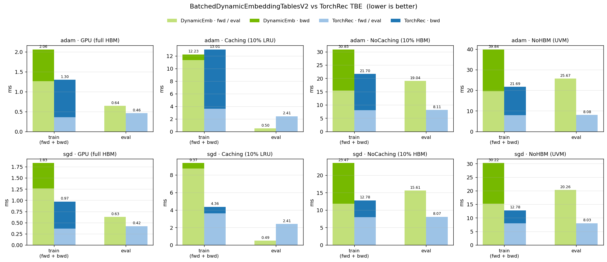
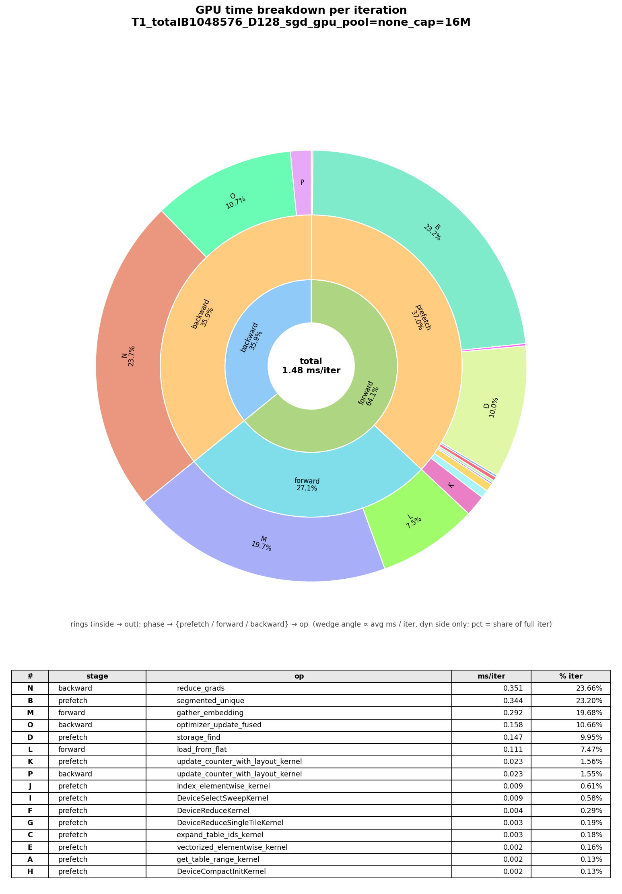
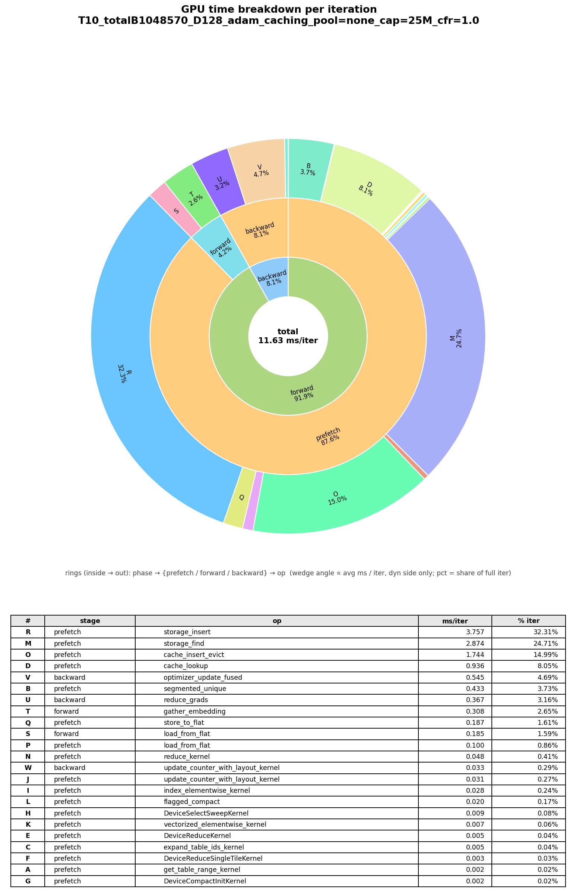

# Dynamic Embedding Benchmark

## Overview

This folder contains benchmarks about dynamicemb.

## 1.Benchmark EmbeddingCollection

In this benchmark, we provide a simple performance test for dynamic embedding using 8 GPUs. The test utilizes the embedding table from DLRM and performs embedding table fusion to create a large embedding table, followed by lookups for 26 features.

### How to run

```bash
bash ./benchmark/benchmark_embedding_collection.sh <use_index_dedup> <use_dynamic_embedding> <batch_size>
```

#### Parameters

- `<use_index_dedup>`: A boolean flag to enable or disable index deduplication before data distribution.
  - **True**: Enables index deduplication, reducing communication overhead.
  - **False**: Disables index deduplication.
  - **Default**: True.

- `<use_dynamic_embedding>`: A boolean flag to enable or disable the use of dynamic embedding tables.
  - **True**: Enables dynamic embedding tables.
  - **False**: Uses static embedding tables from TorchREC.
  - **Default**: True.

- `<batch_size>`: The global batch size for processing during the benchmark.
  - **Default**: 65536.

### Test Results

In this benchmark, we primarily focus on the performance of embedding collection and deduplication. The tests were conducted on a single node with 8 H100 GPUs connected via NVSwitch. Below are the performance results:

| Configuration               | TorchREC Raw Table (ms) | Dynamic Embedding Table (ms) |
|-----------------------------|-------------------------|-------------------------------|
| Open Dedup, Batch Size 65536 | 14.88                   | 21.56                         |
| Close Dedup, Batch Size 65536 | 23.99                   | 28.47                         |

These results indicate the time taken to perform the embedding collection and deduplication operations under the specified configuration.

During the embedding lookup process, dynamic embedding incurs some performance overhead compared to TorchREC's raw table. However, these overheads diminish when considered within the context of the entire end-to-end model.

## 2.Benchmark BatchedDynamicEmbeddingTables

This benchmark measures forward / backward / evaluation overhead of
`BatchedDynamicEmbeddingTablesV2` against the TorchRec/FBGEMM
`SplitTableBatchedEmbeddingBagsCodegen` baseline on a single GPU.

It is structured as a pytest suite (`benchmark_batched_dynamicemb_tables.py`)
wrapped by a thin shell launcher (`benchmark_batched_dynamicemb_tables.sh`).
All extra flags after the shell script are forwarded to pytest, so you can
use pytest's `-k`, `-x`, `--co`, etc. to select / inspect tests.

### Test suites

Four suites parametrize over `(batch_size, num_tables, optimizer, pooling_mode)`
plus `cache_footprint_ratio` for `TestCaching`.  Defaults: `num_tables=10`
with per-table cap = `_GPU_TOTAL_CAP // nt` (`TestGpu`) or
`_CACHE_TOTAL_CAP // nt` (everything else), so total HBM stays fixed
as `nt` changes.

| Suite           | gpu_ratio | caching | Notes                              |
| --------------- | --------- | ------- | ---------------------------------- |
| `TestGpu`       | 1.0       | False   | Full table in HBM                  |
| `TestCaching`   | 0.1       | True    | 10% HBM as LRU cache               |
| `TestNoCaching` | 0.1       | False   | 10% HBM in HybridStorage           |
| `TestNoHbm`     | 0.0       | False   | Pure UVM                           |

Default per-config knobs: `num_iterations=100`, `embedding_dim=128`,
`feature_distribution="pow-law"` with `alpha=1.05`, `emb_precision=fp32`,
Adam (or SGD) with `learning_rate=0.1`, `eps=1e-8`.

### Run everything

```bash
bash ./benchmark/benchmark_batched_dynamicemb_tables.sh
```

Output goes to stdout and a per-config JSON entry is appended to
`benchmark_results.json` (override via `BENCHMARK_RESULTS_FILE=...`).

### Run a subset

The shell script forwards `"$@"` to pytest, so any pytest selector works:

```bash
# Only the full-HBM suite
bash ./benchmark/benchmark_batched_dynamicemb_tables.sh -k TestGpu

# Only Adam configs (any suite)
bash ./benchmark/benchmark_batched_dynamicemb_tables.sh -k adam

# Combine
bash ./benchmark/benchmark_batched_dynamicemb_tables.sh -k "TestCaching and adam"

# List configs without running anything
bash ./benchmark/benchmark_batched_dynamicemb_tables.sh --co
```

Config labels look like
`T10_totalB1048570_D128_adam_caching_pool=none_cap=25M_cfr=1.0`
(`T<num_tables>_totalB<total_batch>_..._cap=<per-table>M`; uniform
per-table caps collapse to a single `cap=<N>M` token); you can match
any substring of that with `-k`.

### Correctness mode

Correctness mode compares the per-iter forward output of DynamicEmb
against the TorchRec/FBGEMM TBE baseline.  It:

1. Restricts the sparse-feature sampler to `[0, cap/2)` for each table.
2. Mirrors TorchRec's `[0, cap/2)` weight slice into DynamicEmb so every
   lookup hits a key with identical initial values on both backends.
3. Runs the timing loop (`benchmark_train_eval`) with `check_forward=True`
   so every train / eval iter asserts `torch.allclose` with a
   precision-aware tolerance (`atol=1e-4, rtol=1e-3` for fp32).

Two ways to enable it:

```bash
# CLI override: force-enable on every parametrized config
bash ./benchmark/benchmark_batched_dynamicemb_tables.sh --correctness

# Per-config: set `correctness=True` on the BenchmarkConfig in
# _gpu_configs / _caching_configs / etc.
```

Correctness is automatically disabled (with a `UserWarning`) when any
`--profile` mode is set, because profiling captures workloads rather than
validating them.

### Nsight Systems (nsys) profiling

`--profile nsys` switches the run to a dedicated nsys-friendly path:
`run_reporting_loop` runs as untimed warmup, then `benchmark_with_nsys`
wraps the actual sampled iterations in a `cudaProfilerStart` /
`cudaProfilerStop` window.  The benchmark itself only annotates NVTX
ranges; the actual capture happens externally via `nsys profile`.

`benchmark_with_nsys` emits **one Start/Stop window per config**.  We
always use `--capture-range-end=repeat-shutdown:N` (with `N >=` the
number of configs) so nsys records every window it sees -- with `-k
<label>` that's a single window, without filter it's the full suite.
Setup / reporting-loop warmup / between-config gaps stay out of the
recording in both modes.

**Note on the `:N`.** Older nsys releases (including the one on the
cluster's `distributed-recommender` container) reject bare
`repeat-shutdown` and require an explicit cycle count.  Bare `repeat`
is accepted, but its default behavior is a *sampled* capture -- in
practice it keeps only a few cycles when many fire in sequence, so
some configs silently end up missing from the trace.  Always pass an
explicit `:N` and size it to the number of `cudaProfilerStart` calls
your script will issue (10 for the full benchmark suite; use a larger
N like 20 if unsure).

**Single config** -- pick one config with `-k <label>`:

```bash
nsys profile \
    --output=trace_dyn \
    --force-overwrite=true \
    --sample=none \
    --cpuctxsw=none \
    --trace=cuda,nvtx,osrt,mpi,ucx \
    --cuda-graph-trace=node \
    --cuda-flush-interval=100 \
    --capture-range=cudaProfilerApi \
    --capture-range-end=repeat-shutdown:10 \
    --target-processes=all \
    bash ./benchmark/benchmark_batched_dynamicemb_tables.sh \
        --profile nsys -k "TestGpu and adam"
```

**Multi config** -- whole suite into one trace:

```bash
nsys profile \
    --output=trace_all \
    --force-overwrite=true \
    --sample=none \
    --cpuctxsw=none \
    --trace=cuda,nvtx,osrt,mpi,ucx \
    --cuda-graph-trace=node \
    --cuda-flush-interval=100 \
    --capture-range=cudaProfilerApi \
    --capture-range-end=repeat-shutdown:10 \
    --target-processes=all \
    bash ./benchmark/benchmark_batched_dynamicemb_tables.sh --profile nsys
```

Flag breakdown (shared by both invocations):

| Flag | Meaning |
| --- | --- |
| `--sample=none` | disable periodic CPU stack sampling -- cuts overhead and trace size when only GPU/NVTX is needed |
| `--cpuctxsw=none` | drop OS context-switch records -- noisy on multi-core, rarely needed for kernel-level perf |
| `--trace=cuda,nvtx,osrt,mpi,ucx` | trace CUDA API + GPU work, NVTX markers, OS-runtime syscalls, MPI calls, UCX calls (the latter two are no-ops on single-node single-GPU and can be dropped) |
| `--cuda-graph-trace=node` | expand CUDA Graph launches into per-node events so kernels inside a captured graph stay individually visible |
| `--cuda-flush-interval=100` | flush the CUDA event buffer every 100 ms so long runs don't overflow the ring buffer and drop events |
| `--capture-range=cudaProfilerApi` | start recording only when the process calls `cudaProfilerStart` (skips table/data setup and the reporting-loop warmup) |
| `--capture-range-end=repeat-shutdown:N` | record up to `N` Start/Stop windows into the same trace (skip gaps in between), end the session at process shutdown.  Set `N` ≥ number of `cudaProfilerStart` calls -- e.g. `:10` for the full suite.  Bare `repeat-shutdown` is rejected on older nsys; bare `repeat` is accepted but silently drops cycles when many fire back-to-back |
| `--target-processes=all` | follow children/forks too -- needed because `torchrun` spawns a worker process to host pytest |
| `--force-overwrite=true` | overwrite an existing output file instead of erroring out |
| `--output=<name>` | output file (`.nsys-rep` is the current extension; `.qdrep` from older releases still works) |

NVTX layout inside each window:
```
<cfg.label()>                          # e.g. T10_totalB1048570_D128_adam_gpu_...
└─ nsys_iter_0                         # per-iter
   ├─ dyn → forward / backward
   └─ trc → forward / backward
└─ nsys_iter_1
└─ ...
```

Browse the trace with `nsys-ui` (locally) or summarize on the cluster:

```bash
# pick a kernel-time top-N across all configs
nsys stats --report cuda_gpu_kern_sum trace_all.nsys-rep | head -30

# group kernel time by NVTX range (= cfg.label()) to compare configs
nsys stats --report cuda_gpu_kern_gb_sum trace_all.nsys-rep | head -30
```

#### Per-op breakdown pipeline (`.nsys-rep` → sunburst PNG)

End-to-end pipeline that reduces each config's nsys trace into a CSV of
per-op GPU time and renders it as a sunburst chart.  Tools:
`nsys_breakdown.py` (trace → CSV) and `nsys_sunburst.py` (CSV → PNG).

**Op attribution.**  `batched_dynamicemb_function.py` wraps the
embedding-side hot path in `torch.cuda.nvtx.range("op:<name>")` markers
(13 ops: `cache_lookup`, `storage_find`, `gather_embedding`,
`reduce_grads`, `optimizer_update_fused`, ...).  Each launch falls into
the innermost `op:*` range active on the CPU side at launch time
(CUPTI_ACTIVITY_KIND_RUNTIME — *not* GPU exec time, which would miss
async backward kernels).  Launches with no `op:*` parent above them
are kept individually under their kernel name so they remain visible
in the chart.

**Step 1 — capture one `.nsys-rep` per config.**  The recommended
approach is one `nsys profile` invocation per config (one
`--capture-range-end=stop` window per process).  This sidesteps a
buffer-rotation bug in older nsys releases that silently drops cycles
when many `repeat`/`repeat-shutdown:N` windows fire back-to-back in a
single process.  On the cluster, drive it from a loop like:

```bash
# pseudocode — see run_nsys_loop.sbatch for the working version
for TEST_ID in $(pytest --collect-only -q ...); do
    LABEL=$(echo "$TEST_ID" | sed -E 's/.*\[(.+)\]$/\1/')
    nsys profile \
        --output=nsys_run/trace_${LABEL} \
        --sample=none --cpuctxsw=none \
        --trace=cuda,nvtx,osrt --cuda-graph-trace=node \
        --capture-range=cudaProfilerApi \
        --capture-range-end=stop \
        torchrun --nnodes 1 --nproc_per_node 1 \
            -m pytest -svv --profile nsys "$TEST_ID"
done
```

After the loop you have one `trace_<NN>_<cfg-label>.nsys-rep` per
config.

**Step 2 — `nsys_breakdown.py`: trace → per-config CSV.**  Exports
each `.nsys-rep` to a sqlite via `nsys export`, then joins
`CUPTI_ACTIVITY_KIND_RUNTIME` (CPU launch times) with
`CUPTI_ACTIVITY_KIND_KERNEL` (GPU exec times) and `NVTX_EVENTS` to
attribute every kernel to the innermost `op:*` range live at launch:

```bash
python nsys_breakdown.py nsys_run/*.nsys-rep --out-dir nsys_run/
# -> nsys_run/opcalls__<cfg-label>.csv  (one CSV per .nsys-rep)
```

Each CSV row is one op (or one bare kernel) with columns:
`phase,parent_stages,op,calls_per_iter,avg_ms_per_iter,total_ms,num_iters,kernel_names,fallback_category`.

**Step 3 — `nsys_sunburst.py`: CSV → PNG.**  Renders a 3-ring
sunburst per CSV (phase / stage / op) with a legend table listing
letter codes, op names, and percentage of total iteration time:

```bash
python nsys_sunburst.py nsys_run/opcalls__*.csv
# -> nsys_run/opcalls__<cfg-label>.sunburst.png  (next to each CSV)
```

The PNG drops next to its CSV by default; pass paths individually to
control output location.  Example outputs live under
[`plots/breakdown_sgd_gpu.png`](./plots/breakdown_sgd_gpu.png) and
[`plots/breakdown_adam_caching_cfr1.0.png`](./plots/breakdown_adam_caching_cfr1.0.png).

Working artifacts (`.nsys-rep`, `.sqlite`, intermediate CSV/PNG) are
expected to land under `local/` (gitignored).  Only the curated
figures committed under `plots/` are tracked.

### Nsight Compute (ncu) profiling

`--profile ncu` profiles per-kernel hardware counters (unlike nsys, which is a
timeline).  It is a two-step workflow:

1. **`--profile ncu-gen`** prints the exact `ncu` command for a config (single-
   config and whole-suite variants) and exits without running anything.  This
   is the source of truth for the literal command.  Optionally pass
   `--ncu-kernel-regex` to name the kernel(s) to profile (emitted verbatim as
   `--kernel-name 'regex:<value>'`); omit it to profile **every** kernel within
   the `--nvtx-include` scope (e.g. all kernels of an op range).
2. **`--profile ncu`** is the inner workload the printed command wraps: it warms
   up via the reporting loop, runs every iteration inside a single
   `cudaProfilerStart/Stop` window (outer NVTX range `cfg.label()`, inner range
   `ncu_iter`, per-iter range `iter_{i}`), and **by default only iteration 0 is
   actually captured** -- the printed command's `--nvtx-include` scopes it.  Use
   `--ncu-iterations` to widen.

So you generate the command, then run it:

```bash
# Step 1 — print the command for one TestGpu config.  -k takes any pytest
# expression matched against the test id (class + cfg.label()); the concise
# "TestGpu and adam" uniquely selects the adam config today.  --ncu-kernel-regex
# is optional (omit to profile all kernels in the nvtx scope).  ncu-gen prints a
# command whose inner -k is the exact, lossless label.
bash ./benchmark/benchmark_batched_dynamicemb_tables.sh \
    --profile ncu-gen -k "TestGpu and adam" \
    --ncu-kernel-regex 'segmented_unique|table_insert'

# Step 2 — run the printed command (shape shown here; ncu-gen emits the exact
# -k label and your --ncu-kernel-regex verbatim):
ncu -f --target-processes all \
    --profile-from-start off \
    --nvtx --nvtx-include 'ncu_iter/iter_0/' \
    --kernel-name 'regex:segmented_unique|table_insert' \
    --set full \
    --import-source=yes \
    --csv --page raw \
    -o ncu_T10_totalB1048570_D128_adam_gpu_pool=none_cap=1M \
    bash ./benchmark/benchmark_batched_dynamicemb_tables.sh \
        --profile ncu -k 'T10_totalB1048570_D128_adam_gpu_pool=none_cap=1M'
```

To profile **all** TestGpu configs (currently `adam` + `sgd`) into one report,
drop the exact label and select the class: `-k TestGpu` on both the `ncu-gen`
and the wrapped `--profile ncu` invocation; the outer `cfg.label()` NVTX range
attributes kernels per config.

| ncu flag | why |
| -------- | --- |
| `--target-processes all` | ncu launches `bash`, which `torchrun`-spawns the python worker that runs the CUDA kernels; without this ncu would only watch the kernel-less `bash`. |
| `--profile-from-start off` | gate profiling to the `cudaProfilerStart/Stop` window (skips table build + warmup).  Must stay paired with `cudaProfilerStart` -- dropping the call profiles nothing. |
| `--nvtx --nvtx-include 'ncu_iter/iter_0/'` | belt-and-suspenders NVTX-range gate, and the iteration selector: only kernels under the listed `iter_{i}` ranges are profiled (default `iter_0`; `--ncu-iterations` emits one include per selected iter). |
| `--kernel-name 'regex:...'` | restrict to the kernel(s) named via the optional `--ncu-kernel-regex`; omitted entirely when that flag is not given, so all kernels in the NVTX scope are profiled (e.g. every kernel of an op range like `op:segmented_unique`). |
| `--set full` | full metric set (heaviest; most replay passes). |
| `--import-source=yes` | embed CUDA source so the Source page works offline (relies on `-lineinfo`, which the build now sets). |

`--num-iterations N` overrides `BenchmarkConfig.num_iterations` (default 100) on
every config.  This is the number of sampled batches, so it also bounds the
warmup/reporting loop and how many iterations each profile mode covers.  Lower
it to keep `--profile ncu` tractable (ncu replays every matched kernel launch
with the full metric set), e.g. add `--num-iterations 3` to the wrapped
`--profile ncu` invocation.

`--ncu-iterations` (only with `--profile ncu`) selects *which* iterations ncu
captures, widening the default of iteration 0 only.  It accepts either a comma
list or a Python-style `begin:end:step` slice (end exclusive; parts optional):

```bash
--ncu-iterations 0,3,7      # capture iterations 0, 3, 7
--ncu-iterations ::2        # every other iteration
--ncu-iterations 2:20:3     # 2,5,8,11,... (clamped to num_iterations)
--ncu-iterations 90:        # the last iterations of a 100-iter run
```

The selection is applied in the **ncu command**, not the workload: a single
`cudaProfilerStart/Stop` pair still wraps the whole run (ncu reliably honors
only one window), and `ncu-gen` turns the selection into one
`--nvtx-include 'ncu_iter/iter_{i}/'` per selected iteration (OR-ed together).
Unselected iterations still run (to advance the table / keep the cache warm)
but their kernels are filtered out by NVTX.  This differs from
`--num-iterations`: that shrinks the *total* iteration count (and warmup);
`--ncu-iterations` keeps the full run but only profiles a subset -- the right
tool when you need a warmed, steady-state iteration rather than the first few.
Pass it to `ncu-gen` so the printed command carries the right `--nvtx-include`
filters.

#### Capturing all kernels of an op range

A single dynamicemb op launches several **differently-named** kernels
(`segmented_unique` runs `expand_table_ids`, `segmented_init`,
`segmented_unique_kernel`, two `cub::DeviceScan*`, `compact_keys_and_freq`,
`adjust_output_indices`, plus a couple of torch fill kernels).  A
`--kernel-name` regex can only match one name, so to profile the **whole op**
you scope by its NVTX range instead and drop the kernel-name filter.

The prefetch/forward path wraps each op in an `op:<name>` NVTX range (e.g.
`op:segmented_unique`, `op:cache_lookup`, `op:gather_embedding`,
`op:reduce_grads`, `op:store_to_flat`, ...).  Their nesting inside a profiled
iteration is:

```
ncu_iter / iter_0 / forward / dynamicemb_prefetch / op:segmented_unique / <kernels>
```

To capture every kernel of `op:segmented_unique` in iteration 0, point
`--nvtx-include` at that nested path and omit `--ncu-kernel-regex` (so no
`--kernel-name` filter is emitted):

```bash
ncu -f --target-processes all --profile-from-start off \
    --nvtx --nvtx-include 'ncu_iter/iter_0/forward/dynamicemb_prefetch/op:segmented_unique/' \
    --set full --import-source=yes --csv --page raw \
    -o ncu_sgd_segunique_all \
    bash ./benchmark/benchmark_batched_dynamicemb_tables.sh --profile ncu -k "TestGpu and sgd"
```

The trailing `/` includes the whole subtree, so all kernels launched inside the
range are profiled regardless of name.  (Anchoring on just `op:segmented_unique/`
would match the op in *every* iteration; the `ncu_iter/iter_0/.../` prefix pins
it to iteration 0.  If the intermediate nesting changes, replace the middle
levels with wildcards: `ncu_iter/iter_0/*/*/op:segmented_unique/`.)

Other profile modes:

| `--profile` value | What it does                                                          |
| ----------------- | --------------------------------------------------------------------- |
| (omitted)         | Normal timing path; reports avg fwd/bwd/train/eval (ms) per config.    |
| `torch`           | Runs each backend under `torch.profiler`; exports Chrome trace + bandwidth report. |
| `nsys`            | NVTX-annotated profile path described above.                          |
| `ncu-gen`         | Prints the matching `ncu` command for the config and exits.           |
| `ncu`             | Warms up via the reporting loop, runs all iterations inside one `cudaProfilerStart/Stop` window, and captures iteration 0 by default (widen with `--ncu-iterations`). |

### Cache footprint sizing (TestCaching)

`TestCaching` is parametrized by `cache_footprint_ratio` (currently
`[0.8, 1.0]`).  At runtime the harness:

1. Generates the full sparse-feature stream before any table is built.
2. Counts distinct keys touched per table across all iterations -- the
   workload's true HBM footprint.
3. Resizes the cache so it holds
   `footprint × cache_footprint_ratio` rows per table
   (DynamicEmb `local_hbm_for_values`, FBGEMM `cache_load_factor`).

This means TestCaching emits one config per ratio in the suite, with
labels like `..._caching_..._cfr=0.8` / `..._cfr=1.0`.  The other three
suites (`TestGpu`, `TestNoCaching`, `TestNoHbm`) leave
`cache_footprint_ratio=None` and keep their construction-time
`hbm_for_embeddings` / `gpu_ratio`.

Cache state from the warmup (`run_reporting_loop`) is **kept** for the
subsequent timed `benchmark_train_eval` — only the hit-rate recorder is
disabled.  The timed numbers therefore measure steady-state cache
behavior, not a cold start.

### Plotting results

`benchmark_results.json` produced above is visualized with
`plot_benchmark_results.py`.  The script writes a single figure
(`benchmark_bdet_plot.png`) into the output directory (default
`./plots/`).  The caching column auto-fans-out into one panel per
`cache_footprint_ratio` present in the JSON, so cfr=0.8 and cfr=1.0 sit
side-by-side in the same image (the figure width scales with column
count).

```bash
# Main figure into ./plots/benchmark_bdet_plot.png
python plot_benchmark_results.py

# Different output directory / results file
python plot_benchmark_results.py \
    --results /path/to/results.json \
    --out-dir /tmp/bdet_plots

# Log y-axis (one suite dominates the range)
python plot_benchmark_results.py --log

# Hide bar value labels
python plot_benchmark_results.py --no-values
```

Each figure carries a two-line subtitle auto-derived from the result
dict:

```
NVIDIA H100 80GB HBM3  ·  D=128  ·  batch=1,048,570
pow-law(α=1.05)  ·  hotness=10  ·  pool=none
```

`cache_footprint_ratio` is intentionally not in the subtitle — it shows
up in the per-panel headers on the top secondary x-axis instead
(`Caching cfr=0.8`, `Caching cfr=1.0`).
Fields populated by `run_single_benchmark`: `gpu_name`, `embedding_dim`,
`batch_size`/`num_tables`, `feature_distribution`, `alpha`, `max_hotness`,
`pooling_mode`, `cache_footprint_ratio`.  Any field missing from a legacy
JSON is silently skipped.

Layout: one row per optimizer; within each row, every panel (`GPU`,
one per caching ratio, `NoCaching`, `NoHBM`) is drawn side-by-side on a
**shared y-axis**.  Panel names sit on a secondary axis at the top,
train/eval labels under the bars, dotted separators between panel
regions.  Each panel shows a stacked `train (fwd + bwd)` bar plus a
separate `eval` bar for DynamicEmb vs TorchRec.  Because modes span
~0.5 ms (GPU) to ~40 ms (NoHBM), GPU bars look small under the shared
scale — pass `--log` to expand the low end.

### Test Results

The figures below were collected on **NVIDIA H100 80GB HBM3** (single GPU)
with `pow-law(alpha=1.05)` index distribution.

Run configuration:
- hardware: NVIDIA H100 80GB HBM3 (single GPU)
- embedding_dtype: float32
- embedding_dim: 128
- num_tables: 10 (per-table batch = total / 10 = 104,857; total batch = 1,048,570)
- cache_algorithm: lru
- gpu_ratio: 1.0 (`TestGpu`) / footprint × `cache_footprint_ratio`
  (`TestCaching`) / 0.1 (`TestNoCaching`) / 0.0 (`TestNoHbm`)
- per-table capacity: 1.6M (`TestGpu`, `_GPU_TOTAL_CAP // nt` = 16M / 10, sized so DynamicEmb + TorchRec TBE both fit in 80 GB), 25.6M otherwise (`_CACHE_TOTAL_CAP // nt` = 256M / 10)
- optimizers: adam (`eps=1e-8`) and sgd
- num_iterations: 100

Latency by suite (DynamicEmb vs TorchRec TBE, lower is better):



#### Per-op breakdown (DynamicEmb side)

Two representative configs profiled via `nsys` and reduced with
`nsys_breakdown.py` + `nsys_sunburst.py` (see [nsys profiling](#nsight-systems-nsys-profiling)).
The sunburst rings are: phase (forward / backward) → stage
(prefetch / forward / backward) → op (NVTX `op:*` range, or kernel name
when no wrapper is present).  Percentages are share of the full
iteration time; letter codes index the legend table below each chart.

`sgd + GPU (full HBM)` — 1.59 ms/iter; cost dominated by
`segmented_unique` (~24%), `gather_embedding` (~19%), and
`optimizer_update_fused` (~12%):



`adam + Caching cfr=1.0` — 11.63 ms/iter; cache traffic dominates:
`storage_insert` (~32%), `storage_find` (~25%), `cache_insert_evict`
(~15%), `cache_lookup` (~8%), with the Adam update (`optimizer_update_fused`)
only ~5%:



## 3.Benchmark distributed EmbeddingCollection (multi-GPU, multi-node)

`benchmark_distributed_embedding_collection.py` times a row-wise sharded
`EmbeddingCollection` of DynamicEmb tables (all in HBM: no caching, no host
memory) across GPUs and nodes, one process per GPU. It times the embedding
alone. Before the run, each GPU draws two batches with random sequence
lengths and keys, and the iterations take them in turn. So the amount each
GPU sends and receives changes from one iteration to the next, and no
iteration repeats the one before it, whose keys and rows the GPU's caches
may still hold. From the third call on (every timed one, with `--warmup` 2
or more), the keys a lookup asks for are already in its table, where the
first two calls put them: the timed lookups find their keys instead of
inserting them, in tables that hold only the two batches' keys (about 24%
of the key range on one node at the configuration below, 66% on four). This
is the same for every dist. No loss is computed. The forward returns a zero
in its place, and the backward gives each looked-up row a gradient drawn
once before the run: +1 or -1 per element, from `--seed` and the rank, so
every dist gets the same. At many features the step still holds the host's
work of handing each feature's rows their gradient (a loop over the
features and an autograd edge per feature, about 1 µs per feature), as any
consumer of the EC's per-feature output would. It runs a plain training
loop (the forward, then `backward()` on that zero, each timed on its own) or
one of TorchRec's train pipelines, with one of these ways to move keys and
rows between GPUs (`--output_dist`):

* `torchrec`: TorchRec's input and output dists (bucketize and NCCL
  all-to-alls; reorder, all-to-all, `index_select`).
* `hierarchical`: DynamicEmb's hierarchical dist
  ([docs/hier_output_dist.md](../docs/hier_output_dist.md)). Its own input
  dist does all the planning, with one host sync per call. Its output dist
  only moves rows: one kernel per direction, and before the backward's, when
  a call has heavy rows, two short kernels that add up their gradients. Its
  capacities come from the benchmark's own batches (`--capacity`). It takes
  index-deduplicated keys: its calls deduplicate them, with or without
  `--use_index_dedup`.
* `auto`: `hierarchical` where the build has it, else `torchrec`.

### How to run

`hierarchical` needs DynamicEmb built against NCCL 2.30.7 or newer
([docs/hier_output_dist.md](../docs/hier_output_dist.md), section 4.2);
`auto` takes TorchRec's dists on a build without it, and `torchrec` runs on
any build. Run from `corelib/dynamicemb`, with DynamicEmb installed, one
process per GPU, and ranks numbered node by node (torchrun and Slurm's
default task layout do this). The words used here (GIN, rail, proxy,
`lookup_rows`, `proxy_rows` and the like) are explained in
[docs/hier_output_dist.md](../docs/hier_output_dist.md), sections 2 and
7.5.

```bash
BENCH=benchmark/benchmark_distributed_embedding_collection.py
ARGS="--num_tables 8 --num_embeddings 4000000 --local_batch_size 4096 \
      --max_seq_len 32 --num_iterations 20 --warmup 5 --use_index_dedup"
export NCCL_CROSS_NIC=0                            # GIN on the rails only (recommended)
export NCCL_NET_PLUGIN=none NCCL_GIN_PLUGIN=none   # only where NCCL's plugin cannot run GIN (Eos)

# 1 node, 8 GPUs
torchrun --nproc_per_node 8 $BENCH $ARGS --output_dist hierarchical

# 2 or 4 nodes under Slurm, one task per GPU
srun -N 2 --ntasks-per-node 8 python $BENCH $ARGS --output_dist hierarchical
srun -N 4 --ntasks-per-node 8 python $BENCH $ARGS --output_dist hierarchical
```

* The script reads torchrun's variables, or makes them from Slurm's: `RANK`,
  `WORLD_SIZE` and `LOCAL_RANK` from `SLURM_PROCID`, `SLURM_NTASKS` and
  `SLURM_LOCALID`, and `LOCAL_WORLD_SIZE` from the tasks per node. Under a
  bare `srun`, `MASTER_ADDR` defaults to the step's first node and
  `MASTER_PORT` to 29500.
* Export NCCL variables before `srun`: `--export=ALL,VAR=x` does not override
  a variable that is already exported. Give every side of a comparison the
  same NCCL settings.
* Run one multi-node job step at a time, and compare setups on the same
  nodes, in turn (the network is shared and nodes differ).

Before it builds the model, `hierarchical` counts what the benchmark's own
batches need of each capacity (`--capacity measure`, the default), and takes
`--capacity_factor` (1.25) times that. So every call fits: a call that
does not raises at its second wait, naming the capacity to raise.

The configuration above has 8 tables of 4,000,000 rows, dim 128, fp32, SGD,
4096 samples per GPU, sequence lengths from 1 to 32 (about 540,000 keys per
GPU and iteration) and index dedup. Two workloads, each with both dists:

```bash
for DIST in torchrec hierarchical; do
  EXTRA="--nic_counters"; [ $DIST = hierarchical ] && EXTRA="$EXTRA --kernel_times"
  $LAUNCH $BENCH $ARGS --output_dist $DIST $EXTRA                     # uniform keys
  $LAUNCH $BENCH $ARGS --output_dist $DIST $EXTRA --key_dist pow-law  # power-law keys
done      # $LAUNCH: the torchrun or srun prefix above
```

Both dists also run without `--use_index_dedup`. TorchRec's dists then send
every key, and the hierarchical dist's calls deduplicate their keys
themselves.

More runs on the same configuration:

* `--check`: first compare the hierarchical dist with TorchRec's (section
  *Options*); the exit status is 1 if they differ, or if any call ran on
  TorchRec's dists.
* `--pipeline sparse_dist` or `--pipeline prefetch`: TorchRec's
  `TrainPipelineSparseDist` or `PrefetchTrainPipelineSparseDist`.
* `--trace --trace_out run.npz` (`hierarchical`, on a build with
  `DYNAMICEMB_HIER_TRACE=1`): the output dist's kernel timelines, IB and
  NVLink use and their overlap. A traced build is slower, so take times from
  a build without the trace.
* `--host_stages` (plain loop): where the CPU waits for the GPU.
* `--capacity <entries>`: the capacities by hand, for example to see calls
  that do not fit.

A large-batch workload: one table of 268 million rows, bf16, and 16,384
samples per GPU, each with 1 to 1,536 keys drawn uniformly (jagged
lengths: about 12.6 million keys per GPU and iteration):

```bash
LARGE="--num_tables 1 --num_embeddings 268435456 --local_batch_size 16384 \
       --max_seq_len 1536 --seq_len_dist uniform --emb_dtype bf16 --output_dtype bf16 \
       --num_iterations 10 --warmup 3 --use_index_dedup"
$LAUNCH $BENCH $LARGE --output_dist hierarchical --kernel_times   # on 1, 2 and 4 nodes
```

The runs below use the defaults: a payload of 512 KiB per chunk
(`DYNAMICEMB_HIER_PAYLOAD_KB`) and a ring of 512 MiB at most
(`DYNAMICEMB_HIER_PROXY_MB`;
[docs/hier_output_dist.md](../docs/hier_output_dist.md), sections 4.4, 12.1
and 15.3). Across nodes, a proxy's stream for one call (1.57 GB on 2 nodes,
2.36 GB on 4) is more than its ring holds, so it passes through the ring in
laps: 3 on 2 nodes, 5 on 4.

On Eos (H100 nodes of 8 GPUs, with a 400 Gb/s NIC per GPU), the output
dist's kernels take these times (the median of 3 runs). A kernel's bandwidth
is the busiest GPU's bytes per call on the link that bounds it, over the
kernel's time (`output_dist_kernel_ms_median`). The bytes are those of
`traffic_max` (*Metrics*; one call per iteration here), in rows of 256
bytes: across nodes `rows_ib`, what its NIC moves in the busier direction;
on one node the larger of `rows_nvlink` and `rows_served`, what it pulls
from its node peers and what they pull from it. The ceiling of IB is
50 GB/s per NIC and direction. That of NVLink is the best all-to-all rate
per GPU that `nvlink_ceiling.cu` measured on the same node
(*NVLink ceiling*): 330 GB/s with SM loads, as the forward pulls, and
352 GB/s with SM stores, as the backward pushes.

| nodes (GPUs) | link | GB per GPU and call | forward ms | forward GB/s (% of ceiling) | backward ms | backward GB/s (% of ceiling) |
|---|---|---|---|---|---|---|
| 1 (8) | NVLink | 2.76 | 8.33 | 331.6 (100%) | 7.94 | 348.1 (99%) |
| 2 (16) | IB | 1.34 | 28.29 | 47.5 (95%) | 32.20 | 41.8 (84%) |
| 4 (32) | IB | 2.02 | 41.93 | 48.1 (96%) | 41.82 | 48.2 (96%) |

On 2 nodes the backward reaches 84% because of the ring's laps: a ring that
holds the stream in one lap (`DYNAMICEMB_HIER_PROXY_MB=12288`) gives
28.55 ms there (47.1 GB/s, 94%, in 2 runs); on 4 nodes the laps cost little.

Many features. These runs keep the keys per GPU about the same while the
features grow: 8 tables of 4,000,000 rows (dim 128, fp32, SGD), each with
`--features_per_table` P features (F = 8P in all), index dedup, plain loop,
about 540,000 keys per GPU and iteration (4.2 million in the two runs
marked `b`: 1,024 × 4,096 and 4,096 × 1,024):

```bash
MANY="--num_tables 8 --num_embeddings 4000000 --use_index_dedup --num_iterations 20 --warmup 5"
$LAUNCH $BENCH $MANY --features_per_table 1   --local_batch_size 4096 --max_seq_len 32       --output_dist hierarchical
$LAUNCH $BENCH $MANY --features_per_table 8   --local_batch_size 4096 --max_seq_len 3        --output_dist hierarchical
$LAUNCH $BENCH $MANY --features_per_table 32  --local_batch_size 2048 --max_seq_len 1 --seq_len_dist fixed --output_dist hierarchical
$LAUNCH $BENCH $MANY --features_per_table 128 --local_batch_size 512  --max_seq_len 1 --seq_len_dist fixed --output_dist hierarchical
$LAUNCH $BENCH $MANY --features_per_table 512 --local_batch_size 128  --max_seq_len 1 --seq_len_dist fixed --output_dist hierarchical
$LAUNCH $BENCH $MANY --features_per_table 128 --local_batch_size 4096 --max_seq_len 1 --seq_len_dist fixed --output_dist hierarchical  # b
$LAUNCH $BENCH $MANY --features_per_table 512 --local_batch_size 1024 --max_seq_len 1 --seq_len_dist fixed --output_dist hierarchical  # b
```

Multi-hot at many features: the same, with several keys per sample, 1 to 4
(uniform) at four of the large points and 1 to 32 at two, so that a GPU has
1.3 to 10.5 million keys per iteration:

```bash
$LAUNCH $BENCH $MANY --features_per_table 128 --local_batch_size 512  --max_seq_len 4  --output_dist hierarchical
$LAUNCH $BENCH $MANY --features_per_table 512 --local_batch_size 128  --max_seq_len 4  --output_dist hierarchical
$LAUNCH $BENCH $MANY --features_per_table 128 --local_batch_size 4096 --max_seq_len 4  --output_dist hierarchical
$LAUNCH $BENCH $MANY --features_per_table 512 --local_batch_size 1024 --max_seq_len 4  --output_dist hierarchical
$LAUNCH $BENCH $MANY --features_per_table 128 --local_batch_size 512  --max_seq_len 32 --output_dist hierarchical
$LAUNCH $BENCH $MANY --features_per_table 512 --local_batch_size 128  --max_seq_len 32 --output_dist hierarchical
```

On Eos, with the loop above (two alternating batches and pre-drawn output
gradients, no loss), TorchRec's dists (`--output_dist torchrec`) against the
hierarchical dist: medians of 2 rounds of alternating order on the same 4
nodes, on 1 / 2 / 4 nodes, in ms: the step (`iter_ms_host`) and the input
dist (`in_seg_ms_mean`).

| features × batch (keys per sample) | keys per GPU | TorchRec step | hier step | hier vs TorchRec | TorchRec input dist | hier input dist |
|---|---|---|---|---|---|---|
| 8 × 4096 (1-32) | 0.5M | 6.8 / 11.3 / 14.9 | 3.3 / 8.5 / 10.7 | -52% / -25% / -29% | 1.38 / 1.66 / 2.16 | 0.30 / 0.70 / 0.71 |
| 64 × 4096 (1-3) | 0.5M | 7.4 / 13.5 / 19.8 | 3.2 / 8.4 / 10.4 | -56% / -38% / -47% | 1.63 / 2.92 / 4.73 | 0.31 / 0.69 / 0.73 |
| 256 × 2048 (1) | 0.5M | 8.8 / 16.6 / 25.8 | 3.7 / 8.7 / 10.4 | -58% / -48% / -60% | 2.30 / 4.39 / 7.90 | 0.36 / 0.75 / 0.75 |
| 1024 × 512 (1) | 0.5M | 13.7 / 18.8 / 29.0 | 6.5 / 9.9 / 10.9 | -53% / -48% / -62% | 3.51 / 5.81 / 10.82 | 0.39 / 0.87 / 0.84 |
| 4096 × 128 (1) | 0.5M | 54.8 / 73.7 / 76.3 | 38.9 / 41.1 / 45.4 | -29% / -44% / -41% | 6.42 / 11.61 / 23.44 | 0.56 / 1.09 / 1.11 |
| 1024 × 4096 (1) | 4.2M | 55.1 / 110.1 / 177.3 | 19.1 / 42.3 / 50.1 | -65% / -62% / -72% | 10.34 / 22.93 / 47.19 | 1.20 / 2.56 / 3.01 |
| 4096 × 1024 (1) | 4.2M | 83.3 / 148.7 / 208.6 | 47.5 / 61.2 / 69.1 | -43% / -59% / -67% | 13.34 / 28.56 / 59.59 | 1.43 / 2.88 / 3.32 |
| 1024 × 512 (1-4) | 1.3M | 16.2 / 30.8 / 45.9 | 9.5 / 17.6 / 22.2 | -41% / -43% / -52% | 3.27 / 6.10 / 11.12 | 0.56 / 1.25 / 1.16 |
| 4096 × 128 (1-4) | 1.3M | 56.5 / 81.1 / 86.2 | 39.3 / 48.0 / 50.4 | -30% / -41% / -41% | 6.39 / 11.84 / 24.56 | 0.81 / 1.54 / 1.56 |
| 1024 × 4096 (1-4) | 10.5M | 96.7 / 190.6 / 287.5 | 40.8 / 65.1 / 75.7 | -58% / -66% / -74% | 11.46 / 24.53 / 51.01 | 2.61 / 5.63 / 6.48 |
| 4096 × 1024 (1-4) | 10.5M | 124.8 / 219.5 / 308.8 | 61.2 / 84.3 / 94.1 | -51% / -62% / -70% | 15.65 / 30.48 / 62.83 | 2.85 / 6.11 / 6.92 |
| 1024 × 512 (1-32) | 8.7M | 68.9 / 131.5 / 179.8 | 35.0 / 61.8 / 70.1 | -49% / -53% / -61% | 4.98 / 8.56 / 14.20 | 2.16 / 4.66 / 5.37 |
| 4096 × 128 (1-32) | 8.7M | 95.8 / 165.7 / 205.3 | 55.8 / 79.3 / 88.9 | -42% / -52% / -57% | 7.89 / 14.02 / 26.52 | 2.39 / 5.13 / 5.78 |

The hierarchical dist's step part by part, on 1 / 2 / 4 nodes, in ms: the
input dist; the lookup's forward and backward kernels and the other kernels
(`fwd/other` and `bwd/other`: the backward of the EC's per-feature split, a
cat of the output gradients, and two small fills), from its first round's
profiled iterations (GPU time per iteration, mean over the ranks); the
output dist's kernels as the rank that arrives last runs them (per call the
least time over the ranks, then the median over the calls: what the dist
takes, without the wait for a slower rank); and the rest of the step, host
time that no kernel above covers.

| features × batch (keys per sample) | step | input dist | lookup fwd + bwd | output dist fwd | output dist bwd | other kernels | rest |
|---|---|---|---|---|---|---|---|
| 8 × 4096 (1-32) | 3.3 / 8.5 / 10.7 | 0.30 / 0.70 / 0.71 | 0.93 / 0.90 / 0.84 | 0.74 / 2.89 / 4.07 | 0.72 / 2.85 / 4.14 | 0.19 / 0.19 / 0.19 | 0.4 / 1.0 / 0.7 |
| 64 × 4096 (1-3) | 3.2 / 8.4 / 10.4 | 0.31 / 0.69 / 0.73 | 0.91 / 0.88 / 0.82 | 0.72 / 2.78 / 3.96 | 0.70 / 2.87 / 4.03 | 0.18 / 0.18 / 0.18 | 0.4 / 1.0 / 0.7 |
| 256 × 2048 (1) | 3.7 / 8.7 / 10.4 | 0.36 / 0.75 / 0.75 | 0.80 / 0.88 / 0.82 | 0.72 / 3.05 / 3.96 | 0.70 / 2.81 / 4.03 | 0.29 / 0.18 / 0.18 | 0.8 / 1.0 / 0.7 |
| 1024 × 512 (1) | 6.5 / 9.9 / 10.9 | 0.39 / 0.87 / 0.84 | 0.80 / 0.88 / 0.82 | 0.72 / 2.73 / 3.95 | 0.70 / 2.82 / 4.05 | 0.30 / 0.19 / 0.19 | 3.6 / 2.4 / 1.0 |
| 4096 × 128 (1) | 38.9 / 41.1 / 45.4 | 0.56 / 1.09 / 1.11 | 0.91 / 0.88 / 0.82 | 0.72 / 2.96 / 3.96 | 0.72 / 2.97 / 4.01 | 0.24 / 0.24 / 0.24 | 35.7 / 32.9 / 35.2 |
| 1024 × 4096 (1) | 19.1 / 42.3 / 50.1 | 1.20 / 2.56 / 3.01 | 5.77 / 4.79 / 3.55 | 5.24 / 14.70 / 20.69 | 5.03 / 16.83 / 20.79 | 1.42 / 1.42 / 1.43 | 0.4 / 2.0 / 0.6 |
| 4096 × 1024 (1) | 47.5 / 61.2 / 69.1 | 1.43 / 2.88 / 3.32 | 5.77 / 4.78 / 3.55 | 5.25 / 14.78 / 20.68 | 5.04 / 16.66 / 20.80 | 1.47 / 1.48 / 1.48 | 28.6 / 20.7 / 19.2 |
| 1024 × 512 (1-4) | 9.5 / 17.6 / 22.2 | 0.56 / 1.25 / 1.16 | 1.79 / 1.95 / 2.00 | 1.74 / 6.52 / 8.93 | 1.67 / 6.19 / 9.01 | 0.70 / 0.46 / 0.46 | 3.1 / 1.2 / 0.6 |
| 4096 × 128 (1-4) | 39.3 / 48.0 / 50.4 | 0.81 / 1.54 / 1.56 | 2.03 / 1.94 / 2.00 | 1.74 / 6.74 / 8.93 | 1.70 / 6.48 / 8.98 | 0.51 / 0.51 / 0.51 | 32.5 / 30.7 / 28.4 |
| 1024 × 4096 (1-4) | 40.8 / 65.1 / 75.7 | 2.61 / 5.63 / 6.48 | 10.89 / 7.08 / 5.00 | 11.92 / 21.96 / 29.48 | 11.41 / 25.05 / 30.51 | 3.53 / 3.53 / 3.54 | 0.4 / 1.9 / 0.7 |
| 4096 × 1024 (1-4) | 61.2 / 84.3 / 94.1 | 2.85 / 6.11 / 6.92 | 10.88 / 7.08 / 5.00 | 11.92 / 21.56 / 29.48 | 11.41 / 26.43 / 30.60 | 3.57 / 3.58 / 3.58 | 20.6 / 19.5 / 18.5 |
| 1024 × 512 (1-32) | 35.0 / 61.8 / 70.1 | 2.16 / 4.66 / 5.37 | 9.74 / 6.51 / 4.69 | 10.10 / 21.32 / 28.13 | 9.68 / 24.42 / 28.35 | 2.91 / 2.92 / 2.92 | 0.4 / 1.9 / 0.6 |
| 4096 × 128 (1-32) | 55.8 / 79.3 / 88.9 | 2.39 / 5.13 / 5.78 | 9.75 / 6.51 / 4.69 | 10.12 / 20.43 / 28.14 | 9.69 / 24.54 / 28.35 | 2.96 / 2.97 / 2.97 | 20.9 / 19.7 / 19.0 |

* The hierarchical dist's step is 25% to 74% shorter than TorchRec's, more
  so with more nodes and more keys per GPU: at 10.5 million keys on 4
  nodes, 75.7 against 287.5 ms at 1,024 features and 94.1 against 308.8 ms
  at 4,096. Its input dist is 2.3 to 21 times shorter.
* The output dist's kernels take the same time at the same keys per GPU
  whatever the features: at 4.2 million keys the forward takes 5.2, 14.7 to
  14.8 and 20.7 ms on 1, 2 and 4 nodes at both 1,024 × 4,096 and 4,096 ×
  1,024.
* The rest is host time that grows with the features: TorchRec's
  EmbeddingCollection gives a JaggedTensor per feature, and autograd has an
  edge per feature. It is 18 to 36 ms of the step at 4,096 features and at
  most 3.6 ms at 1,024; TorchRec's dists pay it too.

Before these runs, the benchmark drew a new batch every iteration and summed
each feature's rows into a loss (two or three kernels per feature), so its
steps at many features were mostly that loss's host work. With that loop,
the changes for many features (one put per chunk and lookup group; count
messages, node rows and planner tables that grow with the features once, not
with the features times the nodes; [docs/hier_output_dist.md](../docs/hier_output_dist.md),
sections 10 and 11) took the output dist's kernels at 4,096 × 128 on 2 and 4
nodes from 13 to 17 ms to 2.7 to 4.2 ms, and its input dist from 2.6 to 3.6
ms to 1.3 to 1.5 ms. The input dist's fusions (section 10) then shortened
the input dist by 5% to 23% at every point, and left the output dist's
kernels within about 1%.

#### Options

| option | default | meaning |
|---|---|---|
| `--output_dist` | `torchrec` | `torchrec`, `hierarchical` or `auto` (see above) |
| `--capacity` | `measure` | The hierarchical dist's `output_dist_capacity`. An int sets `lookup_keys` and `remote_keys` to that many keys. `measure` counts what the benchmark's own batches need of each, as the dist counts it, before the model is built (`hier_needs` in `benchmark_utils.py`, on a process group made for it and destroyed after). It takes `--capacity_factor` times that, and at least 4096 entries more (`hier_capacities`). A call that does not fit raises at its second wait. |
| `--capacity_factor` | 1.25 | with `--capacity measure`: the capacities over the measured needs |
| `--pipeline` | `none` | `none`: plain loop (forward, then backward, one batch at a time); `sparse_dist`: `TrainPipelineSparseDist`; `prefetch`: `PrefetchTrainPipelineSparseDist`. Under a pipeline the report gives whole iterations, and `--check` runs the checked model under it |
| `--num_tables` | 8 | tables |
| `--features_per_table` | 1 | features sharing each table (keys drawn alike for each) |
| `--num_embeddings` | 4194304 | rows per table (all ranks together, all in HBM) |
| `--embedding_dim` | 128 | |
| `--local_batch_size` | 1024 | samples per GPU |
| `--max_seq_len`, `--seq_len_dist` | 32, `uniform` | keys per sample: `uniform` in [1, max] or `fixed` at max |
| `--key_dist`, `--alpha` | `uniform`, 1.05 | `uniform` or `pow-law` (a power law: a few keys are very common; `--alpha` is its exponent) |
| `--key_range` | `--num_embeddings` | uniform keys are drawn from [0, key_range), pow-law ones from [1, key_range) |
| `--dist_type` | `roundrobin` | which rank owns a key: `roundrobin` (key mod ranks) or `hash_roundrobin` (hashed key mod ranks) |
| `--emb_dtype`, `--output_dtype` | `fp32` | `fp32`, `bf16` or `fp16` |
| `--use_index_dedup` | off | TorchRec's index dedup: each rank removes its own repeated keys before the input dist. A call on the hierarchical dist (`hierarchical`, `auto`, `--check`) does so without it too |
| `--optimizer`, `--learning_rate` | `sgd`, 0.01 | `sgd`, `adam`, `exact_adagrad` or `rowwise_adagrad` |
| `--num_iterations`, `--warmup` | 30, 10 | timed and untimed iterations, at least 1 each |
| `--seed` | 1234 | seed of the batches and of the output gradients (different for each rank) |
| `--profile_iterations` | 5 | that many more iterations under `torch.profiler`, for the per-stage kernel times and counts; 0 skips them |
| `--check` | off | Before timing, train 4 steps of two models side by side: one on TorchRec's dists, and one on the hierarchical dist (`--output_dist`'s, or `hierarchical` when that is `torchrec`), both with `--use_index_dedup` or both without it. Both start from the DEBUG initializer, where a key's row is a function of the key. They use SGD at learning rate 1, the same output gradients (+1 or -1 per element, as in the timed run), and keys from an eighth of the table, so nothing is evicted. The capacities are `--capacity`, or measured on the check's own batches. Then print PASSED or FAILED. Outputs must match bit for bit when `--emb_dtype` and `--output_dtype` are both `fp32` and the world size is a power of two. Otherwise they must match bit for bit at the first step, and within 1e-2 after it. The checked model must also have launched its own output dist's kernels at every step, both ways. A sharding that took TorchRec's dists (one rank, for example) prints `FAILED (the <dist> model fell back to TorchRec's dists)`, where `<dist>` is `hierarchical` or `auto`. A failure exits with status 1. |
| `--trace` | off | The hierarchical dist's kernel timelines. It needs DynamicEmb built with `DYNAMICEMB_HIER_TRACE=1` (`docs/hier_output_dist.md`, section 4.4), and else stops with `--trace: rebuild with DYNAMICEMB_HIER_TRACE=1`. It keeps the timelines of the last 64 calls of each direction (every timed call at 64 iterations or fewer), and puts every rank's time stamps on rank 0's clock. It reports the traced metrics below (IB, NVLink and their overlap). A traced build traces every output-dist kernel: two memsets per kernel and counters in shared memory; `--trace` adds two clock stamps per input dist. So its times and kernel counts do not compare with an untraced build's. |
| `--trace_out` | none | with `--trace`: save every rank's traced kernels of the timed iterations to this `.npz` file, for offline analysis |
| `--kernel_times` | off | After the timed iterations, as many again under a CUDA-only profiler. It reports every call's output-dist kernel times, with their wait at the start for the other ranks (the hierarchical dist only). |
| `--host_stages` | off | Plain loop, to find problems. Per call: the CPU time spent waiting for the GPU, by place in the code. |
| `--nic_counters` | off | read every InfiniBand port's counters on each node before and after the timed iterations, and report what each sent and received |
| `--json_out` | none | append the results as one JSON line to this file |

#### Metrics

Times are in ms. A utilization is a % of the link's rate in one direction.
For InfiniBand (IB) that rate is 50 GB/s per NIC (400 Gb/s). For NVLink it is
the ceilings measured with `nvlink_ceiling.cu` (*NVLink ceiling*). JSON field
names are in backticks. The JSON line holds more than these measures.

| metric | JSON field | definition |
|---|---|---|
| step | `iter_ms_host` | Wall time of the timed iterations divided by their number, on rank 0 (`time.perf_counter` around the loop, which ends with a device sync), for the plain loop or a pipeline. |
| input-dist segment | `in_seg_ms_mean`, `in_seg_ms_per_call`, `in_seg_steps_ms` | Plain loop. Four CUDA events on the caller's stream: before `input_dist()`, after it, after the first wait, and after the second wait, when the lookup may start. The segment runs from the first event to the last, idle time from host syncs included. `in_seg_ms_mean` is its mean over calls and ranks, `in_seg_ms_per_call` holds every call, and `in_seg_steps_ms` the three steps. TorchRec's input dist is measured the same way. The first timed call is slow on every dist, because the GPU waits for the CPU when the loop starts. |
| stages | `stages` | Profiled iterations: per stage of the forward or the backward (`fwd/input_dist`, `fwd/lookup`, `bwd/output_dist`, ...), the GPU ms per iteration of its kernels (`ms`) and their count (`kernels`), the mean over ranks. `fwd/other` holds the kernels outside every stage and every autograd node: the zero the model returns for a loss, and the scalar gradient `backward()` starts from (under a pipeline, also its sum of the losses). `bwd/other` holds those of the backward's other nodes: the backward of the EC's per-feature split (a cat of the gradients). `net_ms` is the time of the output dist's kernels that move rows between GPUs: NCCL's, or `fwd_kernel` and `bwd_kernel`. |
| output dist, events | `output_dist_event_ms_median` | Plain loop, `hierarchical`: CUDA events right before and after the output dist's forward and backward launches, in the timed iterations, with no profiler running; the median over calls of the mean over ranks. They hold the kernel's wait at its start for the other ranks and, when the GPU is idle at the launch, the launch's own CPU time. |
| output-dist kernels | `output_dist_kernel_ms_median` | `--kernel_times`: the GPU ms of every call's forward kernel and backward kernels (the heavy rows' two included) under a CUDA-only profiler, the median over calls. |
| rows per iteration | `traffic_mean`, `traffic_max` | The output dist's rows of the timed iterations, per rank and iteration: the mean or the most over the ranks (`traffic_per_rank` holds each rank's). `hierarchical`: `rows_self`, the rows it asks of itself as owner; `rows_nvlink`, the rows it pulls from its node peers; `rows_served`, the rows other GPUs ask of it as owner; across nodes `rows_ib_out` and `rows_ib_in`, the rows its NIC puts and receives in the forward (the backward moves them the other way), `rows_ib`, the larger of the two, `rows_remote`, the rows of its proxy's stream, and `chunks`, that stream's chunks per call. `torchrec`: the forward's rows to itself, to its node peers and to other nodes (`rows_self`, `rows_nvlink`, `rows_ib`), and from other nodes (`rows_ib_in`). |

**InfiniBand.** A NIC's bytes in a direction are the more of what it sends
and what it receives (rows × row bytes, from the dist's plan).

| metric | JSON field | definition |
|---|---|---|
| IB event basis | `ib_event_basis_calls` | Plain loop, `hierarchical`: each NIC's bytes over its GPU's output-dist time from the events above; the median over calls of the mean over NICs (`mean`), and of the busiest NIC's bytes over the slowest GPU's time (`bottleneck`). |
| IB in-kernel | `trace[dir]["ib_inkern"]` | `--trace`: the bytes over the kernel's time once every rank has started, `end_us − skew_all`: its time to its exit, less its wait for the latest rank to start. |
| IB windows | `trace[dir]["ib_win_out"]`, `trace[dir]["ib_win_in"]` | `--trace`: the bytes sent, from the first put until all puts are done; and the bytes received, from the earlier of the first landing and the senders' first put until all rows have landed. |
| first IB put | `trace[dir]["first_put"]` | `--trace`: µs from the kernel's start to its first IB put. |
| TorchRec's IB basis | `ib_kernel_basis` (`pxn`) | Profiled iterations, `torchrec`: each NIC's bytes over the node's longest NCCL kernel (`net_ms`). They are counted as NCCL's PXN routing sends them: the NIC of a node on a rail sends that node's rows for the GPUs of that rail on the other nodes. |
| NIC counters | `nic_bytes_per_iter` | `--nic_counters`: the bytes each InfiniBand port of each node sent and received per iteration, from the port counters. |
| node dedup ratio | `traffic_mean` | `hierarchical`: `rows_ib_out / rows_remote`, the rows owners put over IB over the rows asked of owners on other nodes, per iteration. |

**NVLink.** On one node, NVLink use is that of the busiest port, which the
benchmark does not print. Per call and direction, take the rank that
serves the most bytes, `(num_recv − own) × row_bytes`, from `--trace_out`
(the `.npz`'s `records`, whose columns `fields` names). Those are the rows
its node peers pull from it in the forward, or push into it in the
backward. Divide them by its `exited − enter_first`, from its entry barrier
to its exit barrier. Take the median over calls 1 and up, then over runs,
and compare it with the one-port ceiling of `nvlink_ceiling.cu` for that
pattern (SM loads with one GPU sending, SM stores with one GPU receiving).
The large batch's table takes a simpler basis, as every GPU moves about as
much there: the busiest GPU's rows in `traffic_max` over the kernel's time
from `--kernel_times`, which includes its wait at the start, against the
all-to-all ceiling.

**NVLink and IB at the same time** (`--trace`, from the 10 µs timelines of
each kernel; a bin that is partly inside a window counts in proportion):

| metric | JSON field | definition |
|---|---|---|
| `overlap_nv` | `trace[dir]["overlap_nv"]` | The share of a rank's NVLink bytes moved while its IB window is open: from its first put or landing to its last put done or landing. NVLink is the faster link, so this asks whether NVLink's work hides inside IB's time. |
| `overlap_nv_node` | `trace[dir]["overlap_nv_node"]` | the same with the node's IB window (from the first of its GPUs to the last, on rank 0's clock) |
| `overlap_ib` | `trace[dir]["overlap_ib"]` | The share of a rank's IB rows that land while its NVLink moves (from 5% to 95% of its NVLink bytes). NVLink is about 7 times as fast as one NIC, so it cannot cover most of the IB time unless it is slowed down on purpose. And in the backward a row crosses NVLink before it can cross IB. |
| `overlap_ib_node` | `trace[dir]["overlap_ib_node"]` | the same with the node's NVLink spans |

The trace metrics (`trace[dir]`, per direction `fwd` and `bwd`) are taken
per call over the ranks (min, mean, max), then as the median over the
calls.

**Memory**, per rank: the most over the ranks.

| metric | JSON field | definition |
|---|---|---|
| reserved_max | `mem_reserved_max_bytes` | The most that PyTorch's caching allocator reserved during the timed iterations, all told (the batches and their output gradients included: `mem_input_bytes`, `mem_grad_bytes`). |
| windows | `mem_window_bytes` | The window of each hierarchical sharding, summed (its op's `memory()["windows"]`: `docs/hier_output_dist.md`, section 7.1), from `ncclMemAlloc`, outside the allocator. |
| reserved + windows | `mem_total_reserved_bytes` | The two together. |
| device memory in use | `mem_device_used_bytes` | From `cudaMemGetInfo`, after the timed iterations (and at earlier checkpoints): the CUDA context, NCCL's communicators and buffers, the windows, the tables and PyTorch's memory. |

### NVLink ceiling

`nvlink_ceiling.cu` measures NVLink on its own. It is a single
`.cu` file with its build and run lines at the top (`nvcc -O3
-arch=sm_90`). It measures what NVLink gives inside a node with SM loads and
SM stores, at several CTA counts. It runs an all-to-all with all GPUs
sending and receiving at once. It also runs one GPU sending to all
(fan-out: a hot owner's rows read by every peer). And it runs one GPU
receiving from all (fan-in: every peer storing gradient rows into a hot
owner). Its one-GPU figures are the ceilings of a hot owner's port
(*Metrics*, **NVLink**), and its best all-to-all figures those of every GPU
at once (the large batch on one node). On H100 nodes it measured
375.4–375.6 GB/s for one GPU sending (SM loads), and 376.0–376.1 GB/s for
one GPU receiving (SM stores). With every GPU exchanging with every other,
on the node of the large batch's one-node runs, it measured at best
330.3 GB/s with SM loads (32 CTAs) and 352.4 GB/s with SM stores
(`all-to-all in rounds`, 264 CTAs; 345.7 GB/s with stores to every peer at
once). So NVLink moves about 7 times as much per GPU as one NIC (50 GB/s).

The hierarchical dist's output dist needs the plans its own input dist makes,
so this benchmark times it in place (`--kernel_times`, `--trace`).
