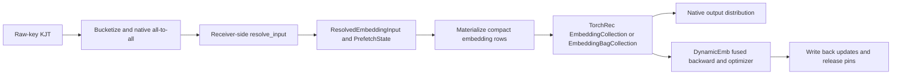

# RFC: Resolve DynamicEmb keys during input distribution

Status: proposed; implementation submitted for design review as a draft.

Related issue: [#459](https://github.com/NVIDIA/recsys-examples/issues/459).
The [maintainer's scope clarification](https://github.com/NVIDIA/recsys-examples/issues/459#issuecomment-6189054416)
includes HBM, cache and storage, starting with row-wise HBM sequence embeddings.

## Problem and scope

DynamicEmb currently resolves keys in its lookup path. That couples hash-table
admission, eviction, initialization and storage access to embedding computation.
Moving resolution to the receiver's input distribution makes the compute stage
consume resolved rows and permits reuse of TorchRec lookup.

The prototype covers the previously supported row-wise sequence and row-wise /
table-row-wise pooled paths, training and evaluation, across HBM, cache, host,
hybrid and external-storage interfaces. Existing restrictions, including
unsupported sharding/score combinations, remain explicit. This does not add
table-row-wise sequence support.

The validated base is `476cdc01d1625337070d71659c9bb304c1593d8f`. Subsequently,
[#528](https://github.com/NVIDIA/recsys-examples/pull/528) introduced hierarchical
input/output distribution in `d53b9c8ca504f239d64078062d020d8e27f52bcf`. Its receiver,
lookup and deduplication paths overlap this work. Integration with that commit is
pending, and the results below do not validate hierarchical distribution. The
draft must be updated and revalidated against current main before merge.

## Proposed data flow

Resolution runs after the tensors awaitable completes, on the stream performing
that wait. It reuses the existing unique, admission, find/insert, initialization
and pinning code. The splits awaitable attaches a postprocessing callback to the
native tensors awaitable; it preserves the metadata TorchRec reads for output
distribution instead of replacing the native awaitable type.

The grouped lookup's `resolve_input` runs feature processors on raw keys once,
then resolves each DynamicEmb kernel group. Static TorchRec groups retain their
native input. A single resolved group is returned directly; multiple groups
retain their split results and state explicitly.

### Indices and weights at the boundary

There are three distinct index spaces:

| Index | Meaning and owner |
| --- | --- |
| Hash slot | Hash-table metadata, reference counters and eviction bookkeeping |
| Value row | Physical embedding/optimizer row; distinct from the hash slot for HBM storage |
| Compact row | Position in this batch's unique-row workspace, used by native TorchRec lookup |

`ResolvedEmbeddingInput.values()` contains per-occurrence value-row indices.
Its `PrefetchState` also carries unique keys, table IDs, resolved rows, hash
slots, reverse indices, admission results and lifetime metadata. Original keys
needed by `need_indices=True` stay in the sequence output context.

This prototype is a compact-workspace adapter, not a zero-copy binding of the
persistent DynamicEmb table to a fused TorchRec TBE. For HBM/cache, compute loads
the resolved unique rows without querying the hash table; for opaque storage it
uses the already-resolved snapshot. Native lookup addresses that workspace using
the batch's reverse indices. This also gives rejected/non-admitted keys a valid
initialized scratch row without assigning them persistent storage.

TorchRec's public unsharded `EmbeddingCollection` and `EmbeddingBagCollection`
own gather/pooling. DynamicEmb retains its existing fused gradient reduction and
optimizer; this proposal does not replace them with a TorchRec optimizer.
Uniform-dimension groups use one synthetic feature over the compact matrix.
Pooled results are reshaped into the original batch/feature layout. Mixed-D
pooling keeps per-table strided weight views. FP16/BF16 pooled workspaces are
promoted to FP32 before pooling, with the requested output cast applied last.

Cached native modules live outside the model tree. They are constructed on meta,
materialized and zeroed without consuming the caller's RNG. Frozen scratch
parameters are rebound only for the call and restored in `finally`, so batch
workspaces do not enter checkpoints or external optimizers. The existing JT and
offsets are supplied through KJT's public constructor cache to avoid another
split/scan/concatenation.

## Row lifetime, eviction and optimizer state

### HBM and cache

Resolution reuses the existing initialization and counter protocol. A reused
row is initialized together with its optimizer state before it becomes visible
to lookup. Batch state retains both hash-slot and value-row identity; backward
updates value rows and refreshes hash slots when rehashing changed the key map.
An in-flight batch pins its rows so eviction cannot repurpose them underneath
compute. Backward releases the pins; calls without a backward graph release
them after lookup using the existing stream-ordering protocol.

Admission and score semantics remain with DynamicEmb. Deduplication frequency
counters and per-key scores are applied at resolution, and rejected rows are
excluded from persistent optimizer writes. The implementation keeps the raw
table forward and FIFO prefetch APIs for existing callers.

### Host, hybrid and external storage / PS

An opaque `Storage.find`/`insert` backend cannot expose a stable GPU row address.
Resolution therefore creates a compact snapshot containing embedding and
optimizer values. Distributed input objects, autograd contexts and the legacy
FIFO own pending snapshots. `ActiveStorageRows` indexes them with weak references
so discarding an input or graph without backward does not retain its buffers.

After an optimizer update, values are written through to the backend and
published to overlapping outstanding snapshots, matching the full `(table, key)`
identity. A finite backing store may evict an in-flight key; resolution restores
its live value rather than initializing a different row. This preserves current
embedding and optimizer state when prefetched batches overlap.

`TableAccessGate` orders backend access and publishing across CUDA streams.
Find/publish copies record the source and destination streams on live tensors,
so cancelling a graph does not let the allocator recycle memory before queued
copies finish. Backends keep their existing interface; no remote slot-address or
GPU-pointer API is introduced for PS implementations.

### Evaluation

Evaluation resolves read-only rows through cache, storage and PS. Missing keys
use the evaluation initializer without insertion, admission or optimizer update.
Cold native lookup must preserve CPU/CUDA RNG state, including after checkpoint
restore, so warm and restored models do not diverge in downstream dropout.

## Pipeline and compatibility contracts

Native TorchRec split fusion can replace the input distribution awaitable and
drop its resolution callback. DynamicEmb keeps this all-to-all under `_key_dist`
instead of the fuser's `_dist` attribute. The decision is uniform across ranks,
including empty table-row-wise ranks. The prototype retains native all-to-all
and records the resolved state across pipeline stream transitions.

This opt-out is a correctness tradeoff with a possible performance cost. A
future integration with split fusion must preserve the callback and native
split/recat metadata; it should be reviewed separately with pipeline tests.
The new hierarchical path likewise needs resolution at its receiver-completion
boundary and correct lifetime ownership for its plans and lookup groups. That
integration is not claimed by the current prototype.

Existing raw-table/FIFO APIs, mixed static and dynamic groups, feature processors,
score-bearing input and original output indices are covered on the validated
base. Unsupported learned pooling weights continue to raise during training;
no-grad feature processing preserves the previous contract.

## Implementation map

| Area | Files under `corelib/dynamicemb` |
| --- | --- |
| Receiver callback and grouped resolution | `dynamicemb/shard/input_dist.py`, `rw_sharding.py`, `twrw_sharding.py` |
| Row KJT and explicit ownership | `dynamicemb/shard/resolved_input.py` |
| Resolve/forward boundary | `dynamicemb/batched_dynamicemb_compute_kernel.py`, `batched_dynamicemb_tables.py` |
| Row loading, release and fused updates | `dynamicemb/batched_dynamicemb_function.py`, `key_value_table.py` |
| Opaque-backend live snapshots | `dynamicemb/resolved_storage.py` |
| Public TorchRec lookup adapter | `dynamicemb/torchrec_lookup.py` |
| Regression matrix | `test/unit_tests/test_input_dist_indices.py` |

## Validation actually performed

GPU: RTX PRO 6000 Blackwell Server Edition. Primary environment: PyTorch
2.7.0+cu128, TorchRec 1.2.0 and FBGEMM 1.2.0+cu128. Multi-GPU runs used a private
NCCL 2.28.9 with P2P/IB disabled, `NCCL_CUMEM_HOST_ENABLE=0` and
`NCCL_SOCKET_IFNAME=lo` on this shared host.

| Check on the validated base | Result |
| --- | --- |
| Complete `test_batched_dynamic_embedding_tables_v2.py` | 391 passed, 4 skipped |
| Focused suite plus weighted-pooling and no-grad lifetime suites, one GPU | 336 passed, 4 skipped |
| Focused suite, two GPUs | 284 passed, 4 skipped on each rank |
| Per-key score distributed suite, two GPUs | Passed |
| Additional table-row-wise gradient/pooling checks, four GPUs | Passed with two emulated nodes; not a physical multi-node test |
| Focused suite with TorchRec 1.5.0, one and two GPUs | 284 passed, 4 skipped per invocation/rank |
| Changed-file formatting/import/spelling and whitespace checks | Passed |
| autoflake with root-repository flags | Three findings unchanged from the original main baseline; no new findings |
| mypy against the original main baseline | 362 existing errors versus 364; no new normalized diagnostic messages |

The supplemental environment used PyTorch 2.11.0+cu128, TorchRec 1.5.0+cu128
and FBGEMM 1.5.0+cu129. It emits version warnings and is not an officially
certified dependency combination. These runs do not validate the repository's
target Docker stack (PyTorch 2.13 / TorchRec 1.8.0-rc1 / FBGEMM 1.8.0).

The baseline autoflake findings are one unused local import in
`key_value_table.py` and two unused assignments in the existing full-table test.
The complete repository lint suite is not claimed to pass.

The focused suite exercises resolved-before-lookup behavior, deduplication,
empty ranks/batches, multiple kernel groups, original output indices, per-key
scores, cache/backend eviction, row reuse with Adam state, expansion/rehash,
overlapping and out-of-order SGD/Adam batches, admission, evaluation, feature
processing and both native sparse/prefetch train pipelines. Regressions also
cover low-precision pooling against FP32 accumulation, discarded graphs,
cross-stream cancellation and cold-lookup RNG/dropout consistency. Its four
skips are score/layout combinations the existing implementation rejects.

External-storage tests exercise a PyDict-backed implementation of the PS
interface. No external/network PS service or physical multi-node deployment was
tested. Validation after integration with `d53b9c8` remains pending.

## Performance evidence and limits

Performance is an engineering objective, but #459 specifies no quantitative
speedup target. Moving resolution does not remove its cost, and reusing public
unsharded modules adds adaptation overhead. The prototype does not establish
an end-to-end speedup over main.

The [benchmark methodology, commands and samples summary](../benchmark/README.md#3-resolved-lookup-and-sparsedist-pipeline-ab)
distinguish the previous-gather control from a complete main checkout. All
numbers below are HBM sequence measurements with D=64, per-rank batch=32,
hotness=4, a resident working set, eight trials after 20 warmup steps:

| Workload | Before local optimization | Optimized prototype | Complete main baseline |
| --- | ---: | ---: | ---: |
| Raw-table forward, 128 features, one GPU, 400 steps/trial | 0.819 ms | 0.669 ms | Not measured in this comparison |
| SparseDist training plus dense MLP/SGD, 128 features, two GPUs, 120 steps/trial | 17.93 ms | 17.63 ms | 16.33 ms |

The raw-table median decreased about 18%; a five-call profile records 28 to 24
GPU kernels per full forward. The pipeline median decreased 1.7%, but sample
ranges overlap, so that difference is not evidence of a stable throughput gain.
The optimized pipeline remains about 8% slower than the pinned main baseline in
this workload. That baseline is `476cdc01`, not the subsequently merged #528.
Cache/Storage/PS performance and production model throughput were not measured.

## Alternatives and review decisions

Direct binding of persistent value buffers could avoid the compact workspace,
but must handle growth, padded optimizer layouts, rejected rows and opaque
storage without invalidating native parameter references. The compact adapter
keeps those existing storage contracts and the fused optimizer intact. A fused
TorchRec TBE/optimizer integration would be a separate design decision.

The draft has separable design, functional implementation, and optimization /
benchmark commits. Before marking it ready for merge:

- Review the explicit row-state boundary, compact-workspace choice and retention
  of DynamicEmb's fused optimizer.
- Integrate current main / #528 and test both native and hierarchical receiver
  completion, overflow/fallback, deduplication and pipeline behavior.
- Run the target Docker dependency stack and the applicable distributed checks.
- Profile the remaining full-pipeline overhead on representative workloads and
  agree on acceptable performance, without treating component timing as a
  throughput claim.
- Validate configured external PS implementations before claiming support for
  their remote transport/runtime behavior.

The draft references #459 without automatically closing it while those
acceptance items remain open.
