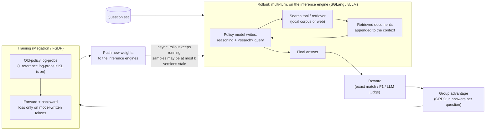

# AI-Search-Plugin

English | [中文](README.zh-CN.md)

Drop-in components that make **RL post-training of search agents** (AI search / deep research) faster and more stable on slime and verl.

> Early release for review. The speed-ups below were measured with the original implementation this package was ported from. Some components are still stubs, and the tests here are CPU-only. Per-run details: [EXPERIMENTS.md](EXPERIMENTS.md).

On five workloads against each framework's fastest config: on four, the same training takes 14–36% less time (1.17–1.56× faster); one is a tie. See [section 4](#4-performance-speed-ups-and-where-time-goes).

---

## 1. What is AI-search post-training?

The model reasons, searches, reads the results and repeats until it can answer. RL teaches it when and what to search. The only reward is whether the final answer is right.



A training sample:

```text
[ system prompt + question ][ thought + query ][ retrieved docs ][ thought + query ][ retrieved docs ] ... [ answer ]
  not in loss                  in loss            not in loss        in loss           not in loss          in loss
```

Only model-written tokens are in the loss, but every token still goes through every layer.

---

## 2. What kind of training it is, and the hard scenarios

AI-search RL is multi-turn, tool-using RL, the same family as coding agents and multi-turn games: the model writes, calls a tool, the result is appended to the context, and it writes again until it answers. The hard parts are broadly shared across this family; how much each one matters depends on the task.

Below are hard scenarios that can show up in industry. We built a synthetic version of each to see where each component should matter; only *f1* (the Qwen3-Next run) has reported numbers (see section 4).

| | Scenario | Why it hurts |
|---|---|---|
| a | One turn, but a very long question | Almost nothing is in the loss, yet every layer computes it all |
| b | Multi-turn search, many rounds | Many small requests; caches go stale after each weight update |
| c | A few very slow trajectories hold up the batch (uneven questions, extreme outliers, very short vs. very long answers) | Every step waits for the last one while other GPUs idle; frameworks that control staleness by dropping samples lose the slow ones |
| d | Very long trajectories (100k+ tokens) | Memory blows up; reading the input is slow |
| e | Easy and hard questions mixed, and the mix keeps changing | When questions get harder, data runs short; when easier, training can't keep up |
| f | Unstable search service: slow at times, timeouts, errors | One slow search slows the whole trajectory; retries pile up |
| g | Several tools mixed: search, opening web pages, running code | Web pages are long; code runs queue up; code results can't be reused |
| h | Very high concurrency (thousands at once) | The request-sending side saturates first while GPUs idle |
| i | A machine dies mid-training | Half-done work is lost and restart is slow |
| j | A few MoE experts are much busier than the rest | The busiest GPU sets the pace |
| k | Different training-to-rollout GPU ratios | The best ratio shifts; more rollout GPUs make weight sync costlier |
| l | More answers per question (e.g. 16) | A group waits for its slowest answer; the same prompt is recomputed |
| m | Long single-turn and multi-turn questions mixed | Uneven batch sizes; reading and generating interfere |
| n | Slow scoring, e.g. another LLM as judge | Scoring time adds straight to every step |

Two easy mistakes in any multi-turn tool-using RL: pass **token IDs** between turns (re-tokenizing breaks training), and mask tool output out of the loss.

---

## 3. Components

★ = on in the default set; the rest are opt-in. "Measured effect" is how much slower things got with the component removed from our full set: × above 1 or + means it helps, ✓ = statistically significant. Per-component numbers, switches, and whether a baseline can get the same by its own config: [docs/COMPONENTS.md](docs/COMPONENTS.md).

| Problem | Component | What it does | Measured effect |
|---|---|---|---|
| **Less waiting for data** | `ticket_admission` ★ (slime), `verl_ceiling` ★ (verl) | Caps how stale a sample can be without lowering concurrency; moves slow groups to a later batch (DEFER) | DEFER: ASearcher ×1.333 ✓ (first 2 pairs reviewed: ×1.286). Ticket itself was 2.3% slower on Qwen3-Next |
| | `pool_fill` ★ | Keeps every inference engine filled with in-flight requests | Not measured separately |
| | `prefetch` ★ | Fetches the next batch while weights are being synced | Search-R1 ×1.033 ✓ (ratio not reviewed); Qwen3-Next +13.5% ✓ |
| | `rshard` ★ | Splits the rollout client that sends requests over several processes | ASearcher ×1.051, not significant |
| **Faster search** | `toolcache` ★ + `tool_hedge` ★ | Sends identical searches once; sends a backup when a search is slow | ASearcher ×1.079, not significant (not reviewed) |
| **Less compute** | `response_logits` ★ | Computes the output layer only on model-written tokens | Search-R1 ×1.116 ✓; ASearcher ×1.090 ✓ |
| | `prefix_tree` | Computes the shared prompt of a group's answers once | Not in the measured configs |
| **Weight sync** | `sampler_nosync` ★ + engine-side fast load | Removes a per-step wait in the inference engine; loads new weights faster | ASearcher ×1.116 ✓ (first 2 pairs reviewed: ×1.171); Libra ×1.151 ✓ |
| | `weight_sync` ★ (+ `verl_inplace` ★) | Pushes new weights to the inference engines faster | Not significant anywhere (~1%) |
| | `kvepoch` / `kvfresh` / `verl_kvfresh` | After a weight update, never reuses caches computed with old weights (correctness) | Cost not significant |
| **MoE only** | `expert_placement` | Moves busy experts to idle GPUs when load is uneven | Qwen3-Next +2.7% ✓ |
| | `r3_ep_plan` | Plans a whole step's MoE communication before training, so layers stop pausing to sync | Not in the measured configs |
| | `hybridep_overlap` | Overlaps MoE communication with compute in two chunks (cannot be combined with the previous one) | Not in the measured configs |
| | `r3_transfer` ★ | Compresses routing-replay data before sending it | Measured together with prefetch (above) |
| | `r3pack` | Balances expert load when packing micro-batches | Did not trigger on Qwen3-Next |
| | `jitfix` ★ | Stops torch.compile from recompiling on every new length | Not measured separately |
| **Other** | `jitcache` | Keeps compiled kernels across runs, saving first-step compile time | Not measured separately |

The direct-HTTP path of `weight_sync` (`ws direct`) is off by default: it caused rare hangs on the 80B model (1 in 60 syncs); root cause not confirmed.

Five more components are registered by name but have no code yet (MTP speculative decoding, DSA selection replay, three GDN items); see [docs/PORTING.md](docs/PORTING.md).

---


## 4. Performance: speed-ups and where time goes

Three open-source small models (Search-R1, ASearcher, Libra) and one large model (Qwen3-Next 80B). Every pair ran on the same machine in both orders, with health checks on both sides, and was independently reviewed. The baseline is the fastest config of that framework we could find that keeps samples at most 2 steps stale. Per-pair numbers, component ablations, health checks and accuracy: [EXPERIMENTS.md](EXPERIMENTS.md).

### 4.1 Speed-ups

| Workload | Hardware | Baseline | Time saved for the same training | Speed-up [95% CI] (pairs) | Notes |
|---|---|---|---|---|---|
| Search-R1 (Qwen2.5-7B) | 1× B300 | slime (5 training + 3 rollout GPUs) + our ticket admission (slime has no staleness bound of its own; with or without it, speed is within noise) | ~15% | **1.170×** [1.164, 1.177] (2) | All checks pass. Mostly from computing only the response part (×1.116) and prefetch (×1.033, ratio not reviewed) |
| Search-R1 (Qwen2.5-7B) | 1× B300 | verl (colocated async) | tie | **1.002×** [0.984, 1.021] (8), **tie** | 4.6% slower per step, but trains ~4.8% more tokens per step. Two checks failed: amount trained, first-3-step reward (at threshold). The baseline may drop over-age samples; not proven. `toolcache` did not activate here |
| ASearcher (Qwen2.5-7B) | 1× B300 | verl best config (colocated async) | ~14% | **1.167×** [1.131, 1.208] (4) | verl may occasionally exceed "2 steps stale" (estimated 0.002–0.16% of trajectories), which favors verl. Against slime: 1.299× (reference only) |
| Libra (Qwen3-14B) | 1× B200 | slime best config + our ticket admission | ~18% | **1.219×** [1.133, 1.310] (6) | Without ticket admission slime must drop to concurrency 8 to stay within the bound, so the baseline gets it too; this number excludes its gain. The gain comes from the combination; single components are mostly within noise |
| Qwen3-Next (80B-A3B) | 4× B300 | verl best config (separate async, partial rollout, routing replay) | ~36% | **1.560×** [1.389, 1.719] (4) | See below |

The Qwen3-Next row covers one simulated-search scenario; it was measured with `ws direct` on (later turned off by default after hangs); verl needed three local fixes to train normally. All six caveats: [EXPERIMENTS.md](EXPERIMENTS.md).

### 4.2 Where small and large models get stuck

In short: **training is the largest stage everywhere (60–89% of each step); we mainly cut the waiting**, and on the large model training as well. Per-stage shares: [EXPERIMENTS.md](EXPERIMENTS.md).

| | Small dense models (one node) | Large MoE model (Qwen3-Next, 4 nodes) |
|---|---|---|
| **Largest stage** | Training, 64–89% of each step; waiting 10–33% | Training: 74% for us, 60% for verl |
| **Where we gain** | Mostly in waiting: 81% of the gap on ASearcher (vs. slime), 83% on Libra. Exception: Search-R1 vs. slime, where 65% is in training (response-only compute). Against verl: ASearcher gains in generation and sync; on Search-R1 the training gain is cancelled by more generation time, hence the tie | Training and waiting each ~40+ s/step shorter (our waiting includes sync; ~51 s without it). verl's 37.5 s sync is added to every step; ours is inside the waiting time |
| **Why waiting is slow** | slime sends all requests from one process and its CPU can't keep up: ~1 s per call on the client vs. 0.04 s at the retriever (ASearcher, not reviewed). Retrieved text is 52% (Search-R1) to 70–83% (ASearcher) of all tokens | verl's generation varies widely: 0–13 s on short steps, ~200 s on long ones; sync and training run one after another (not reviewed) |
| **What helped** | Waiting: DEFER ×1.333, engine hooks ×1.12–1.15, prefetch ×1.033 (DEFER and ASearcher engine hooks: only the first 2 pairs reviewed; prefetch ratio not reviewed; see EXPERIMENTS). Training: response-only compute ×1.09–1.12. Weight-sync changes: no effect | Prefetch +13.5% (without it, ~30 s/step more waiting); expert placement +2.7% (~4 s/step less training) |
| **Can the baseline get it by config?** | Partly: slime's own `--use-distributed-post` roughly halves waiting (not reviewed); with it on, our `rshard` adds only 5%, not significant | No: verl's Megatron path has no expert load balancing |
| **Not measured** | Prefill vs. decode split; multi-node scale | Prefill vs. decode split; where prefetch's 30 s comes from; sparse-attention models; real retrieval |

---

## Install

```bash
python3 -m pip install -U "pip>=23"   # pip 22 (Ubuntu 22.04 default) installs an empty package; upgrade first
pip install .                 # or: pip install -e ".[test]"   (no hard runtime dependencies)
ai-search-plugin list         # components, defaults, status
ai-search-plugin plan verl default max_staleness=2   # print the env / arguments it would set
```

Install into the framework's environment so every Ray worker can import it. torch, slime, verl, SGLang and Megatron are imported lazily.

```python
import ai_search_plugin as asp
plan = asp.install(framework="slime", components="default", options={"max_staleness": 2})
print(plan.shell())   # env + framework arguments
```

Launch examples (illustrative, not run in tests):
- [examples/slime/](examples/slime/): needs slime's fully-async rollout mode; start the trainer with `python -m ai_search_plugin.adapters.slime_train` so `prefetch` works.
- [examples/verl/](examples/verl/): uses `VERL_USE_EXTERNAL_MODULES`; `response_logits` needs the Megatron engine.

**Tested:** `pytest tests/` on a CPU-only machine without any framework: registry, CLI, hooks and the CPU logic of each ported component. 244 passed, 2 skipped (need a slime checkout via `SLIME_SRC`).

**Not tested:** real slime/verl runs, SGLang engine patches, NCCL weight transfer, `rshard`'s Ray integration, the `response_logits` GPU tests in `tests/gpu/`, and the GPU paths of the four newly ported components (`prefix_tree`, `expert_placement`, `r3_ep_plan`, `hybridep_overlap`). See [docs/COMPONENTS.md](docs/COMPONENTS.md#what-is-tested-here-cpu-only-no-gpu-no-framework-installed).
