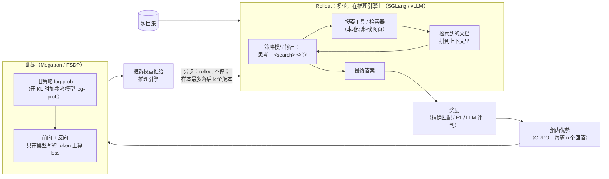

# AI-Search-Plugin

[English](README.md) | 中文

一组即插即用的组件，让 **搜索智能体的 RL 后训练**（AI 搜索 / 深度研究）在 slime 和 verl 上跑得更快、更稳。

> 早期版本，供审阅。下面的提速数字是用本包移植前的原始实现测的。部分组件还是空壳（stub），本仓库测试只在 CPU 上跑。每次实验的细节见 [EXPERIMENTS.md](EXPERIMENTS.md)。

在 5 个任务上对比各框架的最快配置：4 个任务里，同样的训练量我们少用 14–36% 的时间（快 1.17–1.56×），1 个打平，见[第 4 节](#4-效果快了多少时间花在哪)。

---

## 1. 什么是 AI 搜索后训练？

模型先思考，再搜索、读结果，反复几轮后给出答案。RL 教它什么时候搜、搜什么。奖励只看最终答案对不对。



一条训练样本：

```text
[ 系统提示 + 题目 ][ 思考 + 查询 ][ 检索文档 ][ 思考 + 查询 ][ 检索文档 ] ... [ 答案 ]
  不进 loss          进 loss        不进 loss     进 loss        不进 loss         进 loss
```

只有模型写的 token 进 loss，但所有 token 都要过每一层。

---

## 2. AI 搜属于哪类训练，会遇到哪些难题

AI 搜属于"多轮调工具"的 RL 训练，和代码智能体、多轮游戏是一类：模型写一段 → 调工具 → 工具结果拼回上下文 → 再写，直到给出答案。这类训练的难点大体相同，只是在不同任务里轻重不一样。

下面是工业里可能遇到的难题场景。我们为每个场景做了合成版本，用来检查各组件该在哪里起作用；只有 *f1*（Qwen3-Next 那次）报了数字（见第 4 节）。

| | 场景 | 难在哪 |
|---|---|---|
| a | 只问一轮，但题目特别长 | 几乎都不进 loss，却每一层都要算 |
| b | 多轮搜索，来回搜好几次 | 请求又多又碎；权重一更新，旧缓存就不能用了 |
| c | 少数几条特别慢，拖住整批（题和题快慢不一、个别慢得离谱、回答长短两极分化） | 每步都得等最后一条，其他卡闲着；靠丢样本控制新旧的框架会把慢的丢掉 |
| d | 一条轨迹超长，十万词以上 | 显存容易爆；读入很慢 |
| e | 难题和简单题混着来，比例还在变 | 题变难时数据供不上，变简单时训练跟不上 |
| f | 搜索服务不稳：时快时慢、超时、出错 | 搜索慢一次，整条轨迹就慢；重试越堆越多 |
| g | 好几种工具混着用：搜索、打开网页、跑代码 | 网页内容很长；跑代码要排队；代码结果没法复用 |
| h | 并发特别大，同时跑几千条 | 发请求那一侧先忙不过来，GPU 反而闲着 |
| i | 训练中途有机器挂了 | 跑了一半的白跑，重启又慢 |
| j | MoE 模型里有几个专家特别忙 | 最忙的那张卡决定整体速度 |
| k | 训练卡和推理卡的配比不一样 | 最优配比会变；推理卡越多，同步权重越贵 |
| l | 每道题让模型答更多遍，比如 16 遍 | 一组要等最慢的那遍；同样的开头重复算 |
| m | 长的单轮题和多轮题混在一起 | 每份数据长短不均；读入和生成互相干扰 |
| n | 打分很慢，比如要用另一个大模型来判 | 打分时间直接加到每一步上 |

多轮调工具的训练还要注意两点：轮与轮之间要传 **token ID**（重新分词会把训练搞坏）；工具返回的 token 要从 loss 里 mask 掉。

---

## 3. 组件

★ = 默认组合里开着，其余要手动打开。"实测效果"是从全套里去掉这个组件后慢了多少：× 大于 1 或 + 表示有用，✓ = 统计上显著。逐项的详细数字、开关，以及对手改自己的配置能不能拿到，见 [docs/COMPONENTS.md](docs/COMPONENTS.md)。

| 解决什么 | 组件 | 干什么 | 实测效果 |
|---|---|---|---|
| **少等数据** | `ticket_admission` ★（slime）、`verl_ceiling` ★（verl） | 限制样本最多旧几步，但不靠压低并发；慢的组挪到后面的批次（DEFER） | DEFER：ASearcher ×1.333 ✓（复核了前 2 对：×1.286）。ticket 本身在 Qwen3-Next 上反而慢 2.3% |
| | `pool_fill` ★ | 在途请求始终补满每个推理引擎 | 没单独测 |
| | `prefetch` ★ | 同步权重的同时，把下一批数据先取好 | Search-R1 ×1.033 ✓（比值未复核）；Qwen3-Next +13.5% ✓ |
| | `rshard` ★ | 把发请求的 rollout 客户端拆到多个进程 | ASearcher ×1.051，不显著 |
| **搜索更快** | `toolcache` ★ + `tool_hedge` ★ | 同样的搜索只发一次；搜得慢就补发一份 | ASearcher ×1.079，不显著（未复核） |
| **少算** | `response_logits` ★ | 只在模型自己写的部分算最后一层输出 | Search-R1 ×1.116 ✓；ASearcher ×1.090 ✓ |
| | `prefix_tree` | 同一道题的几个回答，开头只算一次 | 不在测速配置里 |
| **权重同步** | `sampler_nosync` ★ + 引擎侧快速加载 | 去掉推理引擎每步一次的等待；更快加载新权重 | ASearcher ×1.116 ✓（复核了前 2 对：×1.171）；Libra ×1.151 ✓ |
| | `weight_sync` ★（+ `verl_inplace` ★） | 更快把新权重推给推理引擎 | 都不显著（约 1%） |
| | `kvepoch` / `kvfresh` / `verl_kvfresh` | 权重更新后不再用旧权重算的缓存，保证结果对 | 开销不显著 |
| **MoE 专用** | `expert_placement` | 专家忙闲不均时，把忙的专家挪到闲的卡上 | Qwen3-Next +2.7% ✓ |
| | `r3_ep_plan` | 训练前一次排好整步的 MoE 通信，每层不再停下来同步 | 不在测速配置里 |
| | `hybridep_overlap` | MoE 发数据和计算分两块同时进行（和上一个不能同开） | 不在测速配置里 |
| | `r3_transfer` ★ | 路由回放数据压缩后再传 | 和 prefetch 一起测（见上） |
| | `r3pack` | 拼微批时平衡各专家的负载 | Qwen3-Next 上没触发 |
| | `jitfix` ★ | 防止 torch.compile 因长度变化反复重编译 | 没单独测 |
| **其他** | `jitcache` | 跨次运行保留编译结果，省掉第一步的编译时间 | 没单独测 |

`weight_sync` 里的直连 HTTP 路径（`ws direct`）默认关闭：在 80B 模型上偶发卡死（每 60 次同步 1 次），根因未确认。

还有 5 个组件只登记了名字、还没有代码（MTP 投机解码、DSA 选块回放、3 个 GDN 相关），见 [docs/PORTING.md](docs/PORTING.md)。

---


## 4. 效果：快了多少、时间花在哪

测了三个开源小模型（Search-R1、ASearcher、Libra）和一个大模型（Qwen3-Next 80B）。每一对都在同一台机器上、正反两种顺序跑，两边都做了健康检查，并经过独立复核。基线是该框架在"样本最多旧 2 步"的前提下我们能调出的最快配置。每一对的数字、组件消融、健康检查和准确率见 [EXPERIMENTS.zh-CN.md](EXPERIMENTS.zh-CN.md)。

### 4.1 快了多少

| 任务 | 机器 | 基线 | 同样训练量，我们少用的时间 | 提速比 [95% CI]（对数） | 说明 |
|---|---|---|---|---|---|
| Search-R1（Qwen2.5-7B） | 1 台 B300 | slime（5 张训练卡 + 3 张推理卡）+ 我们的 ticket 准入（slime 自己没有陈旧度上限；加不加速度在噪声内） | 约 15% | **1.170×** [1.164, 1.177]（2） | 健康检查全过。主要来自只算回答部分（×1.116）和预取（×1.033，比值未复核） |
| Search-R1（Qwen2.5-7B） | 1 台 B300 | verl（同卡异步） | 打平 | **1.002×** [0.984, 1.021]（8），**打平** | 每步慢 4.6%，但每步多训约 4.8% 的 token。两项检查没过：训练量、前 3 步奖励（卡在阈值上）。基线可能丢了超龄样本，未证实。`toolcache` 在这里没生效 |
| ASearcher（Qwen2.5-7B） | 1 台 B300 | verl 最优配置（同卡异步） | 约 14% | **1.167×** [1.131, 1.208]（4） | verl 可能偶尔超出"最多旧 2 步"（估计 0.002–0.16% 的轨迹），这对 verl 有利。对 slime 是 1.299×（仅供参考） |
| Libra（Qwen3-14B） | 1 台 B200 | slime 最优配置 + 我们的 ticket 准入 | 约 18% | **1.219×** [1.133, 1.310]（6） | 不加 ticket 准入，slime 要把并发降到 8 才不超限，所以给基线也加上了；这个数不含它的收益。收益来自组合，单个组件大多在噪声内 |
| Qwen3-Next（80B-A3B） | 4 台 B300 | verl 最优配置（分离式异步、partial rollout、路由回放） | 约 36% | **1.560×** [1.389, 1.719]（4） | 见下方说明 |

Qwen3-Next 这一行只测了一个模拟搜索场景；测速时开着后来因卡死而默认关掉的 `ws direct`；verl 做了三处本地修补才能正常训练。完整的 6 条说明见 [EXPERIMENTS.zh-CN.md](EXPERIMENTS.zh-CN.md)。

### 4.2 小模型和大模型分别卡在哪

一句话：**训练都是时间大头（占每步 60–89%）；我们主要把等数据压了下去**，大模型上训练也省了一截。各段占比见 [EXPERIMENTS.zh-CN.md](EXPERIMENTS.zh-CN.md)。

| | 小 dense 模型（单机） | 大 MoE 模型（Qwen3-Next，4 机） |
|---|---|---|
| **时间大头** | 训练，占每步 64–89%；等数据占 10–33% | 训练：我们占 74%，verl 占 60% |
| **我们快在哪** | 主要省在等数据：ASearcher（对 slime）差距的 81%、Libra 的 83%。例外是 Search-R1 对 slime，65% 省在训练（只算回答部分）。对 verl：ASearcher 省在生成和同步；Search-R1 训练省的被生成多花的抵消，所以打平 | 训练、等数据每步各省四十多秒（等数据里含同步，扣掉后约省 51 s）。verl 的同步 37.5 s 加在每步上，我们的同步算在等数据里，不另外加 |
| **等数据为什么慢** | slime 用一个进程发所有请求，CPU 忙不过来：客户端每次要等约 1 s，检索服务本身只要 0.04 s（ASearcher，未复核）。搜回来的内容占总 token 的 52%（Search-R1）到 70–83%（ASearcher） | verl 的生成时快时慢：短步 0–13 s，长步约 200 s；同步和训练串着做（未复核） |
| **哪些组件有用** | 等数据：慢组延后 DEFER ×1.333、引擎钩子 ×1.12–1.15、预取 ×1.033（DEFER、ASearcher 引擎钩子只复核了前 2 对，预取比值未复核，见 EXPERIMENTS）。训练：只算回答部分 ×1.09–1.12。权重同步改动没效果 | 预取 +13.5%（不开每步多等约 30 s）；专家重排 +2.7%（训练每步省约 4 s） |
| **基线改配置能拿到吗** | 部分能：slime 打开自带的 `--use-distributed-post`，等数据约减半（未复核）；打开后我们拆进程只多 5%，不显著 | 拿不到：verl 的 Megatron 路径没有专家负载均衡 |
| **还没测的** | 读入和生成各占多少；多机规模 | 读入和生成各占多少；预取省的 30 s 具体在哪一环；稀疏注意力模型；真实检索 |

---

## 安装

```bash
python3 -m pip install -U "pip>=23"   # Ubuntu 22.04 自带的 pip 22 会把本包装成空包，先升级
pip install .                 # 或：pip install -e ".[test]"（无硬性运行时依赖）
ai-search-plugin list         # 组件、默认值、状态
ai-search-plugin plan verl default max_staleness=2   # 打印会设置的环境变量 / 参数
```

装到框架所在的环境里，保证每个 Ray worker 都能 import。torch、slime、verl、SGLang、Megatron 都是延迟导入。

```python
import ai_search_plugin as asp
plan = asp.install(framework="slime", components="default", options={"max_staleness": 2})
print(plan.shell())   # 环境变量 + 框架参数
```

启动示例（仅示意，测试中没跑）：
- [examples/slime/](examples/slime/)：slime 需用全异步 rollout 模式；训练端用 `python -m ai_search_plugin.adapters.slime_train` 启动，`prefetch` 才能工作。
- [examples/verl/](examples/verl/)：使用 `VERL_USE_EXTERNAL_MODULES`；`response_logits` 需要 Megatron 引擎。

**测了：** `pytest tests/` 在只有 CPU、没装任何框架的机器上跑，覆盖注册表、CLI、钩子和各已移植组件的 CPU 逻辑。244 个通过，2 个跳过（需通过 `SLIME_SRC` 提供 slime 源码）。

**没测：** 真实 slime/verl 运行、SGLang 引擎补丁、NCCL 权重传输、`rshard` 的 Ray 集成、`tests/gpu/` 里的 `response_logits` GPU 测试，以及新搬进来的 4 个组件（`prefix_tree`、`expert_placement`、`r3_ep_plan`、`hybridep_overlap`）的 GPU 部分。详见 [docs/COMPONENTS.md](docs/COMPONENTS.md#what-is-tested-here-cpu-only-no-gpu-no-framework-installed)。
