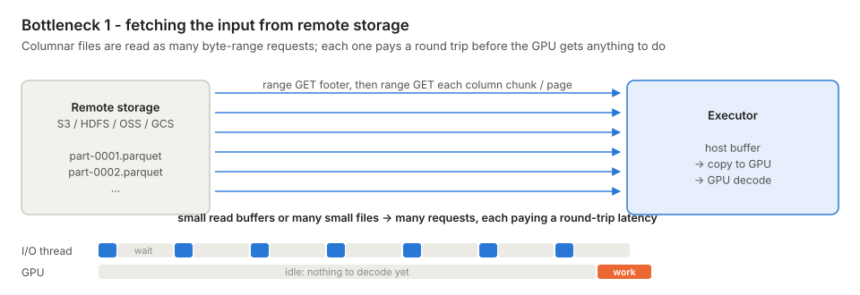
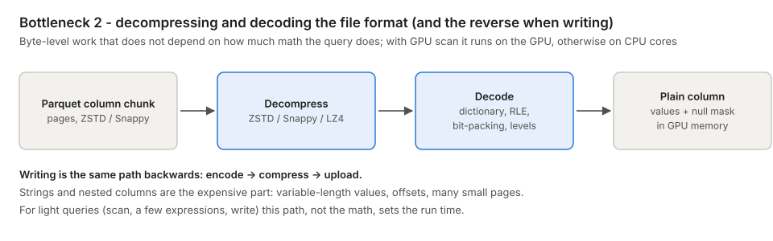
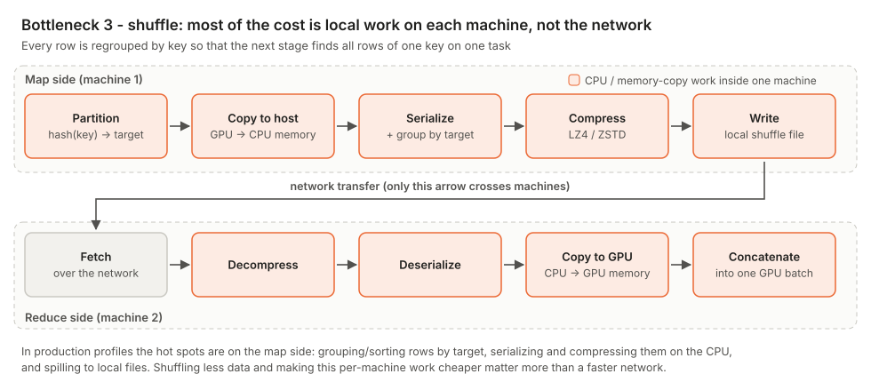
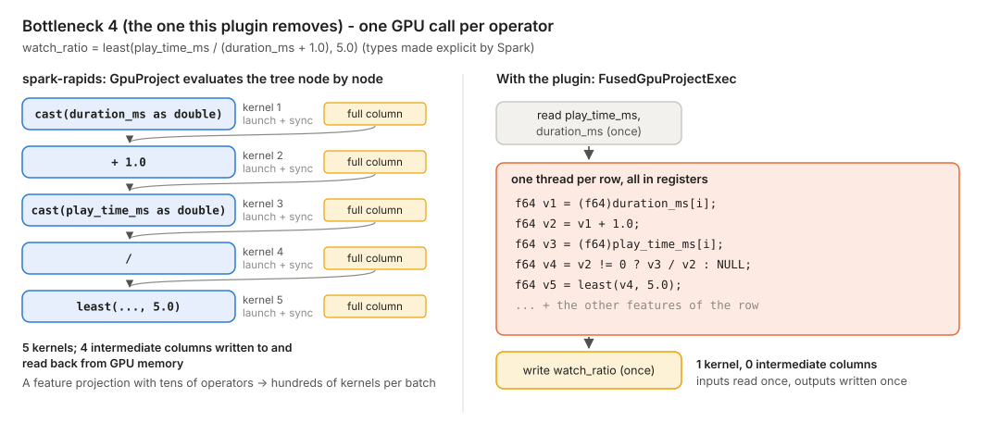
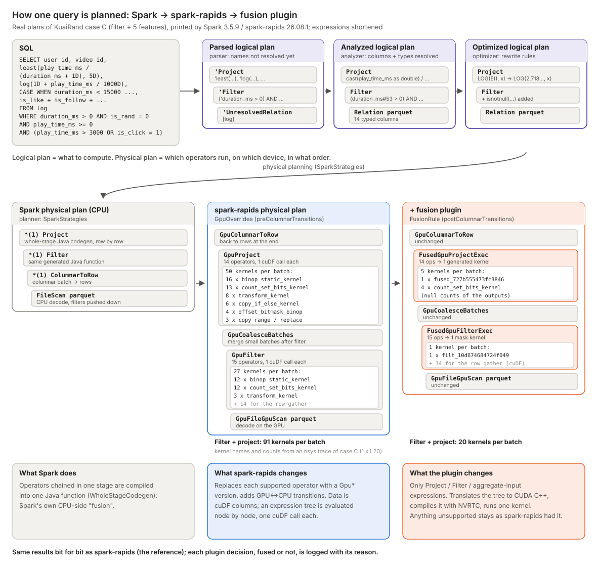

<!--
SPDX-FileCopyrightText: Copyright (c) 2026 NVIDIA CORPORATION & AFFILIATES. All rights reserved.
SPDX-License-Identifier: Apache-2.0
-->

# Feature-Extractor-Plugin: batch (Spark)

English | [中文](README.zh-CN.md)

An add-on for [spark-rapids](https://github.com/NVIDIA/spark-rapids) that fuses chains of row-independent
expressions (the arithmetic, casts, comparisons and `CASE` branches typical of feature engineering) into **one
generated GPU kernel**, with results bit-identical to spark-rapids. It is a separate jar; spark-rapids itself is not
modified.

"Row-independent" describes the computation, not the storage: each output row depends only on the same row's input
values (like `play_time / duration`). The data stays in cuDF's columnar format; the kernel reads the input columns and
gives each row to one GPU thread. Computations that look at other rows (aggregations, sorting, windows, joins) are
not fused.

This page explains:

1. [where Spark jobs spend their time once they run on the GPU](#1-where-spark-jobs-spend-their-time-on-the-gpu), and which part of it this plugin can remove;
2. [how the plugin works](#2-how-the-plugin-works), following one query from SQL to the fused physical plan;
3. [where it fits](#3-where-it-fits).

Measured results on the public [KuaiRand](https://kuairand.com) dataset are in
[benchmarks/kuairand](benchmarks/kuairand/README.md); how to rerun them is in [benchmarks/REPRODUCE.md](benchmarks/REPRODUCE.md).

## 1. Where Spark jobs spend their time on the GPU

From our experience with real industrial big-data workloads (log processing, sample and feature generation, ETL for
search, ads and recommendation), once a Spark job runs on spark-rapids the GPU math is rarely what limits it.
Most of the time goes to **moving and reshaping data**, and it falls into a few recurring bottlenecks:

| # | bottleneck | where the time goes | what usually helps |
| --- | --- | --- | --- |
| 1 | reading input from remote storage | waiting on many small byte-range requests | larger read buffers, fewer and larger files, multithreaded / coalescing readers |
| 2 | decompressing and decoding (encoding on write) | byte-level format work, worst for strings and nested types | GPU decode/encode, better file layout |
| 3 | shuffle | partitioning, serializing, compressing and spilling on each machine's CPU | shuffle less data, larger batches, cheaper per-machine shuffle work |
| 4 | expression evaluation | one GPU call per operator, intermediate columns written to GPU memory | **this plugin**: one fused kernel per expression tree |

The first three are usually the largest; the fourth is real but usually a smaller share. **The plugin only addresses
the fourth**, which is why its end-to-end effect is usually modest (section 3).

### 1.1 Reading input from remote storage



Parquet/ORC files are read with byte-range requests: first the footer, then each needed column chunk. Every request
pays a network round trip. With small read buffers or many small files the reader issues many requests and spends
most of its time waiting, while the GPU has nothing to decode. Faster GPU kernels do not change this phase.

### 1.2 Decompressing and decoding the file format (and the reverse when writing)



Before any expression can run, compressed pages have to be decompressed (ZSTD, Snappy, ...) and decoded (dictionary,
run-length, bit-packing, definition/repetition levels) into plain columns. Writing does the same in reverse. This is
byte-level work whose cost follows the size and layout of the data, not the amount of math in the query; strings and
nested types are the expensive part.

### 1.3 Shuffle



A join or group-by on a key needs all rows of one key in one task, so every row is regrouped between stages. Only one
step of a shuffle crosses machines. Everything else - partitioning, copying between GPU and host memory, grouping or
sorting rows by target, serializing, compressing, spilling to local files, and the reverse on the reading side - is
local work on each machine, much of it on the CPU. In practice this local work, not the network, is what makes
shuffle-heavy jobs slow.

### 1.4 One GPU call per operator in expression evaluation



Inside the GPU, spark-rapids evaluates an expression tree node by node: each operator (`cast`, `+`, `/`, `least`, ...)
is a separate cuDF call that launches a kernel, writes a full intermediate column to GPU memory, and is often followed
by a stream synchronization; the next operator reads that column back. A feature-engineering projection with tens of
operators therefore turns into hundreds of small kernels and syncs per batch. **This is what the plugin removes**: it
compiles the whole tree into one kernel that reads each input column once, keeps all intermediate values in
registers, and writes only the final columns.

## 2. How the plugin works

### 2.1 From SQL to the fused physical plan

The figure follows KuaiRand case C (filter the samples, then compute five features) through every planning step.
The plan texts are the real ones printed by Spark and spark-rapids, shortened.



1. **SQL -> parsed logical plan.** The parser builds a tree of `'Project` / `'Filter` / `'UnresolvedRelation`;
   names are not resolved yet (the leading `'`).
2. **Analyzed logical plan.** Columns and types are resolved and Spark inserts the implicit casts, e.g.
   `play_time_ms / 1000D` becomes `cast(play_time_ms as double) / 1000.0`.
3. **Optimized logical plan.** Rewrite rules run: constants are folded (`LOG(E(), x)` -> `LOG(2.718281828459045, x)`),
   and `isnotnull(...)` conditions are added to the filter so they can be pushed into the Parquet reader.
4. **Spark physical plan (CPU).** The planner picks operators: `FileScan parquet` -> `ColumnarToRow` -> `Filter` ->
   `Project`. The `*(1)` prefix means the three upper operators are compiled into one Java function
   (whole-stage code generation) - Spark's own form of fusion, on the CPU.
5. **spark-rapids physical plan.** spark-rapids' `GpuOverrides` rule replaces every supported operator with its GPU
   version, and its transition rules add `GpuCoalesceBatches` after the filter and a single `GpuColumnarToRow` at the
   end. Data now flows as cuDF columns:

   ```
   GpuColumnarToRow
   +- GpuProject [... watch_ratio, log_play_sec, duration_bucket, interact_cnt ...]   <- 14 operators, one cuDF call each
      +- GpuCoalesceBatches
         +- GpuFilter [isnotnull(...) AND (duration_ms > 0) AND ... ]                 <- 15 operators, one cuDF call each
            +- GpuFileGpuScan parquet [...]
   ```

6. **Plugin.** The plugin's rule runs after spark-rapids has finished (Spark's `postColumnarTransitions` hook,
   also inside adaptive query execution stages). It rewrites only the two nodes that carry expression trees:

   ```
   GpuColumnarToRow
   +- FusedGpuProjectExec [...], fused 14 ops -> 1 kernel fused_727b555473fc3846; 4 kernel outputs, 6 inputs
      +- GpuCoalesceBatches
         +- FusedGpuFilterExec [...], fused 15 ops -> 1 mask kernel filt_10d674684724f049; 4 inputs
            +- GpuFileGpuScan parquet [...]
   ```

   In an nsys trace of this query, the filter and the projection together launch **91 kernels per batch** on
   spark-rapids and **20** with the plugin (the 14 kernels that gather the selected rows are the same on both sides);
   the figure lists them by name.

   The plugin also prints one decision line per candidate, including the reason when something is not fused:

   ```
   FUSED filter: fused 15 ops -> 1 mask kernel filt_10d674684724f049; 4 inputs, 0 cuDF-evaluated sub-expr(s)
   FUSED project: fused 14 ops -> 1 kernel fused_727b555473fc3846; 4 kernel outputs, 6 inputs, 0 cuDF-evaluated sub-expr(s), 0 cuDF output(s)
   ```

### 2.2 What happens inside a fused node

For each `GpuProject`, `GpuFilter` and the input expressions of `GpuHashAggregate`:

1. **Translate.** Each spark-rapids expression is mapped to a small intermediate representation, using a whitelist of
   supported expression classes. A sub-expression that is not supported (for example `length(str)` or a bigint ->
   timestamp cast) is *cut out*: spark-rapids evaluates it as before and the kernel receives its result as one more
   input column. If an output column itself has an unsupported type (string, decimal, nested), that column is left to
   spark-rapids.
2. **Generate.** The representation is turned into CUDA C++: one thread per row, every value paired with a null
   flag, null bitmaps written with one warp ballot per 32 rows.
3. **Compile.** NVRTC compiles the source at run time for the GPU it runs on (about 20 ms per new kernel). Kernels
   are cached in memory and on disk, keyed by source, GPU architecture and NVRTC version.
4. **Run.** The kernel reads the cuDF input buffers in place and writes into memory allocated through RMM, so
   spark-rapids' memory accounting and its split-and-retry on out-of-memory still apply. A filter kernel writes only
   a boolean mask; selecting the rows is still done by cuDF.

**Same results as spark-rapids.** The device functions copy spark-rapids' own GPU semantics (three-valued logic,
division by zero -> NULL, NaN ordering, integer wrap-around, ...), so fused results are bit-identical to unfused
spark-rapids. ANSI mode, non-deterministic expressions and non-UTC time zones are not fused at all.

**Safe to switch on.** If NVRTC cannot be loaded, a kernel fails to compile or launch, or a value falls outside a
guarded range, that batch runs on the original spark-rapids path and the region is blacklisted for the JVM.
`spark.rapids.sql.fusion.shadow=true` runs both paths on every batch and compares them bit by bit, for validation on
real data; `spark.rapids.sql.fusion.kill=true` turns the rewrite off. Details:
[plugin/docs/DESIGN.md](plugin/docs/DESIGN.md) and [plugin/docs/LIMITS-plugin.md](plugin/docs/LIMITS-plugin.md).

## 3. Where it fits

**Good fit**: feature and sample generation with many numeric row-independent expressions in a projection, filter or
aggregate input - arithmetic, casts, comparisons, `CASE` / `IF`, `least` / `greatest`, `log` / `exp` / `pow`, `pmod`
and hashing-style integer math, date parts - especially when the result stays on the GPU (fed to training,
aggregated, joined) instead of going straight to a file.

**Little or no gain**: jobs dominated by reading or writing files, joins, shuffles or aggregations; string, decimal
and nested-type logic (not fused); expressions with only one or two operators.

Because expression evaluation is usually a small part of a whole job (section 1), expect a few percent end to end on
typical pipelines and more only when expression evaluation dominates; the plugin did not slow down any query we
measured. Results are bit-identical to spark-rapids, the start-up cost is about 1 s per executor, and the fusion
log shows what was and was not fused, so it is cheap to try. Measured numbers are in
[benchmarks/kuairand](benchmarks/kuairand/README.md).

## 4. Quick start

Requirements: Spark 3.5.x (tested 3.5.9, 3.5.1, 3.4.3), spark-rapids 26.08.1 (`cuda12` jar), JDK 8/11, Linux x86_64,
and `libnvrtc.so.12` (CUDA 12.x; 12.8+ for Blackwell) on every executor.

```bash
cd plugin
scripts/build.sh          # -> target/gpu-fusion-plugin-0.1.0.jar (no GPU needed)
scripts/selftest.sh       # every kernel template compiles with NVRTC for sm_75 .. sm_120
```

```bash
spark-submit \
  --jars rapids-4-spark_2.12-26.08.1-cuda12.jar,gpu-fusion-plugin-0.1.0.jar \
  --conf spark.plugins=com.nvidia.spark.SQLPlugin \
  --conf spark.sql.extensions=com.nvidia.spark.rapids.fusion.FusionExtension \
  --conf spark.rapids.sql.fusion.mode=SAFE \
  --conf spark.rapids.sql.fusion.explain=ALL \
  your_job.py
```

`mode=OFF` gives plain spark-rapids, so the same job can be timed both ways. All settings are listed in
[plugin/docs/DESIGN.md](plugin/docs/DESIGN.md#2-configuration-prefix-sparkrapidssqlfusion).

## 5. What is in this directory

| path | contents |
| --- | --- |
| [plugin/](plugin) | plugin source (Scala), build and test scripts, demo, design notes and known limits |
| [benchmarks/kuairand/](benchmarks/kuairand/README.md) | the five KuaiRand cases: SQL, real plans, fusion decisions, generated kernels, timing breakdowns |
| [benchmarks/REPRODUCE.md](benchmarks/REPRODUCE.md) | step-by-step reproduction from public sources |
| [docs/images/](docs/images) | figures used on this page |
