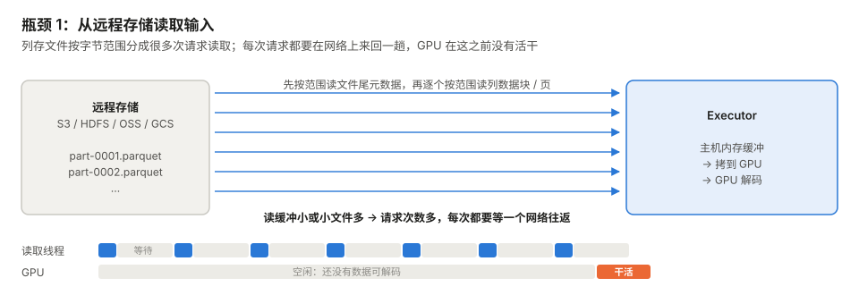
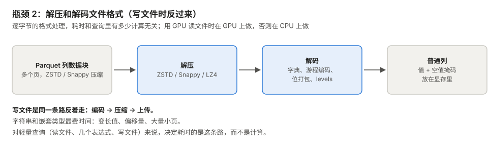
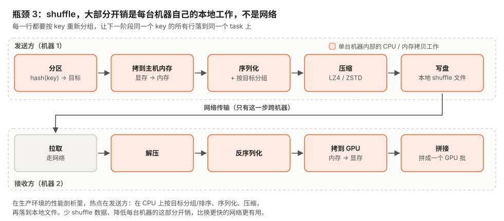
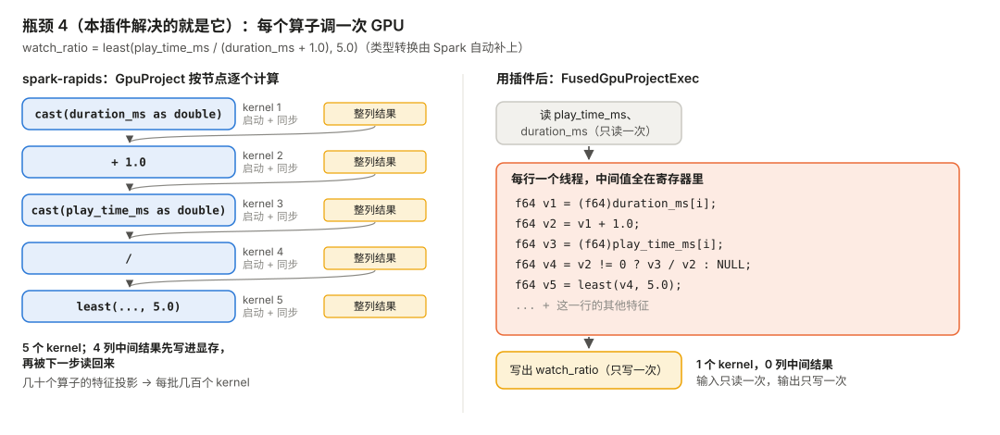
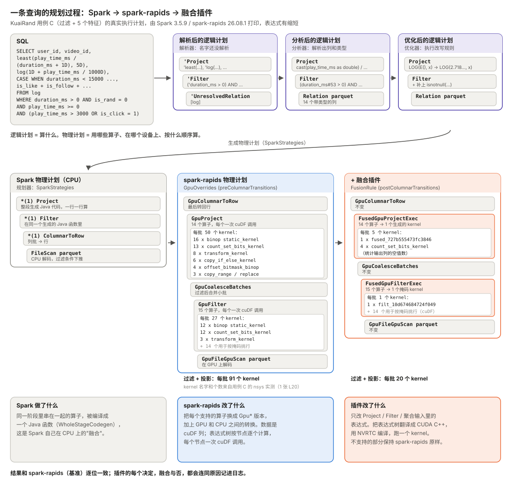

<!--
SPDX-FileCopyrightText: Copyright (c) 2026 NVIDIA CORPORATION & AFFILIATES. All rights reserved.
SPDX-License-Identifier: Apache-2.0
-->

# Feature-Extractor-Plugin：批处理（Spark）

[English](README.md) | 中文

这是 [spark-rapids](https://github.com/NVIDIA/spark-rapids) 的一个插件。特征工程里常见的一长串"每行独立计算"的表达式，比如四则运算、类型转换、比较、`CASE` 分支，原本要分很多步算，它把这些合成**一个自动生成的 GPU kernel**，结果和 spark-rapids 逐位一致。插件是一个独立的 jar，不改 spark-rapids 本身。

"每行独立计算"说的是计算方式，不是存储方式：每一行的结果只用到这一行自己的值（比如 `play_time / duration`），不看别的行。数据始终是 cuDF 的列存格式，kernel 读入各列，每个 GPU 线程负责一行。需要看别的行的计算（聚合、排序、窗口、join）不融合。

本文分三部分：

1. [Spark 任务上 GPU 后时间花在哪](#1-spark-任务上-gpu-后时间花在哪)，以及插件能省掉其中哪一块；
2. [插件怎么工作](#2-插件怎么工作)：拿一条查询，从 SQL 一路跟到融合后的物理计划；
3. [适合什么场景](#3-适合什么场景)。

在公开数据集 [KuaiRand](https://kuairand.com) 上的实测结果见 [benchmarks/kuairand](benchmarks/kuairand/README.md)，复现步骤见 [benchmarks/REPRODUCE.md](benchmarks/REPRODUCE.md)。

## 1. Spark 任务上 GPU 后时间花在哪

我们在真实工业大数据场景里做过不少优化，包括日志处理、样本和特征生成，以及搜广推的 ETL。经验是：Spark 任务跑到 spark-rapids 上以后，GPU 算数很少是瓶颈，大部分时间花在**搬数据和改数据格式**上。常见的瓶颈有下面四种：

| # | 瓶颈 | 时间花在哪 | 一般怎么解决 |
| --- | --- | --- | --- |
| 1 | 从远程存储读数据 | 发出大量小的字节范围请求，每个都要等 | 加大读缓冲、合并小文件、用多线程或合并读取的 reader |
| 2 | 解压和解码（写的时候是编码和压缩） | 逐字节处理文件格式，字符串和嵌套类型最慢 | 放到 GPU 上解码/编码、改善文件布局 |
| 3 | shuffle | 每台机器在本地 CPU 上分区、序列化、压缩、落盘 | 少 shuffle 数据、用更大的批、降低每台机器的 shuffle 开销 |
| 4 | 表达式计算 | 每个算子单独调一次 GPU，中间结果整列写回显存 | **本插件**：每棵表达式树合成一个 kernel |

前三项通常占大头，第四项确实存在，但占比一般较小。**插件只解决第四项**，所以端到端提升通常不大（见第 3 节）。

### 1.1 从远程存储读数据



读 Parquet/ORC 文件时，要先请求文件尾部的元数据，再逐个请求需要的列数据块，每次请求都要在网络上来回一趟。读缓冲小或者小文件多，请求次数就多，读取线程大部分时间在等，GPU 也没有数据可解码。这一段的时间，GPU kernel 再快也省不下来。

### 1.2 解压和解码（写文件时反过来）



表达式开始计算之前，压缩过的数据页要先解压（ZSTD、Snappy 等），再解码成普通的列（字典编码、游程编码、位打包、definition/repetition levels）。写文件是同样的过程倒过来做。这是逐字节的格式处理，耗时取决于数据的大小和布局，和查询里有多少计算无关。字符串和嵌套类型最费时间。

### 1.3 Shuffle



按 key 做 join 或 group-by 时，同一个 key 的所有行要汇到同一个 task 上，所以两个阶段之间要把每一行重新分组。整个 shuffle 里只有一步跨机器，其余的都是每台机器自己的活：分区、在显存和内存之间拷贝、按目标分组或排序、序列化、压缩、落到本地文件，接收方再反着做一遍，其中很多在 CPU 上。实际中，shuffle 重的任务慢，主要慢在这些本地工作上，不在网络。

### 1.4 表达式计算：每个算子调一次 GPU



在 GPU 上，spark-rapids 按节点逐个计算表达式树。每个算子（`cast`、`+`、`/`、`least` 等）都是一次单独的 cuDF 调用：启动一个 kernel，把整列中间结果写进显存，之后常常还要做一次流同步；下一个算子再把这列读回来。一个有几十个算子的特征投影，每批数据就会变成几百个小 kernel 和几百次同步。**插件去掉的就是这部分开销**：它把整棵树编译成一个 kernel，每个输入列只读一次，中间值全留在寄存器里，最后只写出结果列。

## 2. 插件怎么工作

### 2.1 从 SQL 到融合后的物理计划

下图拿 KuaiRand 的用例 C（先过滤样本，再算五个特征）走完每一步规划。图里的执行计划都是 Spark 和 spark-rapids 实际打印出来的，只做了缩短。



1. **SQL → 解析后的逻辑计划。** 解析器生成 `'Project` / `'Filter` / `'UnresolvedRelation` 组成的树，名字还没有解析（前面带 `'`）。
2. **分析后的逻辑计划。** 解析出列名和类型，Spark 自动补上隐式类型转换，例如 `play_time_ms / 1000D` 变成 `cast(play_time_ms as double) / 1000.0`。
3. **优化后的逻辑计划。** 执行改写规则：常量折叠（`LOG(E(), x)` → `LOG(2.718281828459045, x)`），并给过滤条件补上 `isnotnull(...)`，方便下推到 Parquet reader。
4. **Spark 物理计划（CPU）。** 规划器选出具体算子：`FileScan parquet` → `ColumnarToRow` → `Filter` → `Project`。前缀 `*(1)` 表示上面三个算子被编译成同一个 Java 函数（whole-stage code generation），这是 Spark 自己在 CPU 上的"融合"。
5. **spark-rapids 物理计划。** spark-rapids 的 `GpuOverrides` 规则把每个支持的算子换成 GPU 版本，再由它的转换规则在过滤后面加上 `GpuCoalesceBatches`，在最后加一个 `GpuColumnarToRow`。从这里开始，数据以 cuDF 列的形式流动：

   ```
   GpuColumnarToRow
   +- GpuProject [... watch_ratio, log_play_sec, duration_bucket, interact_cnt ...]   <- 14 个算子，每个一次 cuDF 调用
      +- GpuCoalesceBatches
         +- GpuFilter [isnotnull(...) AND (duration_ms > 0) AND ... ]                 <- 15 个算子，每个一次 cuDF 调用
            +- GpuFileGpuScan parquet [...]
   ```

6. **插件。** 插件的规则在 spark-rapids 处理完之后运行（挂在 Spark 的 `postColumnarTransitions` 上，自适应执行 AQE 的各个阶段里也会运行），只改写带表达式树的两个节点：

   ```
   GpuColumnarToRow
   +- FusedGpuProjectExec [...], fused 14 ops -> 1 kernel fused_727b555473fc3846; 4 kernel outputs, 6 inputs
      +- GpuCoalesceBatches
         +- FusedGpuFilterExec [...], fused 15 ops -> 1 mask kernel filt_10d674684724f049; 4 inputs
            +- GpuFileGpuScan parquet [...]
   ```

   用 nsys 实测这条查询：过滤和投影两部分加起来，spark-rapids 每批数据要启动 **91 个 kernel**，用插件后是 **20 个**（其中按掩码挑行的 14 个两边一样）。图里按名字列出了这些 kernel。

   插件还会对每个候选节点打印一行决策；没有融合的，也会写明原因：

   ```
   FUSED filter: fused 15 ops -> 1 mask kernel filt_10d674684724f049; 4 inputs, 0 cuDF-evaluated sub-expr(s)
   FUSED project: fused 14 ops -> 1 kernel fused_727b555473fc3846; 4 kernel outputs, 6 inputs, 0 cuDF-evaluated sub-expr(s), 0 cuDF output(s)
   ```

### 2.2 融合节点内部做了什么

对每个 `GpuProject`、`GpuFilter`，以及 `GpuHashAggregate` 的输入表达式：

1. **翻译。** 按白名单把 spark-rapids 的表达式翻译成一个小的中间表示。不支持的子表达式（比如 `length(str)`，或 bigint 转 timestamp）会被"切出去"：仍由 spark-rapids 照原样计算，结果作为一个额外的输入列传给 kernel。如果某个输出列本身是不支持的类型（字符串、decimal、嵌套类型），这一列就整列留给 spark-rapids。
2. **生成代码。** 把中间表示生成 CUDA C++ 代码：每行一个线程，每个值都带一个空值标记，空值位图每 32 行用一次 warp ballot 写出。
3. **编译。** 运行时用 NVRTC 针对当前 GPU 编译，每个新 kernel 大约 20 ms。编译结果在内存和磁盘上都有缓存，按源码、GPU 架构和 NVRTC 版本区分。
4. **执行。** kernel 直接读 cuDF 的输入缓冲区，输出写到通过 RMM 分配的显存里，所以 spark-rapids 的显存统计和 OOM 时拆分重试的机制都照样有效。过滤 kernel 只写出一列布尔掩码，按掩码挑行还是交给 cuDF。

**结果和 spark-rapids 一致。** 设备函数照搬了 spark-rapids 自己在 GPU 上的语义（三值逻辑、除以 0 得 NULL、NaN 的排序规则、整数溢出回绕等），所以融合后的结果和不融合的 spark-rapids 逐位一致。ANSI 模式、非确定性表达式、非 UTC 时区一律不融合。

**可以放心打开。** 如果 NVRTC 加载不了、kernel 编译或启动失败，或者数值超出受保护的范围，那一批数据会退回 spark-rapids 原来的路径计算，这个融合区域在当前 JVM 里也会被拉黑，不再融合。设 `spark.rapids.sql.fusion.shadow=true` 时，每批数据两条路径都跑一遍并逐位比较，可以拿来在真实数据上做验证；设 `spark.rapids.sql.fusion.kill=true` 可以关掉改写。详见 [plugin/docs/DESIGN.md](plugin/docs/DESIGN.md) 和 [plugin/docs/LIMITS-plugin.md](plugin/docs/LIMITS-plugin.md)。

## 3. 适合什么场景

**适合**：特征和样本生成任务，投影、过滤或聚合输入里有大量数值型、每行独立计算的表达式，比如四则运算、类型转换、比较、`CASE` / `IF`、`least` / `greatest`、`log` / `exp` / `pow`、`pmod`、哈希类整数运算、取日期字段。如果算出的结果继续留在 GPU 上用（喂给训练、做聚合或 join），而不是直接写文件，效果更明显。

**收益很小或没有收益**：以读写文件、join、shuffle、聚合为主的任务；字符串、decimal、嵌套类型的逻辑（不融合）；只有一两个算子的表达式。

整个任务里，表达式计算通常只占一小部分（见第 1 节），所以一般的流水线端到端只能快几个百分点，只有表达式计算占大头的任务才会快得更多。在我们测过的查询里，插件没有让任何一个变慢。结果和 spark-rapids 逐位一致，每个 executor 的启动开销大约 1 秒，融合日志会写明哪些融合了、哪些没有，所以试用成本很低。实测数字见 [benchmarks/kuairand](benchmarks/kuairand/README.md)。

## 4. 快速上手

环境要求：Spark 3.5.x（测过 3.5.9、3.5.1、3.4.3），spark-rapids 26.08.1（`cuda12` 版 jar），JDK 8/11，Linux x86_64，每个 executor 上都要有 `libnvrtc.so.12`（CUDA 12.x；Blackwell 需要 12.8 及以上）。

```bash
cd plugin
scripts/build.sh          # 生成 target/gpu-fusion-plugin-0.1.0.jar（不需要 GPU）
scripts/selftest.sh       # 检查每个 kernel 模板都能用 NVRTC 编译到 sm_75 .. sm_120
```

```bash
spark-submit \
  --jars rapids-4-spark_2.12-26.08.1-cuda12.jar,gpu-fusion-plugin-0.1.0.jar \
  --conf spark.plugins=com.nvidia.spark.SQLPlugin \
  --conf spark.sql.extensions=com.nvidia.spark.rapids.fusion.FusionExtension \
  --conf spark.rapids.sql.fusion.mode=SAFE \
  --conf spark.rapids.sql.fusion.explain=ALL \
  your_job.py
```

设 `mode=OFF` 就是原版 spark-rapids，同一个任务可以开关对比计时。全部配置项见 [plugin/docs/DESIGN.md](plugin/docs/DESIGN.md#2-configuration-prefix-sparkrapidssqlfusion)。

## 5. 目录说明

| 路径 | 内容 |
| --- | --- |
| [plugin/](plugin) | 插件源码（Scala）、构建和测试脚本、示例、设计说明和已知限制 |
| [benchmarks/kuairand/](benchmarks/kuairand/README.md) | KuaiRand 五个用例：SQL、真实执行计划、融合决策、生成的 kernel、耗时拆分 |
| [benchmarks/REPRODUCE.md](benchmarks/REPRODUCE.md) | 从公开资源一步步复现 |
| [docs/images/](docs/images) | 本文用到的图 |
