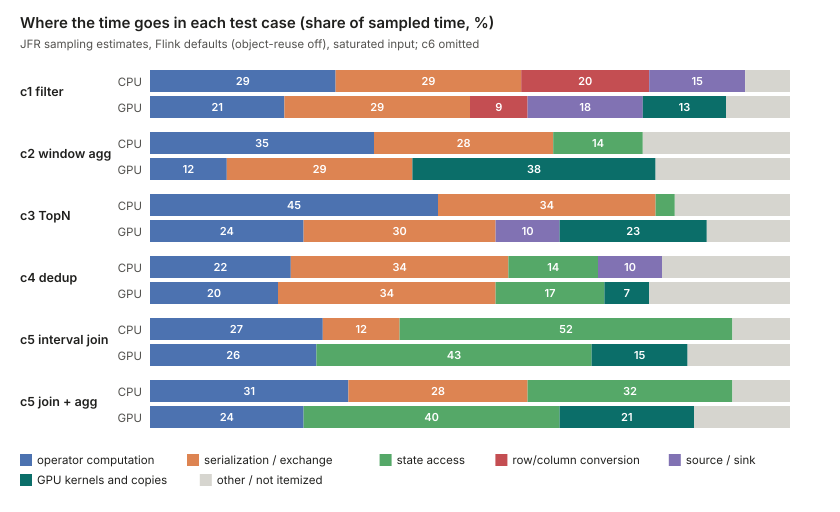
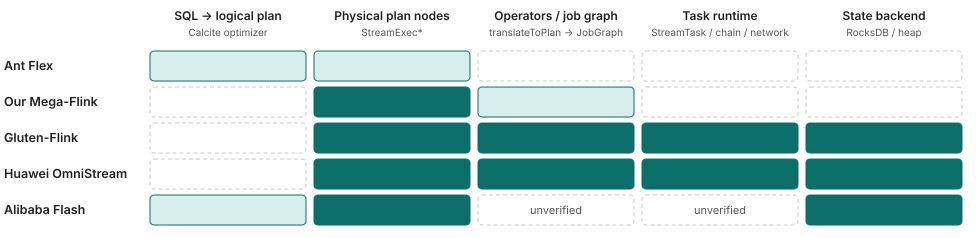

<!--
SPDX-FileCopyrightText: Copyright (c) 2026 NVIDIA CORPORATION & AFFILIATES. All rights reserved.
SPDX-License-Identifier: Apache-2.0
-->
# Feature-Extractor-Plugin: streaming (Flink)

English | [中文](README.zh-CN.md)

The streaming part of Feature-Extractor-Plugin is a small GPU operator library for Flink. You call it explicitly from a job, only for the few steps where a GPU pays off. It does not override Flink's planner classes, and its results are checked against Flink's own CPU output. The operators are extracted from the research plugin [Mega-Flink](https://github.com/cb521/Mega-Flink). **The library (`library/`), its CUDA and JNI layer (`library/native/`), the qualification and profiling tools (`tools/`), example jobs (`examples/`) and the benchmark driver and scripts (`benchmarks/`) are in this directory.** So are the analysis behind the design and the benchmark results. The library covers window aggregation and INNER lookup join. It was checked on one L20 at parallelism 1; see [docs/LIMITS.md](docs/LIMITS.md). The Table/SQL bridge is not started, and the other operators stay in Mega-Flink.

This page explains:

1. [where Flink jobs spend their time](#1-where-flink-jobs-spend-their-time), and how little of it a GPU can remove;
2. [when to use the CPU and when the GPU](#2-when-to-use-cpu-when-to-use-gpu);
3. [what the library contains](#3-components), and [how to build and run it](#33-quick-start);
4. [the six test cases we ran](#4-benchmark-cases-and-links) and what happened;
5. [what is in this directory](#5-what-is-in-this-directory);
6. [how other projects accelerate Flink](#6-related-work-how-other-projects-accelerate-flink).

**Conditions for our numbers**: KuaiRand-27K log (92.9M rows) replayed in event-time order, no Kafka, heap state; one NVIDIA L20; Flink 2.2.1 with the Mega-Flink build; parallelism 1 unless stated; saturated input, 3M records after 300k warm-up, median of 3 rounds; `pipeline.object-reuse=true` on both CPU and GPU; CPU and GPU final tables compared by SHA-256, all matched. Not tested on other GPUs, multiple GPUs, other datasets or a cluster. The benchmark report was rewritten after review; the rewrite has not been independently re-reviewed. Details: [benchmarks/README.md](benchmarks/README.md).

## 1. Where Flink jobs spend their time

Public evidence, usual fixes and our full measurements for each class are in [docs/bottlenecks.md](docs/bottlenecks.md). Each public number covers one company and one scenario. Our measurements, summarized:

| Class | Where the time goes | Our measurement |
|---|---|---|
| Serialization and copying | Kryo/POJO, deep copies between operators | c1 filter, object-reuse off to on: CPU 0.84M to 2.47M rows/s, GPU 1.03M to 2.06M |
| State access | RocksDB serialization, seek, compaction; heap hash lookups | Interval join state 52% (CPU) / 43% (GPU) of sampled time; window aggregate 14% (CPU); dedup 14% / 17% |
| Source, sink, parsing | JSON/Avro/PB decoding, connectors | Source thread 10% to 18% of sampled time; Kafka and real formats not measured |
| Row/column conversion | RowData to columnar and back; on a GPU also H2D/D2H | c1 on GPU: conversion 88% of the timed GPU steps, kernel 5% |
| JVM pipeline ceiling | One source thread, exchange and one sink thread | No-compute probe: CPU 0.856M, GPU 0.851M rows/s; on TopN the GPU was idle over 95% |
| Skew, checkpoint, network, GC | Stability, tail latency, recovery | Not measured |

The time breakdowns are estimates. They come from JFR sampling in an earlier run with Flink defaults (object-reuse off).



Read the figure with the table. On both sides, most time goes to serialization and exchange, state access and row/column conversion. GPU kernels are a small share. So a faster kernel alone rarely speeds up a Flink job.

## 2. When to use CPU, when to use GPU

### 2.1 At a glance

**Good fit**: window aggregation (HOP and TUMBLE) and INNER lookup join against a dimension table, at high traffic with large batches. In our tuned runs the GPU was 25% to 26% faster on window aggregation and 76% faster on lookup join.

**Little or no gain**: filter/project, TopN, keep-last dedup and interval join. The CPU was 11% to 22% faster there, because the cost is serialization, JVM state access and conversion, not computation.

**Expectation**: these are single-GPU results on one dataset, mostly at parallelism 1. Expect a gain only when the step is heavy, measured against an already tuned CPU job.

### 2.2 Why not put everything on the GPU

The GPU replaces only the computation step. Most Flink time goes to serialization and exchange, source replay, state access and JVM-side row/column conversion. In the operators we profiled, the kernel was 3% to 5% of the work. On TopN the GPU was more than 95% idle (kernel about 108 ms in a job of about 3.2 s). For each step, ask whether it is heavy enough to pay for packing, copying and unpacking.

### 2.3 Rule 1: tune the CPU side first

One setting, `pipeline.object-reuse`, flipped the filter result. With defaults, the GPU was 23% faster (1.03M vs 0.83M rows/s). With it on for both sides, the CPU was 20% faster (2.47M vs 2.06M). The CPU gained 2.95x, the GPU 2.0x. For TopN we also raised `table.exec.rank.topn-cache-size` to 100000. Other CPU options were not explored.

### 2.4 Rule 2: results by step (tuned, saturated, parallelism 1)

| Step | CPU | GPU (batch) | Winner | Other parallelism |
|---|---|---|---|---|
| Filter / project | 2.47M/s | 2.06M/s | CPU +20% | not measured |
| HOP window aggregate (two-phase) | 1.48M/s | 1.86M/s | GPU +26% | p2 +26%, p4 +16% |
| TUMBLE window aggregate | 1.61M/s | 2.02M/s | GPU +25% | not measured |
| Per-user TopN (append-only) | 1.36M/s | 1.23M/s | CPU +11% | CPU +38% (p2), +21% (p4) |
| Keep-last dedup | 1.03M/s | 0.85M/s | CPU +22% | not measured |
| Interval join (INNER) | 292k/s | 253k/s | CPU +15% | not measured |
| Interval join + filter / + aggregate | 308k / 293k | 262k / 236k | CPU +17% / +24% | not measured |
| Lookup join (INNER, single BIGINT key) | 1.30M/s | 2.28M/s | GPU +76% | p2 +88%, p4 +20%; 4M-row table +83% |

- **CPU** for filter/project, TopN, dedup and interval join. The cost is serialization, JVM state access and conversion, which the GPU does not remove. At 20k and 100k rows/s both sides keep up. On the filter, latency is about 3 ms on the GPU and under 0.01 ms on the CPU.
- **GPU** for window aggregation and INNER lookup join, at high traffic with large batches. Each record touches several windows or does a lookup. HOP two-phase p50 latency was 36 ms vs 48 ms at saturation and 37 ms vs 63 ms at 100k rows/s. At low and medium rates, lookup join mostly ran the JVM lookup (batches under 1024 rows fall back), so those latencies say nothing about the GPU.
- **Limits**: lookup join was tested only as INNER, with a single BIGINT key and a few BIGINT columns. LEFT cannot run on the GPU in this build. The table had 1,039,412 rows, the GPU limit is 4,194,304 rows, and the full 32M-row table was not tested. Not measured: other key types, heavier expressions, multi-GPU, parallelism above 4, parallelism 2/4 for dedup and interval join, any workload outside KuaiRand. Do not read the table as a general rule.

### 2.5 Rule 3: how to use the GPU

- **Batch (accumulate, then run)**: the only mode our data supports. It won on window aggregation and lookup join at saturation, and needs enough traffic to fill batches.
- **Persistent (resident kernel)**: our data does not support it. On TopN at saturation it reached 0.43M rows/s, against 1.36M on the CPU. On interval join it was worse at every rate (p99 about 200 ms). All figures use the default configuration except the TopN saturation figure.
- **Adaptive (switch by traffic)**: at low and medium rates 0 rows went to the GPU. At saturation it was below batch on TopN and about equal on dedup. We found no case where it beat the better of CPU and batch.

### 2.6 Rule 4: keep consecutive steps on the GPU (fusion)

Fusion keeps data on the GPU between two steps instead of copying it back to the host. For interval join followed by filter or aggregate, with both sides tuned, it gave no throughput gain (join +0.8%, join+filter +1.1%, both within noise; join+aggregate -7%). It lowered median latency only for join+aggregate (6.5% at saturation, 12% at 100k rows/s). JVM join state is the largest cost on both sides. Other operator pairs are unverified.

### 2.7 Checklist before choosing GPU

1. Tune the CPU job first (at least `pipeline.object-reuse`) and measure it.
2. Run the qualification and profiling tools (section 3) to check that the heavy part is the step you plan to move.
3. Move only window aggregation or INNER lookup join of the shape above, or a shape you have measured.
4. Compare CPU and GPU on your data, and compare the final output.

## 3. Components

Status: **In this directory** = the code is here; **Mega-Flink only** = exists in Mega-Flink and was not extracted; **Not started**. Design: [docs/DESIGN.md](docs/DESIGN.md). How far each part was verified: [docs/LIMITS.md](docs/LIMITS.md).

**First version (decided): window aggregation + bounded INNER lookup join. Everything else is optional and included only if a re-measurement shows it wins.**

### 3.1 Components

| Component | What it is | Status |
|---|---|---|
| GPU operator library | Operators called explicitly from a Flink job (DataStream API with builders `GpuWindows` and `GpuJoins`), no planner override | **In this directory** ([library/](library/README.md)): window aggregation (TUMBLE, HOP, one or two phase) and INNER lookup join, 63 unit tests. **Mega-Flink only**: filter, TopN, dedup, interval join and the fused variants |
| Builder API and shape validation | Build-time checks of types, window parameters, key and aggregate combinations; append-only input is enforced at run time | **In this directory** (part of the library) |
| Table/SQL bridge | Table to stream, GPU operator, back to Table | **Not started**; not in the first version (decided) |
| Native layer (CUDA, JNI) | Row/column packing, device memory, the kernels needed | **In this directory** ([library/native/](library/native)): `build.sh`, `selftest.sh` |
| Selection logic | Picks CPU, persistent or batch by traffic; CPU fallback | **Mega-Flink only** (adaptive controllers). The library runs in batch mode; 2.5 showed no adaptive win |
| Qualification and profiling tools | Python, no GPU. Judges whether a job is worth a CPU/GPU comparison; finds hot spots, back pressure, skew. Read-only, via Flink REST or a history archive. Matches SQL node names, so pure DataStream jobs are not identified | **In this directory** ([tools/](tools/README.md), version 0.1.0; Flink 2.2.1). The XGBoost prediction was not taken over |
| Benchmark driver | Replays KuaiRand at several rates, runs CPU/GPU variants, compares tables by SHA-256 | **In this directory** ([benchmarks/](benchmarks/REPRODUCE.md)): `driver/`, `scripts/`, `cases/`, `prepare_stream_data.py`. The GPU side of c1, c3, c4, c5 needs a Mega-Flink build |
| Example jobs | KuaiRand jobs matching c2 and c6 | **In this directory** ([examples/](examples/README.md)): `WindowFeaturesJob`, `LookupAuthorJob` |
| GPU metrics and alerts | Prometheus rules, Grafana dashboard, runbook | **Mega-Flink only**, as static candidates, not deployed; not taken over |

Not planned: the planner override layer, the installer, and operators that did not beat CPU in Mega-Flink's own tests (LEFT/SEMI/ANTI join, standalone Calc, COUNT DISTINCT, SESSION windows, cross join).

### 3.2 Design decisions

Decided ([docs/DESIGN.md](docs/DESIGN.md), section 9): Java package `com.nvidia.fep.flink` (a prefix replacement, JNI symbols included); copyright line NVIDIA, with a conservative NOTICE that names Mega-Flink; first version = window aggregation and bounded INNER lookup join; Flink 2.2.x only; no Table bridge in the first version; XGBoost subcommands dropped and the Calc interpreter left out of the native layer. Still open: operators beyond the first version (window join, group aggregate, over aggregate, the optional candidates). They join only if a re-measurement shows a win.

The operator list came from Mega-Flink's own benchmark claims (for example, TopN and dedup faster than CPU). In our tuned runs the CPU won on those two, and lookup join, which was not on the list, won on the GPU. Workloads and CPU settings differ and have not been reconciled, so the first version follows our own measurements. Known risks: moving from a SQL job to the library changes operator state names, so a savepoint from the SQL job cannot be restored. Some Flink classes the library uses are `@Internal` and may change between minor versions.

### 3.3 Quick start

**Requirements**: Flink 2.2.1 (Maven fetches the jars; the examples start a local mini cluster, so you need no Flink installation), JDK 11 (a JDK, not a JRE: the native build needs `jni.h`), Maven 3, the CUDA Toolkit with `nvcc` (compiling needs no GPU), one NVIDIA GPU to run the GPU path, and Python 3.8 or newer for the tools and data preparation. `$STREAMING` is this directory.

**Build the library** (jar `fep-flink-gpu`; the examples take it from the local Maven repository):

```bash
cd $STREAMING/library
mvn -q install -DskipTests        # or: mvn -q test   (63 unit tests, no GPU)
```

**Build the native libraries** (four `libcudf_flink_*.so` files). `--archs` is a list of CUDA architectures, default `"89 90a"` (89 = L20 and other Ada cards, 90a = Hopper, for example H20; 90a has only been compiled, never run). `CUDA_TOOLKIT_ROOT` is the toolkit that holds `bin/nvcc` (or put `nvcc` on `PATH`). `JNI_INCLUDE_DIR` is the directory with `jni.h` (default: `$JAVA_HOME/include`). `--out` is the output directory.

```bash
CUDA_TOOLKIT_ROOT=$CUDA_HOME JNI_INCLUDE_DIR=$JAVA_HOME/include \
  $STREAMING/library/native/build.sh --archs "89" --out $NATIVE_OUT
$STREAMING/library/native/selftest.sh $NATIVE_OUT     # optional, needs a GPU
```

**Run an example.** The examples replay the KuaiRand log; prepare it with `benchmarks/prepare_stream_data.py` ([benchmarks/REPRODUCE.md](benchmarks/REPRODUCE.md), step 4) and point `KUAIRAND_DIR` at the result. Run the same job on both engines and compare the SHA-256 in the `RESULT` line:

```bash
cd $STREAMING/examples
mvn -q package && mvn -q dependency:build-classpath -Dmdep.outputFile=cp.txt
export KUAIRAND_DIR=$FEP_DATA_DIR              # contains log/*.i64 and video/*.i64
CP="target/*:$(cat cp.txt)"
java -Xmx16g -cp "$CP" com.nvidia.fep.examples.WindowFeaturesJob \
  --engine cpu --window hop --two-phase true --records 3000000 --out $OUT/cpu
LD_LIBRARY_PATH=$CUDA_HOME/lib64 java -Xmx16g -Djava.library.path=$NATIVE_OUT -cp "$CP" \
  com.nvidia.fep.examples.WindowFeaturesJob \
  --engine gpu --window hop --two-phase true --records 3000000 --out $OUT/gpu
```

`LookupAuthorJob` takes the same `--engine`, `--records` and `--out`. All options: [examples/README.md](examples/README.md).

**Run the tools** (Python 3 standard library only; `--output-dir` must not exist yet):

```bash
cd $STREAMING/tools
./fep-flink-tools qualification --snapshot-file fixtures/rest-snapshot.json \
  --explain-file fixtures/explain.txt --output-dir out/demo        # offline, bundled fixture
./fep-flink-tools profiling --rest-url http://JOBMANAGER:8081 --job-id <32-hex-id> --output-dir out/prof   # live job
python3 tests/self_test.py                                        # self-test
```

## 4. Benchmark cases and links

Six common recommendation feature and sample computations, written as Flink SQL on KuaiRand and run on Flink CPU and on GPU (Mega-Flink) on one L20. All GPU numbers below come from Mega-Flink. The library in this directory reproduces c2 and c6: the final tables match the CPU runs and the GPU kernels ran (see [docs/LIMITS.md](docs/LIMITS.md)); its throughput was not measured separately. To rebuild Mega-Flink at the pinned commit with one command and rerun all six cases, see [benchmarks/REPRODUCE.md](benchmarks/REPRODUCE.md) section 7a. Method, dataset, result tables, limitations and reproduction requirements are in [benchmarks/README.md](benchmarks/README.md). The results below are tuned (object-reuse on both sides) saturated throughput. That document also has default-configuration numbers; some conclusions differ (for example c1).

| Case | What it does (scenario) | Result (tuned, saturated) | Link |
| --- | --- | --- | --- |
| c1 Filter / cleaning | Filter on duration, play time, random-exposure flag, etc.; compute watch ratio, duration bucket, interaction count (sample cleaning) | CPU faster: 2.47M vs 2.06M rec/s (CPU +20%); at low/mid rates latency is <0.01 ms on CPU vs about 3 ms on GPU | [c1](benchmarks/group2-cpu-wins.md#c1-filter) |
| c2 Window aggregation | Per user, impressions / clicks / play time over the last 30 min (HOP, 5 min slide) and over 5 min TUMBLE (real-time statistical features) | GPU faster: HOP two-phase 1.86M vs 1.48M (GPU +26%), TUMBLE 2.02M vs 1.61M (GPU +25%); latency also lower | [c2](benchmarks/group1-gpu-wins.md#c2-window) |
| c3 Per-user TopN | Top 10 longest-watched videos per user, ROW_NUMBER (top-K behavior features) | CPU faster: 1.36M vs 1.23M (CPU +11%); at parallelism 2/4 CPU is +38% / +21%. The GPU is mostly idle; the bottleneck is on the JVM side | [c3](benchmarks/group2-cpu-wins.md#c3-topn) |
| c4 Keep-last dedup | Keep the latest row per (user_id, video_id) (sample dedup) | CPU faster: 1.03M vs 0.85M (CPU +22%) | [c4](benchmarks/group2-cpu-wins.md#c4-dedup) |
| c5 Interval Join and fusion | Join impressions with clicks within 30 min; also with a following Filter and a following aggregation, fused on GPU (impression-click attribution) | Throughput favors CPU: join +15%, join-filter +17%, join-agg +24%; with aggregation, GPU p50 latency is about 23% lower. After tuning, fusion gives no throughput gain, only slightly lower latency for join-agg | [c5](benchmarks/group2-cpu-wins.md#c5-join) |
| c6 Lookup Join | Look up a video dimension table per event to fetch author_id, INNER (item-side feature joins) | GPU faster: 2.28M vs 1.30M (GPU +76%); only 1.04M dimension rows were loaded, the full table was not tested; LEFT cannot run on GPU in this build | [c6](benchmarks/group1-gpu-wins.md#c6-lookup) |

To re-run the cases, see [benchmarks/REPRODUCE.md](benchmarks/REPRODUCE.md). The CPU side needs only open-source Flink 2.2.1. **The GPU side of c1, c3, c4 and c5 needs a Mega-Flink build.**

In short: on this data the GPU helps for window aggregation (c2) and dimension lookups (c6). For filtering, TopN, dedup and interval join the CPU is not behind, since the cost is serialization, JVM state access and conversion. These are single-GPU results, mostly at parallelism 1.

## 5. What is in this directory

| Path | Contents |
| --- | --- |
| [README.md](README.md), [README.zh-CN.md](README.zh-CN.md) | this page |
| [docs/bottlenecks.md](docs/bottlenecks.md) | the full bottleneck list with public evidence and our measurements |
| [docs/related-work.md](docs/related-work.md) | how other projects accelerate Flink, one flow diagram each |
| [docs/images/](docs/images) | figures used on these pages |
| [benchmarks/README.md](benchmarks/README.md) | method, summary, limits and reproduction notes |
| [benchmarks/group1-gpu-wins.md](benchmarks/group1-gpu-wins.md) | the two cases where the GPU won (c2, c6): SQL, real plans, evidence, results |
| [benchmarks/group2-cpu-wins.md](benchmarks/group2-cpu-wins.md) | the four cases where the CPU won (c1, c3, c4, c5): SQL, real plans, evidence, results |
| [docs/DESIGN.md](docs/DESIGN.md), [docs/LIMITS.md](docs/LIMITS.md) | design of the library (scope, API, what was extracted, decisions); known limits and what was verified |
| [docs/how-it-works.md](docs/how-it-works.md) | how Mega-Flink runs a GPU operator, and what the library took over |
| [library/](library/README.md), [library/native/](library/native) | the Java library (`GpuWindows`, `GpuJoins`, package `com.nvidia.fep.flink`) with CPU unit tests; CUDA and JNI sources with `build.sh` and `selftest.sh` |
| [tools/](tools/README.md) | `fep-flink-tools`: qualification and profiling |
| [examples/](examples/README.md) | two KuaiRand example jobs, runnable on CPU or GPU |
| [benchmarks/REPRODUCE.md](benchmarks/REPRODUCE.md) | how to re-run the six cases; with `benchmarks/driver/`, `scripts/`, `cases/`, `prepare_stream_data.py`, `data-sha256.txt` |

## 6. Related work: how other projects accelerate Flink

**Mega-Flink and this library.** [Mega-Flink](https://github.com/cb521/Mega-Flink) is our research plugin. It replaces Flink's physical plan nodes, so SQL jobs run on the GPU without code changes, and it covers many more operators. This library is a smaller extract of it: two operators that you call explicitly from DataStream code, with no planner override. The Mega-Flink row below describes the plugin; the "This library" row describes the library. All GPU numbers in section 4 come from Mega-Flink.

We compare five projects that replace part of Flink's execution with a faster engine. Sources are their public code, documentation and blog posts (read November 2026). Their performance numbers use different workloads and baselines, so we do not compare them. Per-project flow diagrams and notes: [docs/related-work.md](docs/related-work.md).

### Three angles for comparing how they hook into Flink

The projects differ on three independent angles: **depth** (how far down Flink's pipeline they replace things), **unit** (how big a piece one "can this run natively?" decision covers) and **timing** (when that decision is made).

| Project | Depth | Unit of each decision | When decided | When something is unsupported |
|---|---|---|---|---|
| Ant Flex | Planning only: expressions (and the conditions of join/correlate nodes) | Expression | Planning | Falls back to Flink, down to single expressions |
| Mega-Flink (our research plugin) | Physical plan nodes; the GPU operator runs inside Flink's own tasks | Node | Planning (at run time it only switches paths inside an operator already chosen) | Per node, back to the CPU node |
| This library (extracted from Mega-Flink) | None in the planner; the job calls two operators itself and they run inside Flink's own tasks | The operator the caller picks (window aggregation or lookup join) | When the job is built | The build fails with an exception; no fallback |
| Gluten-Flink | Nodes, graph translation, task entry, state | Node | Planning | Calc-type nodes fail the job; source/sink fall back |
| StreamFusion | Nodes, its own operators, state in Rust | A block of consecutive columnar nodes | Planning (after Flink's optimizer) | The block falls back to Flink (an early design note says per operator; unverified) |
| Huawei OmniStream | Nodes (description only), job graph, task runtime, network, state | Operator chain (`JobVertex`) | Job-graph generation (native operators are created when the task starts) | Per chain; for SQL jobs one non-forward edge sends the whole job back |
| Alibaba Flash | Execution plan and state (ForStDB); other details unverified | Whole SQL (the blog also mentions operator-level fallback, not reconciled) | Planning | Whole query runs on the Java plan |

Gluten-Flink and OmniStream both decide per node-sized unit, but OmniStream goes much deeper. Flex has the smallest unit and the shallowest depth. Authors explain only a few of their choices: StreamFusion (avoid conversions inside a block; a single native operator can lose to Flink, 0.58x and 0.81x), Alibaba (slow disk state access), Flex (Velox does not support stateful operators yet). We found no statement linking unit, timing and state placement, so we compare positions without explaining them.

### Which stages each project replaces


The columns are the stages of a Flink SQL job. The further right a project reaches, the more of Flink's runtime it takes over.
**None of them uses an official extension point.** In Flink's source, `PlannerFactory`, `ExecNode` and `ExecNodeMetadata` are annotated `@Internal`, and [FLIP-32](https://cwiki.apache.org/confluence/spaces/FLINK/pages/103088143/FLIP-32+Restructure+flink-table+for+future+contributions) only makes the whole planner replaceable, not single operators. We found no proposal for operator-level replacement in the dev mailing list or JIRA. Not checked: whether custom rules can be injected through `CalciteConfig` / `Programs`, and whether a `CompiledPlan` can carry a custom `ExecNode`. Spark, by contrast, has [`SparkSessionExtensions`](https://spark.apache.org/docs/latest/api/scala/org/apache/spark/sql/SparkSessionExtensions.html) (marked experimental), which spark-rapids uses to plug in.

### What we take from this (our reading, not tested)

- State is the main difference. Alibaba, Huawei and Gluten-Flink move state to the native side, Flex leaves stateful operators on Flink, and Mega-Flink keeps state in the JVM. In our interval-join runs state access was 43% to 52% of sampled time, which a GPU kernel cannot take over.
- We found no project that offers accelerated operators as a library the user calls explicitly, and none that runs Flink SQL streaming operators on a GPU. There is no evidence either way on whether the explicit-library approach is better.
