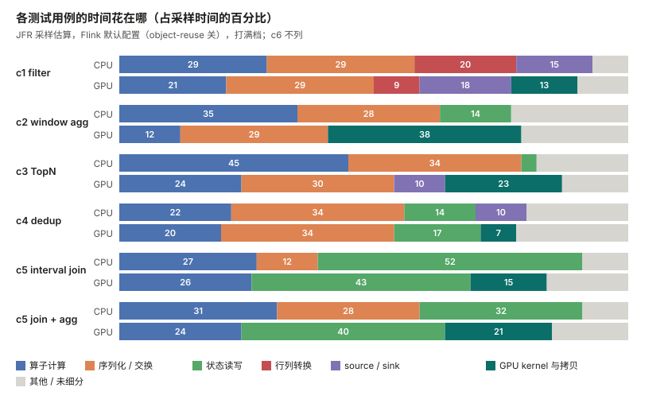

<!--
SPDX-FileCopyrightText: Copyright (c) 2026 NVIDIA CORPORATION & AFFILIATES. All rights reserved.
SPDX-License-Identifier: Apache-2.0
-->
# Feature-Extractor-Plugin：streaming（Flink）

[English](README.md) | 中文

Feature-Extractor-Plugin 的流式部分是一个小的 Flink GPU 算子库。用户在作业里显式调用，只用在 GPU 值得上的少数几步。它不覆盖 Flink 的规划器类，结果会与 Flink 自己的 CPU 输出对拍。算子从研究性插件 [Mega-Flink](https://github.com/cb521/Mega-Flink) 中抽取。**库（`library/`）、它的 CUDA 与 JNI 层（`library/native/`）、qualification 与 profiling 工具（`tools/`）、示例作业（`examples/`）以及基准驱动和脚本（`benchmarks/`）都已在这个目录里。**设计依据的分析和基准测试结果也在这里。库覆盖窗口聚合和 INNER 维表查询，只在一张 L20、并行度 1 下验证过，见 [docs/LIMITS.zh-CN.md](docs/LIMITS.zh-CN.md)。Table/SQL 桥接尚未开始，其他算子仍只在 Mega-Flink 里。

这一页回答：

1. [Flink 作业的时间花在哪](#1-flink-作业的时间花在哪)，GPU 能去掉其中多少；
2. [什么时候用 CPU，什么时候用 GPU](#2-什么时候用-cpu什么时候用-gpu)；
3. [库里有什么](#3-组件组成)，以及[怎么构建和运行](#33-快速上手)；
4. [我们跑的六个测试用例](#4-测试用例与跳转链接)和结果；
5. [这个目录里有什么](#5-这个目录里有什么)；
6. [其他项目怎么加速 Flink](#6-相关工作其他项目是怎么加速-flink-的)。

**我们数字的测量条件**：KuaiRand-27K 日志（9,292 万行）按事件时间回放，没有 Kafka，堆内状态；1 张 NVIDIA L20；Flink 2.2.1，用 Mega-Flink 的构建；除注明外并行度为 1；不限速打满，预热 30 万条后测 300 万条，3 轮取中位数；CPU 和 GPU 两边都开 `pipeline.object-reuse=true`；CPU 与 GPU 的最终结果表按 SHA-256 对拍，全部一致。没有在其他 GPU、多卡、其他数据集或集群上测过。基准报告在评审后改写过，改写后尚未独立复核。详见 [benchmarks/README.zh-CN.md](benchmarks/README.zh-CN.md)。

## 1. Flink 作业的时间花在哪

每类瓶颈的公开证据、常见解法和我们的完整实测见 [docs/bottlenecks.zh-CN.md](docs/bottlenecks.zh-CN.md)。每个公开数字只对应一家公司的一个场景。我们的实测摘要：

| 类别 | 时间花在哪 | 我们的实测 |
|---|---|---|
| 序列化与复制 | Kryo/POJO、算子间深拷贝 | c1 过滤，object-reuse 关到开：CPU 0.84M 到 2.47M 条/秒，GPU 1.03M 到 2.06M |
| 状态读写 | RocksDB 的序列化、seek、compaction；堆内哈希查找 | Interval Join 状态占采样时间 52%（CPU）/ 43%（GPU）；窗口聚合 14%（CPU）；去重 14% / 17% |
| Source、Sink、解析 | JSON/Avro/PB 解码、连接器 | source 线程占采样时间 10% 到 18%；Kafka 和真实格式没测 |
| 行列转换 | RowData 与列格式互转；GPU 上还有 H2D/D2H | c1 在 GPU 上：转换占计时的 GPU 步骤的 88%，kernel 占 5% |
| JVM 流水线上限 | 一个 source 线程、交换、一个 sink 线程 | 无计算探针：CPU 0.856M，GPU 0.851M 条/秒；TopN 一例里 GPU 空闲超过 95% |
| 倾斜、checkpoint、网络、GC | 稳定性、尾延迟、恢复 | 没测 |

时间构成是估算，来自更早一次用 Flink 默认配置（object-reuse 关）跑的 JFR 采样。



图和表一起看。两边的时间大头都是序列化与交换、状态读写、行列转换，GPU kernel 只占很小一块。所以光靠 kernel 更快，很难让 Flink 作业变快。

## 2. 什么时候用 CPU，什么时候用 GPU

### 2.1 一眼看结论

**适合**：窗口聚合（HOP 和 TUMBLE）和对维表的 INNER 查询，条件是流量高、每批足够大。我们调优后的实测里，窗口聚合 GPU 快 25% 到 26%，维表查询 GPU 快 76%。

**几乎没收益**：过滤/投影、TopN、keep-last 去重、Interval Join。这些步骤 CPU 快 11% 到 22%，因为成本在序列化、JVM 状态读写和行列转换，不在计算。

**预期**：这是单卡、一个数据集、主要在并行度 1 下的结果。只有这一步够重才会有收益，且要和已调优的 CPU 作业比。

### 2.2 为什么不是什么都上 GPU

GPU 只替换"计算"这一步。Flink 作业的时间大头在序列化和交换、source 回放、状态读写，以及 JVM 侧的行列转换。我们分析的算子里，GPU kernel 只占 3% 到 5%。TopN 一例里 GPU 超过 95% 的时间空闲（kernel 约 108 ms，整个作业约 3.2 s）。对每一步要问的是：它够不够重，值不值得付出打包、拷贝、解包的代价。

### 2.3 第一条：先把 CPU 侧调好

仅 `pipeline.object-reuse` 一项就翻转了过滤的结论。默认配置下 GPU 快 23%（103 万对 83 万条/秒）。两边都开后 CPU 快 20%（247 万对 206 万）。CPU 提升 2.95 倍，GPU 提升 2.0 倍。TopN 另把 `table.exec.rank.topn-cache-size` 调到 100000。其他 CPU 选项没有试过。

### 2.4 第二条：分步骤的实测结果（调优后、打满、并行度 1）

| 步骤 | CPU | GPU（batch） | 谁赢 | 其他并行度 |
|---|---|---|---|---|
| 过滤 / 投影 | 247 万/秒 | 206 万/秒 | CPU +20% | 未测 |
| HOP 窗口聚合（两阶段） | 148 万/秒 | 186 万/秒 | GPU +26% | 并行度 2 +26%，4 +16% |
| TUMBLE 窗口聚合 | 161 万/秒 | 202 万/秒 | GPU +25% | 未测 |
| 每用户 TopN（append-only） | 136 万/秒 | 123 万/秒 | CPU +11% | CPU +38%（2），+21%（4） |
| keep-last 去重 | 103 万/秒 | 85 万/秒 | CPU +22% | 未测 |
| Interval Join（INNER） | 29.2 万/秒 | 25.3 万/秒 | CPU +15% | 未测 |
| Interval Join 后接过滤 / 聚合 | 30.8 万 / 29.3 万 | 26.2 万 / 23.6 万 | CPU +17% / +24% | 未测 |
| 维表查询（INNER，单 BIGINT key） | 130 万/秒 | 228 万/秒 | GPU +76% | 并行度 2 +88%，4 +20%；400 万行维表 +83% |

- **选 CPU**：过滤/投影、TopN、去重、Interval Join。这些步骤的成本在序列化、JVM 状态读写和行列转换，GPU 换不掉。每秒 2 万、10 万条时两边都跟得上，GPU 多约 3 ms 延迟，CPU 过滤延迟不到 0.01 ms。
- **选 GPU**：窗口聚合和 INNER 维表查询，条件是流量高、每批足够大。每条记录要进多个窗口或做一次查表。HOP 两阶段 p50 延迟打满时 36 ms 对 48 ms，每秒 10 万条时 37 ms 对 63 ms。维表查询在低、中档多半走的是 JVM 查表（每批不足 1024 行会回落），这两档的延迟不能算作 GPU 的结果。
- **边界**：维表查询只测了 INNER，且只有单个 BIGINT key 和少量 BIGINT 列；本构建下 LEFT 无法上 GPU。维表 104.0 万行，GPU 上限是 4,194,304 行，3,204 万行全表没有测。**没测过**：其他 key 类型、更重的表达式、多卡、并行度大于 4、去重和 Interval Join 在并行度 2/4 下的表现、KuaiRand 以外的负载。不要把这张表当成通用规律。

### 2.5 第三条：GPU 怎么用

- **攒批（batch）**：我们的数据只支持这一种。窗口聚合和维表查询在打满时赢；流量要足够大才能攒满批。
- **常驻（persistent）**：我们的数据不支持。TopN 打满时只有 43 万条/秒，CPU 是 136 万；Interval Join 各档都更差（p99 约 200 ms）。这些数字除 TopN 打满一项外都来自默认配置。
- **自适应（adaptive）**：低、中档 0 行上 GPU。打满时 TopN 不如 batch，去重与 batch 相当。没有发现它胜过 CPU 和 batch 中较好者的情形。

### 2.6 第四条：连续几步留在 GPU（融合）

融合让数据在两个 GPU 步骤之间留在 GPU，不搬回主机。Interval Join 后接过滤或聚合，两边调优后融合没有吞吐收益（join +0.8%，join+过滤 +1.1%，均在噪声内；join+聚合 −7%），只有 join+聚合的中位延迟更低（打满低 6.5%，每秒 10 万条时低 12%）。两边最大的成本都是 JVM 里的 Join 状态。其他算子组合**未验证**。

### 2.7 选 GPU 前的检查清单

1. 先把 CPU 作业调好（至少 `pipeline.object-reuse`）并测一次。
2. 跑 qualification 和 profiling 工具（见第 3 节），确认重的部分正是你打算挪走的那一步。
3. 只挪窗口聚合或上述形状的 INNER 维表查询，或你自己测过的形状。
4. 用你的数据做 CPU/GPU 对比，并核对最终输出。

## 3. 组件组成

状态：**已在本目录** = 代码已放进来；**仅在 Mega-Flink** = Mega-Flink 里有，没有抽取；**尚未开始**。设计见 [docs/DESIGN.zh-CN.md](docs/DESIGN.zh-CN.md)，各部分验证到什么程度见 [docs/LIMITS.zh-CN.md](docs/LIMITS.zh-CN.md)。

**第一版（已定）：窗口聚合 + 有界 INNER 维表查询；其余为可选，只有重新测量后确实赢才放进去。**

### 3.1 组件

| 组件 | 说明 | 现状 |
|---|---|---|
| GPU 算子库 | 由用户在 Flink 作业里显式调用的算子（DataStream API 加 builder：`GpuWindows`、`GpuJoins`），不覆盖规划器 | **已在本目录**（[library/](library/README.md)）：窗口聚合（TUMBLE、HOP，一阶段或两阶段）和 INNER 维表查询，63 个单元测试。**仅在 Mega-Flink**：过滤、TopN、去重、Interval Join 及其融合变体 |
| builder API 与形状校验 | 构建时检查类型、窗口参数、key 与聚合的组合；append-only 输入在运行时强制 | **已在本目录**（属于库的一部分） |
| Table/SQL 桥接 | Table 转流、调用 GPU 算子、再转回 | **尚未开始**；不进第一版（已定） |
| 原生层（CUDA、JNI） | 行列打包、显存管理、需要的 kernel | **已在本目录**（[library/native/](library/native)）：`build.sh`、`selftest.sh` |
| 选档逻辑 | 按流量选 CPU、常驻或攒批；回退 CPU | **仅在 Mega-Flink**（自适应控制器）。库只跑攒批模式；2.5 没看到自适应的收益 |
| qualification / profiling 工具 | 纯 Python，不需要 GPU。判断作业是否值得做 CPU/GPU 对照；看热点、反压、倾斜。只读访问 Flink REST 或历史归档。按 SQL 节点名识别算子，纯 DataStream 作业识别不了 | **已在本目录**（[tools/](tools/README.md)，版本 0.1.0；对应 Flink 2.2.1）。XGBoost 预测没有带入 |
| 基准与对拍脚本 | 按多档速率回放 KuaiRand，跑 CPU/GPU 各变体，按 SHA-256 对拍 | **已在本目录**（[benchmarks/](benchmarks/REPRODUCE.zh-CN.md)）：`driver/`、`scripts/`、`cases/`、`prepare_stream_data.py`。c1、c3、c4、c5 的 GPU 侧需要 Mega-Flink 构建 |
| 示例作业 | 与 c2、c6 对应的 KuaiRand 示例 | **已在本目录**（[examples/](examples/README.md)）：`WindowFeaturesJob`、`LookupAuthorJob` |
| GPU 指标与告警模板 | Prometheus 规则、Grafana 面板、运维手册 | **仅在 Mega-Flink**，是静态候选，未部署；没有带入 |

不打算放进库的：规划器覆盖层、安装器，以及在 Mega-Flink 自己的测试里没有赢过 CPU 的算子（LEFT/SEMI/ANTI Join、单独的 Calc、COUNT DISTINCT、SESSION 窗口、Cross Join）。

### 3.2 设计决策

已定（[docs/DESIGN.zh-CN.md](docs/DESIGN.zh-CN.md) 第 9 节）：Java 包名 `com.nvidia.fep.flink`（按前缀替换，JNI 符号同规则）；版权行为 NVIDIA，NOTICE 用保守写法并点明 Mega-Flink；第一版 = 窗口聚合和有界 INNER 维表查询；只做 Flink 2.2.x；第一版不含 Table 桥接；XGBoost 子命令不带入，native 层不含 Calc 解释器。仍未定：第一版之外再加哪些算子（Window Join、GroupAggregate、Over，以及可选候选）。它们只有重新测量确实赢才加。

这份算子清单原本依据 Mega-Flink 自己的基准结论（例如 TopN、去重比 CPU 快）。在我们调优后的测试里这两项是 CPU 赢，不在清单里的维表查询反而 GPU 赢。负载和 CPU 设置不同，尚未对齐，所以第一版以我们自己的实测为准。已知风险：从 SQL 作业改用本库，算子状态名会变，原 SQL 作业的 savepoint 无法恢复；用到的部分 Flink 类标注为 `@Internal`，小版本升级时可能变化。

### 3.3 快速上手

**要求**：Flink 2.2.1（由 Maven 拉取 jar，示例自己启动本地 mini cluster，不用装 Flink）、JDK 11（要 JDK，不能只有 JRE：native 构建要 `jni.h`）、Maven 3、带 `nvcc` 的 CUDA Toolkit（编译不需要 GPU）、跑 GPU 路径要一张 NVIDIA GPU，工具和数据准备要 Python 3.8 或更新。`$STREAMING` 指本目录。

**构建库**（jar 名 `fep-flink-gpu`，示例从本地 Maven 仓库取它）：

```bash
cd $STREAMING/library
mvn -q install -DskipTests        # 或：mvn -q test（63 个单元测试，不需要 GPU）
```

**构建 native 库**（四个 `libcudf_flink_*.so`）。`--archs` 是 CUDA 架构列表，默认 `"89 90a"`（89 = L20 等 Ada 卡，90a = Hopper，如 H20；90a 只编译过，没运行过）。`CUDA_TOOLKIT_ROOT` 是含 `bin/nvcc` 的工具包目录（或把 `nvcc` 放进 `PATH`）。`JNI_INCLUDE_DIR` 是含 `jni.h` 的目录（默认 `$JAVA_HOME/include`）。`--out` 是输出目录。

```bash
CUDA_TOOLKIT_ROOT=$CUDA_HOME JNI_INCLUDE_DIR=$JAVA_HOME/include \
  $STREAMING/library/native/build.sh --archs "89" --out $NATIVE_OUT
$STREAMING/library/native/selftest.sh $NATIVE_OUT     # 可选，需要 GPU
```

**运行示例。**示例回放 KuaiRand 日志；先用 `benchmarks/prepare_stream_data.py` 准备数据（[benchmarks/REPRODUCE.zh-CN.md](benchmarks/REPRODUCE.zh-CN.md) 第 4 步），再把 `KUAIRAND_DIR` 指向结果。同一个作业在两个引擎上各跑一次，比较 `RESULT` 行里的 SHA-256：

```bash
cd $STREAMING/examples
mvn -q package && mvn -q dependency:build-classpath -Dmdep.outputFile=cp.txt
export KUAIRAND_DIR=$FEP_DATA_DIR              # 内含 log/*.i64 和 video/*.i64
CP="target/*:$(cat cp.txt)"
java -Xmx16g -cp "$CP" com.nvidia.fep.examples.WindowFeaturesJob \
  --engine cpu --window hop --two-phase true --records 3000000 --out $OUT/cpu
LD_LIBRARY_PATH=$CUDA_HOME/lib64 java -Xmx16g -Djava.library.path=$NATIVE_OUT -cp "$CP" \
  com.nvidia.fep.examples.WindowFeaturesJob \
  --engine gpu --window hop --two-phase true --records 3000000 --out $OUT/gpu
```

`LookupAuthorJob` 的 `--engine`、`--records`、`--out` 相同。全部选项见 [examples/README.md](examples/README.md)。

**运行工具**（Python 3，只用标准库；`--output-dir` 必须尚不存在）：

```bash
cd $STREAMING/tools
./fep-flink-tools qualification --snapshot-file fixtures/rest-snapshot.json \
  --explain-file fixtures/explain.txt --output-dir out/demo        # 离线，用自带样例
./fep-flink-tools profiling --rest-url http://JOBMANAGER:8081 --job-id <32位十六进制> --output-dir out/prof   # 在线作业
python3 tests/self_test.py                                        # 自测
```

## 4. 测试用例与跳转链接

我们在 NVIDIA L20 单卡上，用 KuaiRand 公开数据集，把六类常见的推荐特征 / 样本计算写成 Flink SQL，分别在 Flink CPU 和 GPU（Mega-Flink）上运行对比。下面所有 GPU 数字都来自 Mega-Flink。本目录里的库复现了 c2 和 c6：最终结果表与 CPU 一致，GPU kernel 确实运行过（见 [docs/LIMITS.zh-CN.md](docs/LIMITS.zh-CN.md)）；它的吞吐没有单独测过。要用一条命令按固定版本重建 Mega-Flink、再跑完六个用例，见 [benchmarks/REPRODUCE.zh-CN.md](benchmarks/REPRODUCE.zh-CN.md) 的 7a 节。测量方法、数据、结果表、已知局限和复现要求见 [benchmarks/README.zh-CN.md](benchmarks/README.zh-CN.md)。下列结论取自调优后（两边都开 object-reuse）打满档的吞吐。该文档也有默认配置下的数字，部分结论不同（例如 c1）。

| 用例 | 做什么（场景） | 结论（调优后，打满档） | 链接 |
| --- | --- | --- | --- |
| c1 过滤清洗 | 按时长、播放、随机曝光等条件过滤，并计算观看比例、时长分桶、互动次数（样本清洗） | CPU 更快：2.47M 对 2.06M 条/秒（CPU +20%）；低/中档延迟 CPU <0.01 ms，GPU 约 3 ms | [c1](benchmarks/group2-cpu-wins.zh-CN.md#c1-filter) |
| c2 窗口聚合 | 每用户最近 30 分钟（5 分钟步长 HOP）及 5 分钟 TUMBLE 的曝光数、点击数、播放时长（实时统计特征） | GPU 更快：HOP 两阶段 1.86M 对 1.48M（GPU +26%），TUMBLE 2.02M 对 1.61M（GPU +25%）；延迟也更低 | [c2](benchmarks/group1-gpu-wins.zh-CN.md#c2-window) |
| c3 每用户 TopN | 每个用户观看时长最长的 10 条，ROW_NUMBER（Top-K 行为特征） | CPU 更快：1.36M 对 1.23M（CPU +11%）；并行度 2/4 下 CPU +38% / +21%。GPU 大部分时间空闲，瓶颈在 JVM 侧 | [c3](benchmarks/group2-cpu-wins.zh-CN.md#c3-topn) |
| c4 keep-last 去重 | 按 (user_id, video_id) 保留最新一条（样本去重） | CPU 更快：1.03M 对 0.85M（CPU +22%） | [c4](benchmarks/group2-cpu-wins.zh-CN.md#c4-dedup) |
| c5 Interval Join 及融合 | 曝光流与点击流在 30 分钟区间内 join；另测后接 Filter、后接聚合，GPU 上多步融合（曝光-点击归因） | 吞吐 CPU 更快：join +15%、join-filter +17%、join-agg +24%；接聚合时 GPU 延迟 p50 低约 23%。融合在调优后没有吞吐收益，仅 join-agg 延迟略低 | [c5](benchmarks/group2-cpu-wins.zh-CN.md#c5-join) |
| c6 Lookup Join | 事件流查视频维表，取 author_id，INNER（物品侧特征拼接） | GPU 更快：2.28M 对 1.30M（GPU +76%）；维表只装了 104 万行，未测全量；LEFT 在本构建不能上 GPU | [c6](benchmarks/group1-gpu-wins.zh-CN.md#c6-lookup) |

复现这些用例见 [benchmarks/REPRODUCE.zh-CN.md](benchmarks/REPRODUCE.zh-CN.md)。CPU 侧只需要开源 Flink 2.2.1。**c1、c3、c4、c5 的 GPU 侧需要 Mega-Flink 构建。**

一句话归纳：本次数据下，GPU 在窗口聚合（c2）和维表查询（c6）上有收益。过滤、TopN、去重、Interval Join 上 CPU 不输，因为成本在序列化、JVM 状态读写和行列转换。这是单卡、并行度主要为 1 的结果。

## 5. 这个目录里有什么

| 路径 | 内容 |
| --- | --- |
| [README.md](README.md)、[README.zh-CN.md](README.zh-CN.md) | 本页 |
| [docs/bottlenecks.zh-CN.md](docs/bottlenecks.zh-CN.md) | 完整的瓶颈清单，含公开证据和我们的实测 |
| [docs/related-work.zh-CN.md](docs/related-work.zh-CN.md) | 其他项目怎么加速 Flink，每个一张流程图 |
| [docs/images/](docs/images) | 这些页面用到的图 |
| [benchmarks/README.zh-CN.md](benchmarks/README.zh-CN.md) | 方法、汇总、局限和复现说明 |
| [benchmarks/group1-gpu-wins.zh-CN.md](benchmarks/group1-gpu-wins.zh-CN.md) | GPU 赢的两个用例（c2、c6）：SQL、真实计划、证据、结果 |
| [benchmarks/group2-cpu-wins.zh-CN.md](benchmarks/group2-cpu-wins.zh-CN.md) | CPU 赢的四个用例（c1、c3、c4、c5）：SQL、真实计划、证据、结果 |
| [docs/DESIGN.zh-CN.md](docs/DESIGN.zh-CN.md)、[docs/LIMITS.zh-CN.md](docs/LIMITS.zh-CN.md) | 库的设计（范围、API、抽取了什么、决策）；已知局限和验证范围 |
| [docs/how-it-works.zh-CN.md](docs/how-it-works.zh-CN.md) | Mega-Flink 怎么运行 GPU 算子，以及库带来了什么 |
| [library/](library/README.md)、[library/native/](library/native) | Java 库（`GpuWindows`、`GpuJoins`，包 `com.nvidia.fep.flink`）及 CPU 单元测试；CUDA 与 JNI 源码，含 `build.sh`、`selftest.sh` |
| [tools/](tools/README.md) | `fep-flink-tools`：qualification 与 profiling |
| [examples/](examples/README.md) | 两个 KuaiRand 示例作业，可在 CPU 或 GPU 上跑 |
| [benchmarks/REPRODUCE.zh-CN.md](benchmarks/REPRODUCE.zh-CN.md) | 六个用例的复现方法；另有 `benchmarks/driver/`、`scripts/`、`cases/`、`prepare_stream_data.py`、`data-sha256.txt` |

## 6. 相关工作：其他项目是怎么加速 Flink 的

**Mega-Flink 和本库。** [Mega-Flink](https://github.com/cb521/Mega-Flink) 是我们的研究插件：它替换 Flink 的物理计划节点，SQL 作业不改代码就能跑在 GPU 上，覆盖的算子也多得多。本库是从它抽出的精简版：两个由用户在 DataStream 代码里显式调用的算子，不覆盖规划器。下表里 Mega-Flink 一行描述的是插件，“本库”一行描述的是这个库。第 4 节里所有 GPU 数字都来自 Mega-Flink。

我们比较五个把 Flink 的一部分执行换成更快引擎的项目，资料来自它们公开的代码、文档和博客（读于 2026 年 11 月）。各家性能数字所用的工作负载和基线不同，这里不做比较。逐个项目的流程图和说明见 [docs/related-work.zh-CN.md](docs/related-work.zh-CN.md)。

### 从三个角度比较"怎么接入 Flink"

这五个项目在三个互相独立的角度上不同：**深度**（沿着 Flink 的流程一路换到哪一段）、**单位**（一次判断"能不能用原生"看多大一块）、**时机**（什么时候做这个判断）。

| 项目 | 深度 | 判断单位 | 决定时机 | 不支持时 |
|---|---|---|---|---|
| 蚂蚁 Flex | 只在规划阶段：表达式（以及 Join / Correlate 条件里的表达式） | 表达式 | 规划时 | 退回 Flink，细到单个表达式 |
| Mega-Flink（我们的研究插件） | 物理计划节点；GPU 算子在 Flink 自己的任务里运行 | 节点 | 规划时（运行时只在已选好的算子内部切换路径） | 按节点退回 CPU 节点 |
| 本库（从 Mega-Flink 抽出） | 规划器里没有改动；作业自己调用两个算子，它们在 Flink 自己的任务里运行 | 调用者选的算子（窗口聚合或维表查询） | 构建作业时 | 构建失败并抛异常，不回退 |
| Gluten-Flink | 节点、作业图翻译、任务入口、状态 | 节点 | 规划时 | 计算类节点让作业失败；数据源/输出退回 |
| StreamFusion | 节点、自己的算子、状态在 Rust | 一连串列式节点组成的一块 | 规划时（Flink 优化之后） | 整块退回 Flink（早期设计笔记写的是逐算子，未核实） |
| 华为 OmniStream | 节点（只写说明）、作业图、任务运行时、网络、状态 | 算子链（`JobVertex`） | 生成作业图时（任务启动时才创建原生算子） | 按算子链；SQL 作业只要有一条边不是直连，整个作业退回 |
| 阿里 Flash | 执行计划和状态（ForStDB），其余细节未核实 | 整条 SQL（博客另一处提到算子级回退，没有统一） | 规划时 | 整条查询走 Java 计划 |

Gluten-Flink 和 OmniStream 的判断单位都是节点，但 OmniStream 换得深得多；Flex 单位最小，深度也最浅。作者只对少数选择写过理由：StreamFusion（避免块内转换；单独换一个原生算子可能比 Flink 慢，0.58 倍和 0.81 倍）、阿里（状态落盘太慢）、Flex（Velox 暂时不支持有状态算子）。我们没有找到任何把单位、时机和状态位置联系起来的说法，所以只比较各家的位置，不解释原因。

### 各项目替换了哪几段


列是一个 Flink SQL 作业依次经过的阶段。越往右，项目接管的 Flink 自身运行时越多。
**没有一家用官方扩展点。** Flink 源码里 `PlannerFactory`、`ExecNode`、`ExecNodeMetadata` 都标着 `@Internal`，[FLIP-32](https://cwiki.apache.org/confluence/spaces/FLINK/pages/103088143/FLIP-32+Restructure+flink-table+for+future+contributions) 只是让整个规划器可以替换，不是替换单个算子。我们在 dev 邮件列表和 JIRA 里没找到算子级替换的提案。没查的：能否通过 `CalciteConfig` / `Programs` 注入自定义规则，以及 `CompiledPlan` 能否带自定义 `ExecNode`。作为对照，Spark 有 [`SparkSessionExtensions`](https://spark.apache.org/docs/latest/api/scala/org/apache/spark/sql/SparkSessionExtensions.html)（标着实验性），spark-rapids 就是靠它接入的。

### 我们从中得到的（我们的判断，未验证）

- 状态是最主要的差别。阿里、华为、Gluten-Flink 把状态搬到原生侧，Flex 不碰有状态算子，Mega-Flink 把状态留在 JVM。我们的 Interval Join 实测里，状态读写占采样时间的 43% 到 52%，GPU kernel 接管不了这部分。
- 我们没找到把加速算子做成用户显式调用的库的项目，也没找到别的用 GPU 跑 Flink SQL 流式算子的项目。显式调用的库是否更好，目前没有证据支持任何一方。
