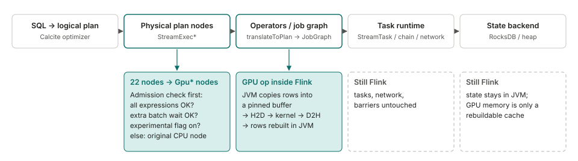
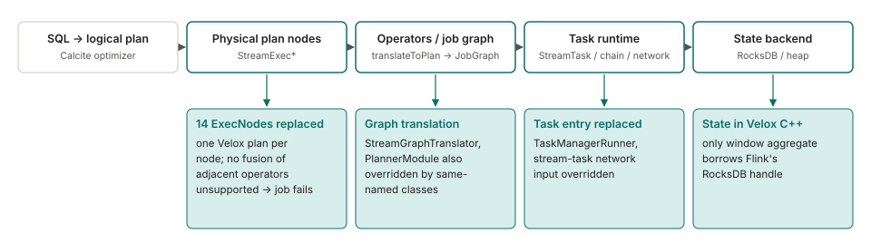
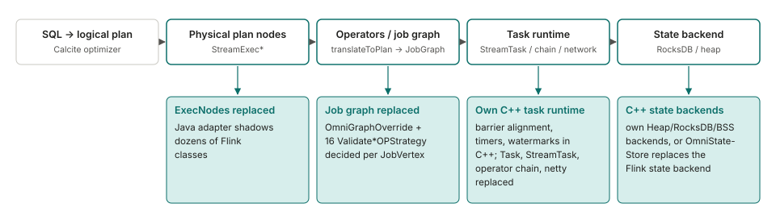
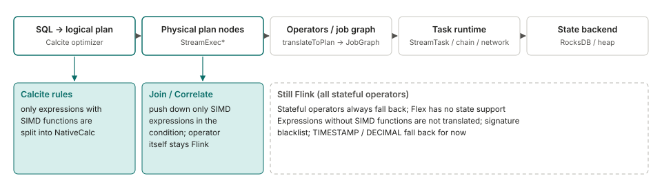
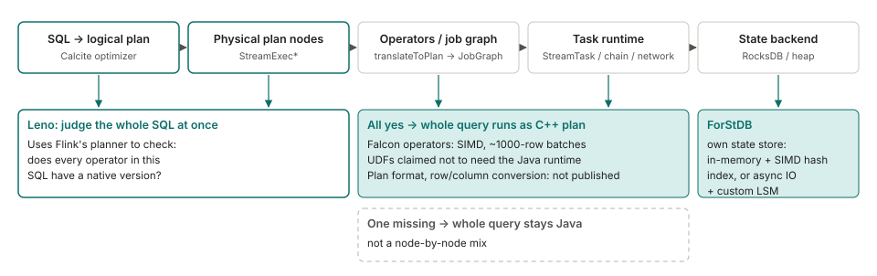

<!--
SPDX-FileCopyrightText: Copyright (c) 2026 NVIDIA CORPORATION & AFFILIATES. All rights reserved.
SPDX-License-Identifier: Apache-2.0
-->
# Per-project notes: how other projects accelerate Flink

English | [中文](related-work.zh-CN.md)

Details and flow diagrams behind section 6 of the [README](../README.md). Sources are public code, documentation and blog posts, read in November 2026. We mark details we could not confirm as **unverified**.

## Mega-Flink (GPU)

- It falls back to the original CPU node, one node at a time. The default mode is `cpu-row`; `gpu-native` must be set explicitly.
- The JVM copies rows into a pinned buffer, then runs H2D, kernel and D2H, and rebuilds rows in the JVM. Options that cut conversions (fusion, host-pack) are mostly off by default. State stays in Flink and is the source of truth for checkpoints. GPU memory is a rebuildable cache.
- Apache-2.0; Flink 2.2.1 only; the installer patches the planner jar in `flink-table-planner-loader`; a research plugin on H20. Source: [Mega-Flink](https://github.com/cb521/Mega-Flink), docs and code.

## Gluten-Flink (CPU, Velox)

- Calc, aggregate and rank nodes with an unsupported function or shape raise an exception at planning, and the job fails. Source/Sink nodes with no matching factory fall back to Flink's original transformation. SEMI/ANTI joins and mini-batch cases keep Flink's operators.
- No conversion between adjacent native operators. On the Java input path, each record becomes its own one-row vector, with no batching (checked in code). State is on the native side. Only two window-aggregate nodes pass RocksDB handles to native code, and the native snapshot at checkpoint is discarded. Tests only check that a job runs; there is no checkpoint-restore test. Open issue: memory-pool leak with RocksDB (#11791).
- Apache-2.0; experimental; Flink 1.19.3 only. Source: [apache/gluten, `gluten-flink`](https://github.com/apache/gluten/tree/main/gluten-flink) code, README and issues. The README reports Nexmark q0 at 161 s versus 462 s for Flink. A community comment reports the opposite (8 min versus 4 min). Neither states full test conditions.

## Huawei OmniStream (CPU, Kunpeng)

- Decided per operator chain (`JobVertex`) when the job graph is generated. For SQL jobs, one non-forward edge sends the whole job back; DataStream jobs are exempt. The flag is a JobManager static that is only set to false, so in a session cluster it can affect later jobs.
- Native tasks pass `VectorBatch` pointers (no serialization on the same TaskManager). Java to native copies each row, and a batch closes at 1000 rows or 1 s. Native to Java allocates a heap row per record, the most expensive point.
- State: its own C++ backends, or OmniStateStore, a separate state backend that replaces Flink's. MulanPSL-2.0 (Java adapter: Apache-2.0); Flink 1.16.3; aarch64 Kunpeng with openEuler only; Join supports Inner only. Source: [OmniStream](https://gitcode.com/openeuler/OmniStream) and its documentation.

## Ant Group Flex (CPU, Velox)

- Falls back per expression and per node. It is Arrow-based. Conversion cost was close to 11%, and 6.68% after converting only the columns the expressions use (one kind of job with many pass-through long fields).
- Stateful operators are not supported yet and fall back to Flink. The stated reason is that Velox lacks stateful operators and retraction messages. They are on the roadmap, so this is a current limit, not a design choice.
- No public code. Reported for production: among jobs suited to vectorization, average +75%, best 14x. Source: a conference talk (FFA 2024) as reproduced on [CSDN](https://blog.csdn.net/DB_GPT/article/details/144718528) and [Zhihu](https://zhuanlan.zhihu.com/p/1916129445640648620). Other figures on third-party summary pages (number of jobs, cores saved) could not be traced to an original source, so we omit them.

## Alibaba Flash (CPU, commercial)

- Judged for the whole SQL: if any operator has no native version, the whole query runs on the Java plan. The blog also mentions operator-level fallback and does not reconcile the two.
- Its own state store, ForStDB. The stated reason: spilling state to disk is hundreds to thousands of times slower than memory. No job-level numbers.
- Closed commercial product. The open-source [ForSt](https://github.com/ververica/ForSt) backend in Flink 2.0 is a separate project. The format of the C++ plan and DataStream support are **unverified**. Source: [Alibaba Cloud blog](https://www.alibabacloud.com/blog/flash-a-next-gen-vectorized-stream-processing-engine-compatible-with-apache-flink_602088).

## Not drawn

- **ByteDance Bolt**: the Flink part is not open source yet (see the [discussion](https://github.com/bytedance/bolt/discussions/20)). Two designs are described; which one is implemented is **unverified**. **Ververica VERA-X**: closed. The [announcement](https://www.ververica.com/blog/vera-x-introducing-the-first-native-vectorized-apache-flink-engine) does not describe how it hooks in.
- No other project running Flink SQL streaming operators on a GPU was found. Flink's own GPU work is at the resource and inference level (for example [FLIP-592](https://cwiki.apache.org/confluence/display/FLINK/FLIP-592%3A+First-Class+Accelerator+Resource+Support)).

## What we take from this (our reading, not tested)

- State separates the projects. Alibaba, Huawei and Gluten-Flink move state to the native side, Flex leaves stateful operators alone, and Mega-Flink keeps state in the JVM. In our measurements, state reads and writes took 43% to 52% of the time in an interval join, and a GPU kernel cannot take that over.
- Flex replaces only expressions and leaves stateful operators on Flink, the narrowest approach here. We did not find its authors describing this as a risk trade-off. We found no project that exposes accelerated operators as a library the user calls explicitly, instead of replacing Flink internals. Whether that is better has no evidence either way.
- **Limits of this comparison**: we read StreamFusion only at summary level, the Ant talk only through reproductions, Huawei's repository docs only (the documentation site was not reachable), and Flash and VERA-X only as summaries. We did not build or run any of these projects. For Mega-Flink, we diffed the 22 replaced `StreamExec*` classes against Flink 2.2.1. The changes are mostly additions, and most classes change fewer than 70 original lines. We did not analyse the diff for semantics.
