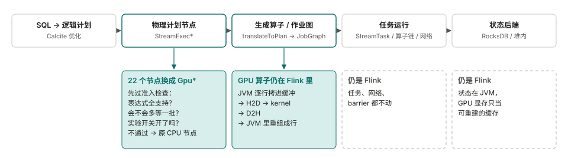
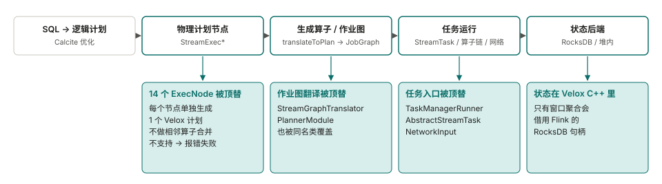
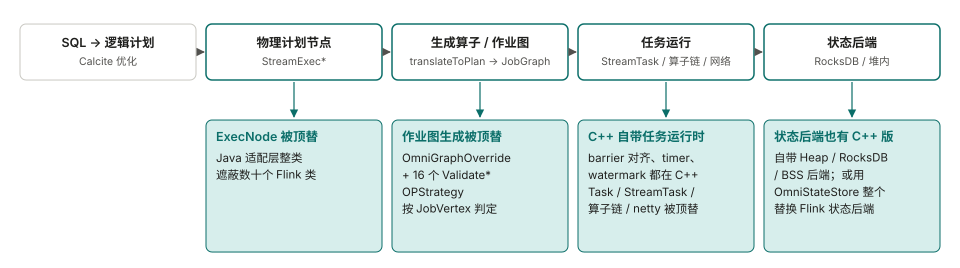
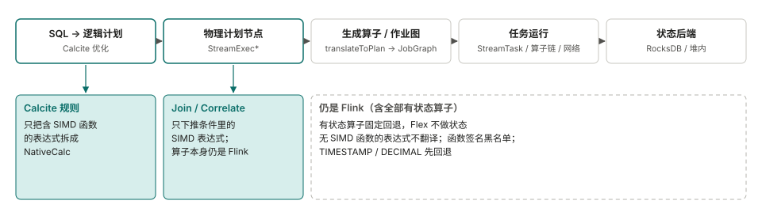
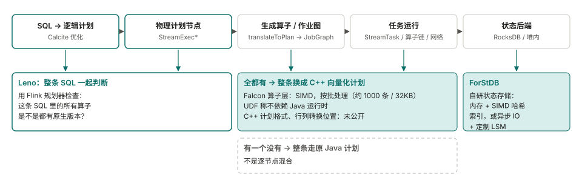

<!--
SPDX-FileCopyrightText: Copyright (c) 2026 NVIDIA CORPORATION & AFFILIATES. All rights reserved.
SPDX-License-Identifier: Apache-2.0
-->
# 逐个项目的说明：其他项目是怎么加速 Flink 的

[English](related-work.md) | 中文

这是 [README](../README.zh-CN.md) 第 6 节背后的细节和流程图。资料来自公开的代码、文档和博客，读于 2026 年 11 月。没能确认的地方，我们标成**未核实**。

## Mega-Flink（GPU）

- 按节点退回原来的 CPU 节点。默认模式是 `cpu-row`，要显式设成 `gpu-native`。
- JVM 把行拷进 pinned 缓冲，再依次做 H2D、kernel、D2H，最后在 JVM 里重组成行。能减少转换的选项（融合、host-pack）多数默认关闭。状态留在 Flink，checkpoint 以它为准。GPU 显存只是可重建的缓存。
- Apache-2.0；只认 Flink 2.2.1；安装器给嵌在 `flink-table-planner-loader` 里的 planner jar 打补丁；定位是 H20 上的研究插件。来源：[Mega-Flink](https://github.com/cb521/Mega-Flink) 的文档和代码。

## Gluten-Flink（CPU，Velox）

- Calc、聚合、排名节点遇到不支持的函数或形态，规划阶段直接抛异常，作业失败。数据源和输出节点找不到对应实现时，退回 Flink 原来的做法。半连接、反连接和开了 mini-batch 的情况仍用 Flink 原算子。
- 相邻原生算子之间没有转换。Java 输入这条路径上，每条记录成为一个单行向量，不攒批（已在代码里核实）。状态在原生侧。只有两个窗口聚合节点把 RocksDB 句柄传给原生，checkpoint 时原生返回的快照被丢弃。测试只检查作业能跑完，没有 checkpoint 恢复的测试。未解决的问题包括用 RocksDB 时内存池泄漏（#11791）。
- Apache-2.0；实验性；只支持 Flink 1.19.3。来源：[apache/gluten 的 `gluten-flink`](https://github.com/apache/gluten/tree/main/gluten-flink) 代码、README 和 issue。README 报告 Nexmark q0 为 161 秒，对 Flink 的 462 秒。社区有一条评论说 q0 的结果相反（8 分钟对 4 分钟）。两边都没给全测试条件。

## 华为 OmniStream（CPU，鲲鹏）

- 按一条算子链（`JobVertex`）判定，在生成作业图时静态决定。SQL 作业只要有一条边不是 forward，整个作业回退；DataStream 作业不受限。这个开关是 JobManager 里的静态变量，只会被置为 false，所以在 session 集群里会影响后面的作业。
- 原生任务之间传 `VectorBatch` 指针（同一个 TaskManager 内不序列化）。Java 到原生：每行拷贝一次，攒满 1000 行或 1 秒成一批。原生到 Java：每条记录在堆上分配一行，是最贵的转换点。
- 状态：自带的 C++ 后端，或 OmniStateStore（一个独立的状态后端，替换 Flink 的）。木兰 PSL-2.0（Java 适配层是 Apache-2.0）；Flink 1.16.3；只能跑在鲲鹏 aarch64 + openEuler；Join 只支持 Inner。来源：[OmniStream](https://gitcode.com/openeuler/OmniStream) 及其文档。

## 蚂蚁 Flex（CPU，Velox）

- 按表达式和节点退回。基于 Arrow。转换开销近 11%，只转换表达式用到的列之后降到 6.68%（针对含大量长字段透传的一类作业）。
- 有状态算子暂不支持，退回 Flink。演讲给的原因是 Velox 暂不支持有状态算子和回撤消息。路线图里要做，所以这是目前的限制，不是有意的设计取舍。
- 没有公开代码。线上数字：适合向量化的作业平均 +75%，最好 14 倍。来源：FFA 2024 的演讲，经 [CSDN](https://blog.csdn.net/DB_GPT/article/details/144718528) 和 [知乎](https://zhuanlan.zhihu.com/p/1916129445640648620) 转载整理。第三方摘要页上引用的其他数字（作业数、省的核数）找不到原始出处，所以不采用。

## 阿里 Flash（CPU，商业版）

- 按整条 SQL 判断：只要有一个算子没有原生版本，整条查询都走 Java 计划。博客另一处还提到算子级回退，两种说法没有统一。
- 自研状态存储 ForStDB。给的理由：状态落到磁盘比内存慢成百上千倍。没有作业级数字。
- 闭源商业产品。Flink 2.0 里开源的 [ForSt](https://github.com/ververica/ForSt) 状态后端是另一个项目。C++ 计划的格式、是否支持 DataStream：**未核实**。来源：[阿里云博客](https://www.alibabacloud.com/blog/flash-a-next-gen-vectorized-stream-processing-engine-compatible-with-apache-flink_602088)。

## 没画的

- **字节 Bolt**：Flink 部分还没开源（见[讨论帖](https://github.com/bytedance/bolt/discussions/20)）。描述了两种设计，实际实现的是哪种：**未核实**。**Ververica VERA-X**：闭源。[发布博客](https://www.ververica.com/blog/vera-x-introducing-the-first-native-vectorized-apache-flink-engine)没说怎么接入。
- 没找到其他用 GPU 跑 Flink SQL 流式算子的项目。Flink 自己和 GPU 相关的工作都在资源和推理层（例如 [FLIP-592](https://cwiki.apache.org/confluence/display/FLINK/FLIP-592%3A+First-Class+Accelerator+Resource+Support)）。

## 我们从中得到的（我们的判断，未验证）

- 状态把几个项目分开了。阿里、华为、Gluten-Flink 把状态搬到原生侧，Flex 不碰有状态算子，Mega-Flink 把状态留在 JVM。我们自己的测量里，双流区间关联中状态读写占 43% 到 52% 的时间，GPU kernel 接管不了这部分。
- Flex 只换表达式，有状态算子留给 Flink，是这几种做法里最窄的。我们没有找到作者把它说成是风险取舍。我们也没找到哪个项目把加速算子做成让用户显式调用的库，而不是替换 Flink 内部。这样做是否更好，目前两边都没有证据。
- **这份比较的局限**：StreamFusion 只读到摘要；蚂蚁的演讲读的是转载，不是原文；华为的文档网站打不开，只读了仓库自带文档；Flash 和 VERA-X 读的是摘要。我们没有编译或运行过这些项目。对 Mega-Flink，我们把被替换的 22 个 `StreamExec*` 类和 Flink 2.2.1 逐行对比过：改动以新增为主，多数类改动的原有代码少于 70 行。这个对比没有做语义分析。
