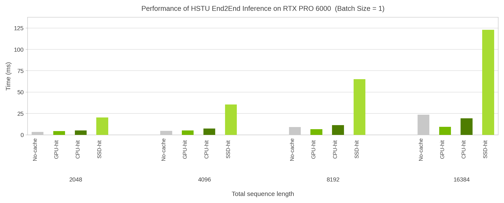

# HSTU inference benchmark with FlexKV cache

We provide benchmarks for HSTU inference with a FlexKV-backed KV cache, covering GPU-hit, CPU(Host)-hit, (local)SSD-hit, and a no-cache recompute baseline on the same request shape.

## How to run the benchmark

```bash
~$ cd recsys-examples/examples/hstu
~$ export PYTHONPATH=${PYTHONPATH}:$(realpath ../)

# FlexKV cache-tier hits (default: gpu_hit,cpu_hit,ssd_hit). CUDA Graph is on.
~$ python3 ./inference/benchmark/inference_benchmark_flexkv.py \
    --history-len 1024 --append-history-len 0 --only-onboard \
    --warmup-iters 100 --timed-iters 50

# GPU-hit and CPU-hit only (CPU-only FlexKV, no SSD config)
~$ python3 ./inference/benchmark/inference_benchmark_flexkv.py \
    --scenarios gpu_hit,cpu_hit \
    --history-len 1024 --append-history-len 0 --only-onboard \
    --warmup-iters 100 --timed-iters 50

# No-cache baseline (recompute; does not start FlexKV)
~$ python3 ./inference/benchmark/inference_benchmark_flexkv.py \
    --disable-kvcache \
    --history-len 1024 --append-history-len 0 --only-onboard \
    --warmup-iters 100 --timed-iters 50
```

- `--disable-kvcache`: run the no-cache recompute baseline.
- `--scenarios`: comma-separated cache-tier paths. Supported values are `gpu_hit`, `cpu_hit`, and `ssd_hit`. Default is `gpu_hit,cpu_hit,ssd_hit`.
- `--history-len`: cached or recomputed prefix length per feature (action and item each). Default is 1024.
- `--append-history-len`: extra tokens appended on the timed request after the warmed prefix. Default is 1024. These new tokens are written into the GPU KV cache and then offloaded to Host/SSD, so this flag is used to measure the follow-up offload path. Set it to 0 (or pass `--only-onboard`) when you only want to time prefix reuse.
- `--only-onboard`: time the warmed prefix only (`history-len`). Without this flag, the timed sequence length is `history-len + append-history-len`.
- `--flexkv-config-path`: FlexKV tier config file.

For SSD-hit, set `ssd_cache_dir` in `[flexkv_ssd.yml](../../../corelib/recsys_kvcache_manager/configs/flexkv_ssd.yml)` to a writable local SSD path, then:

```bash
~$ python3 ./inference/benchmark/inference_benchmark_flexkv.py \
    --scenarios ssd_hit \
    --history-len 1024 --append-history-len 0 --only-onboard \
    --warmup-iters 100 --timed-iters 50 \
    --flexkv-config-path ../../corelib/recsys_kvcache_manager/configs/flexkv_ssd.yml
```


## Benchmark results

Here we present the benchmark results of HSTU inference with FlexKV cache on a single RTX PRO 6000 Blackwell GPU.

HSTU Setup for benchmark:


| Parameter                   | Value |
| --------------------------- | ----- |
| Number of HSTU layers       | 8     |
| Hidden Dim Size             | 1024  |
| Number of Heads             | 4     |
| Head Dim Size               | 256   |
| Max batch size              | 16    |
| Max Per Sequence Length     | 16384 |
| Per Sequence Targets Number | 256   |
| Data type                   | BF16  |
| CUDA Graph                  | on    |


### 1. End-to-end inference performance

GPU-hit is the latency floor once the prefix is long enough. Versus the no-cache baseline we see **1.4x ~ 2.5x** on GPU-hit as total history grows from 8K to 16K. CPU-hit is **1.2x** at 16K. SSD-hit is 100% local-SSD restore (DISK2H then H2D) and is transfer-dominated.

* **Performance Results on RTX PRO 6000 (batch size = 1):**



| Total sequence length | No-cache (ms) | GPU-hit (ms) | CPU-hit (ms) | SSD-hit (ms) |
| --------------------- | ------------- | ------------ | ------------ | ------------ |
| 2048                  | 3.29          | 4.35         | 5.18         | 20.44        |
| 4096                  | 4.67          | 5.18         | 7.41         | 35.49        |
| 8192                  | 9.22          | 6.50         | 11.41        | 65.22        |
| 16384                 | 23.47         | 9.36         | 19.43        | 122.98       |

Note:

1. The baseline (`No-cache`) is `forward_nokvcache` (`--disable-kvcache`), without FlexKV and without KV-cache reuse.
2. The end-to-end latency includes the embedding part, which utilizes both native `EmbeddingCollection` from TorchRec and `DynamicEmbedding`.
3. `--history-len` is the per-feature prefix reused by `gpu_hit` / `cpu_hit` / `ssd_hit`, or fully recomputed by the no-cache baseline. Attention KV length is `2 * history-len` (action + item).
4. In the test cases with KV cache enabled, onboarding of the cached prefix is within time measurement.
5. At short history, no-cache can beat GPU-hit because the timed path includes KV lookup/onboard. At long history, GPU-hit is clearly faster.

