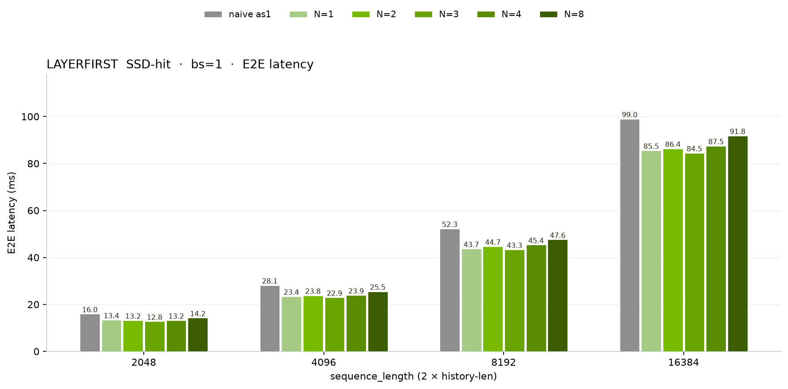
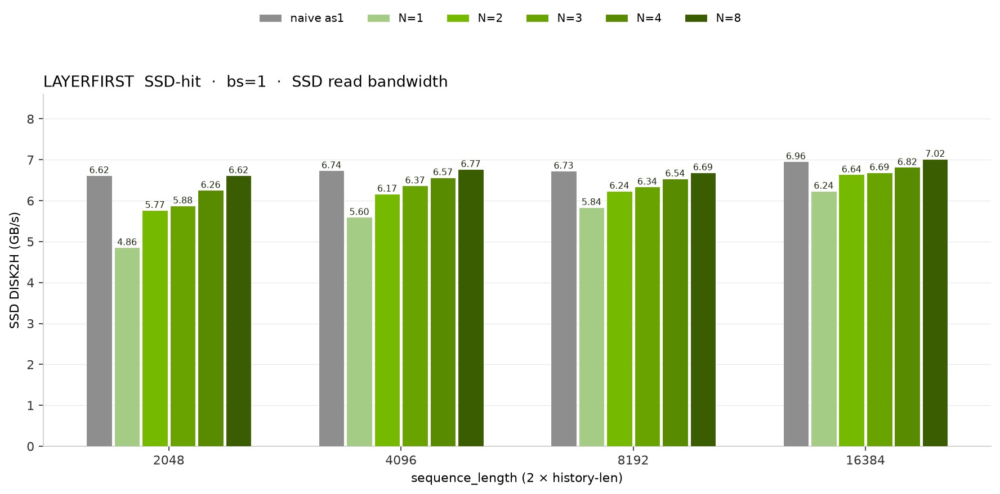

# HSTU inference benchmark with FlexKV cache

We provide benchmarks for HSTU inference with a FlexKV-backed KV cache, covering GPU-hit, CPU(Host)-hit, (local)SSD-hit, and a no-cache recompute baseline on the same request shape.

## How to run the benchmark

```bash
~$ cd recsys-examples/examples/hstu
~$ export PYTHONPATH=${PYTHONPATH}:$(realpath ../)

# FlexKV cache-tier hits (default: gpu_hit,cpu_hit,ssd_hit). CUDA Graph is on.
~$ python3 ./inference/benchmark/inference_benchmark_flexkv.py \
    --history-len 1024 --append-history-len 0 --only-onboard \
    --warmup-iters 100 --timed-iters 50

# GPU-hit and CPU-hit only (CPU-only FlexKV, no SSD config)
~$ python3 ./inference/benchmark/inference_benchmark_flexkv.py \
    --scenarios gpu_hit,cpu_hit \
    --history-len 1024 --append-history-len 0 --only-onboard \
    --warmup-iters 100 --timed-iters 50

# No-cache baseline (recompute; does not start FlexKV)
~$ python3 ./inference/benchmark/inference_benchmark_flexkv.py \
    --scenarios no_cache \
    --history-len 1024 --append-history-len 0 --only-onboard \
    --warmup-iters 100 --timed-iters 50
```

- `--scenarios`: comma-separated paths. Supported values are `gpu_hit`, `cpu_hit`, `ssd_hit`, and `no_cache`. Default is `gpu_hit,cpu_hit,ssd_hit`.
- `--layerwise`: overlap SSD→CPU DISK2H with CPU→GPU H2D, and start HSTU on each layer once that layer is on GPU. Off: one full DISK2H into CPU, then one full H2D, no overlap.
- `--layer-granularity N`: how many original layers each DISK2H writes into CPU. Only applies with `--layerwise`. Unset defaults to 1. `--layer-granularity 8` matches the 8 HSTU layers, so the whole KV is read into CPU in one DISK2H; the only overlap left is CPU→GPU H2D with HSTU.
- `--history-len`: cached or recomputed prefix length per feature (action and item each). Default is 1024.
- `--append-history-len`: extra tokens appended on the timed request after the warmed prefix. Default is 1024. These new tokens are written into the GPU KV cache and then offloaded to Host/SSD, so this flag is used to measure the follow-up offload path. Set it to 0 (or pass `--only-onboard`) when you only want to time prefix reuse.
- `--only-onboard`: time the warmed prefix only (`history-len`). Without this flag, the timed sequence length is `history-len + append-history-len`.
- `--flexkv-config-path`: FlexKV tier config file.

For SSD-hit, set `ssd_cache_dir` in `[flexkv_ssd.yml](../../../corelib/recsys_kvcache_manager/configs/flexkv_ssd.yml)` to a writable local SSD path, then:

```bash
~$ python3 ./inference/benchmark/inference_benchmark_flexkv.py \
    --scenarios ssd_hit \
    --history-len 1024 --append-history-len 0 --only-onboard \
    --warmup-iters 100 --timed-iters 50 \
    --flexkv-config-path ../../corelib/recsys_kvcache_manager/configs/flexkv_ssd.yml
```


## Benchmark results

Here we present the benchmark results of HSTU inference with FlexKV cache on a single RTX PRO 6000 Blackwell GPU (SSD read bandwidth ~7.00 GiB/s).

HSTU Setup for benchmark:


| Parameter                   | Value |
| --------------------------- | ----- |
| Number of HSTU layers       | 8     |
| Hidden Dim Size             | 1024  |
| Number of Heads             | 4     |
| Head Dim Size               | 256   |
| Max batch size              | 16    |
| Max Per Sequence Length     | 16384 |
| Per Sequence Targets Number | 256   |
| Data type                   | BF16  |
| CUDA Graph                  | on    |


### 1. End-to-end inference performance

GPU-hit is the latency floor once the prefix is long enough. Versus the no-cache baseline we see **1.4x ~ 2.5x** on GPU-hit as sequence_length grows from 8k to 16k. CPU-hit is **1.2x** at 16k. 

- **Performance Results on RTX PRO 6000 (batch size = 1):**


### 2. SSD-hit layerwise vs naive

Layerwise onboard splits SSD DISK2H into spans of `N` original layers and overlaps H2D with HSTU. Naive is sequential DISK2H + H2D with no overlap. 

```bash
# naive: sequential DISK2H + H2D
python3 ./inference/benchmark/inference_benchmark_flexkv.py \
    --scenarios ssd_hit --history-len 1024 --append-history-len 0 --only-onboard --no-prefetch \
    --warmup-iters 100 --timed-iters 50 \
    --flexkv-config-path ../../corelib/recsys_kvcache_manager/configs/flexkv_ssd.yml

# layerwise, N = 1 2 3 4 8
python3 ./inference/benchmark/inference_benchmark_flexkv.py \
    --scenarios ssd_hit --layerwise --layer-granularity N \
    --history-len 1024 --append-history-len 0 --only-onboard --no-prefetch \
    --warmup-iters 100 --timed-iters 50 \
    --flexkv-config-path ../../corelib/recsys_kvcache_manager/configs/flexkv_ssd.yml
```

- naive: one SSD→CPU DISK2H, then one CPU→GPU H2D, no overlap.
- `N = 1 2 3 4`: each DISK2H writes N layers into CPU and overlaps with CPU→GPU H2D and HSTU.
- `N = 8`: one DISK2H of the whole KV into CPU. Overlap is only the CPU→GPU H2D with HSTU.
- **End-to-end latency (ms), RTX PRO 6000 (batch size = 1):**



Layerwise is faster than naive at every sequence length. N=8 stays the closest to naive because both read the full KV in one DISK2H, its remaining gain is H2D overlapped with HSTU. Finer N is faster still once the small-transfer bandwidth gap in the measured figure is removed.

- **Measured SSD read bandwidth (GB/s):**



SSD read bandwidth rises with transfer granularity: N=1 is lowest (~4.9–6.2 GB/s) because each DISK2H is a single layer, and N=8 matches naive (~6.6–7.0 GB/s) because both issue one full-KV disk read.
